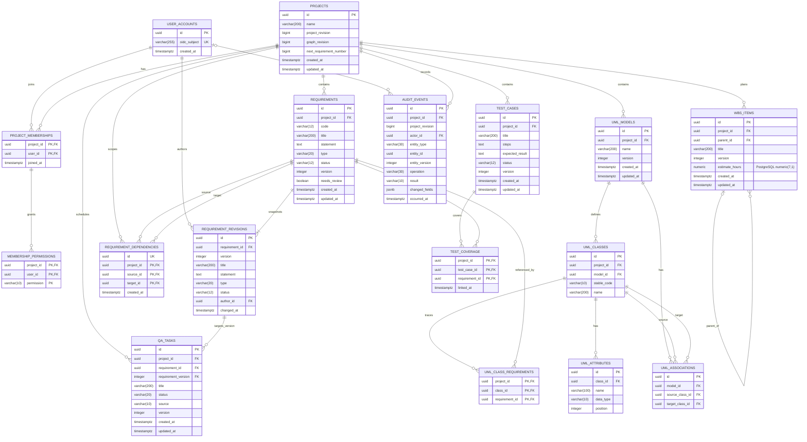
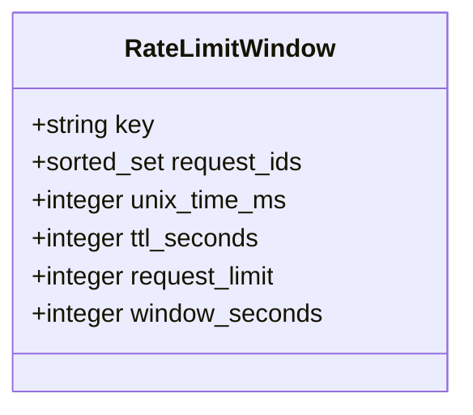

# 2.4. Проєктування та документування моделей даних

**Система:** UseTrace Studio  
**Основа:** SRS, редакція 1.1 від 14.11.2026; контейнерна архітектура ЛР №5  
**Сховища:** PostgreSQL 16 — авторитетне постійне сховище; Redis — тимчасовий стан обмеження частоти запитів  
**Статус:** логіко-фізична модель; проєкт DDL `db/migrations/001_initial_schema.sql` створено, виконання в PostgreSQL 16 ще не підтверджено

## 2.4.1. Межі моделі

PostgreSQL зберігає проєкти, членство та права, вимоги й незмінні ревізії, ребра DAG, структуровану UML-модель, WBS, тест-кейси, покриття, QA-завдання та журнал змін. NetworkX будує відновлювану проєкцію графа в пам'яті Backend API на основі таблиць `requirements` і `requirement_dependencies`. Redis зберігає тільки ключі рухомого вікна rate limiting; він не є джерелом вимог або історії.

Автентифікацію виконує зовнішній OIDC-провайдер. `user_accounts.oidc_subject` пов'язує його незмінний ідентифікатор із внутрішнім UUID; пароль і токени доступу в цій БД не зберігаються. Git, CI, моніторинг та WebSocket-з'єднання не є окремими постійними сутностями цієї редакції SRS. Журнал `audit_events` фіксує факт підтвердженої зміни, але не оголошується довговічною чергою доставки WebSocket-подій.

## 2.4.2. ERD PostgreSQL

Позначення: `||` — рівно один, `o|` — нуль або один, `o{` — нуль або багато. Позначки `PK` і `FK` у Mermaid показують участь поля в ключі; складені ключі, `UNIQUE`, `CHECK`, часткові індекси й правила транзакцій уточнено після схеми. Типи `varchar(n)` і `uuid` відповідають PostgreSQL. Для `estimate_hours` точний тип `numeric(7,1)` наведено в коментарі до поля та специфікації, оскільки кома в типі має обмеження сумісності з парсером Mermaid. `timestamptz` зберігає момент часу; час записується в UTC.

У SQL-міграції `wbs_items.estimate_hours` оголошується як `numeric(7,1)`. Наявність першої ревізії вимоги забезпечує операція створення: початкова вимога і ревізія №1 записуються в одній транзакції.

## 2.4.3. Специфікація таблиць

У таблицях нижче `NN` означає `NOT NULL`; `UQ` — `UNIQUE`. Усі UUID генеруються сервером і не змінюються. Поля `created_at`, `updated_at`, `changed_at`, `occurred_at` мають тип `timestamptz`; сервер записує час у UTC.

### `user_accounts` — локальна ідентичність

| Поле | Тип | Обмеження | Призначення |
| --- | --- | --- | --- |
| `id` | `uuid` | PK | Внутрішній ідентифікатор. |
| `oidc_subject` | `varchar(255)` | NN, UQ | Незмінний `sub` довіреного OIDC-провайдера; якщо провайдерів кілька, ключ розширюється до `(issuer, sub)`. |
| `created_at` | `timestamptz` | NN | Час створення локального облікового запису. |

### `projects` — область ізоляції даних

| Поле | Тип | Обмеження | Призначення |
| --- | --- | --- | --- |
| `id` | `uuid` | PK | ID проєкту. |
| `name` | `varchar(200)` | NN | Назва. |
| `project_revision` | `bigint` | NN, `DEFAULT 0`, `CHECK >= 0` | Монотонний номер підтверджених змін проєкту для знімків і дельт. |
| `graph_revision` | `bigint` | NN, `DEFAULT 0`, `CHECK >= 0` | Номер стану DAG; оновлюється разом зі зміною ребра або активного складу вершин. |
| `next_requirement_number` | `bigint` | NN, `DEFAULT 1`, CHECK `BETWEEN 1 AND 100000000` | Наступний номер коду вимоги; резервується під блокуванням рядка проєкту, не перевикористовується після архівування. |
| `created_at`, `updated_at` | `timestamptz` | NN | Час створення і останньої зміни. |

### `project_memberships`, `membership_permissions` — членство та права

| Таблиця / поле | Тип | Обмеження | Призначення |
| --- | --- | --- | --- |
| `project_memberships.project_id` | `uuid` | PK разом із `user_id`, FK → `projects.id` | Проєкт членства. |
| `project_memberships.user_id` | `uuid` | PK разом із `project_id`, FK → `user_accounts.id` | Учасник. |
| `project_memberships.joined_at` | `timestamptz` | NN | Час вступу. |
| `membership_permissions.project_id`, `user_id` | `uuid`, `uuid` | складений FK → `project_memberships(project_id,user_id)`; частина PK | Членство, якому видано право. |
| `membership_permissions.permission` | `varchar(10)` | частина PK; `CHECK IN ('read','write','qa','admin')` | Одне з чотирьох прав SRS. |

Службовий обліковий запис CI отримує тільки `read`. Кожний запит перевіряє членство та потрібне право в конкретному проєкті; право `admin` не замінює запису членства.

### `requirements` — актуальний стан вимоги

| Поле | Тип | Обмеження | Призначення |
| --- | --- | --- | --- |
| `id` | `uuid` | PK; UQ `(project_id,id)` для складених FK | Стабільний ID вимоги. |
| `project_id` | `uuid` | NN, FK → `projects.id` | Область ізоляції. |
| `code` | `varchar(12)` | NN, UQ `(project_id,code)`, шаблон `^REQ-[0-9]{4,8}$` | Код вимоги; унікальність діє також для архівних записів. |
| `title` | `varchar(200)` | NN, довжина 1–200 | Назва. |
| `statement` | `text` | NN, довжина 1–10000; формальна перевірка модального слова | Формулювання вимоги. |
| `type` | `varchar(20)` | NN, `functional` / `nonfunctional` | Тип. |
| `status` | `varchar(12)` | NN, `draft` / `approved` / `archived` | Статус; `archived` означає логічне видалення. |
| `version` | `integer` | NN, `CHECK > 0` | Поточна версія для `expected_version`. |
| `needs_review` | `boolean` | NN, `DEFAULT false` | Позначка впливу зміни іншої вимоги. |
| `created_at`, `updated_at` | `timestamptz` | NN | Час створення й оновлення. |

Створення вимоги: після перевірки JWT/права `write` транзакція блокує рядок `projects` (`FOR UPDATE`), бере `next_requirement_number` у діапазоні 1–99999999, формує `REQ-` і номер із доповненням нулями щонайменше до чотирьох цифр, збільшує лічильник, вставляє `requirements` (`version = 1`, `status = draft`, `needs_review = false`) та ревізію 1, збільшує `project_revision` і `graph_revision` на 1 і вставляє одну подію `audit_events` з `result = success`; усі записи фіксуються одним COMMIT. При будь-якій помилці виконується ROLLBACK; при вичерпанні номерів — `409 CODE_EXHAUSTED` без запису. Код не перевикористовується після архівування. `created_at` і `updated_at` сервер встановлює в одній транзакції. Запис `requirements` і початкова ревізія створюються атомарно. Редагування виконує умовне оновлення за `id`, `project_id` і `expected_version`; за невідповідності версії повертається `409`, а попередній стан не змінюється. Формальну перевірку слова «повинна/повинен/повинні/має» виконує валідатор застосунку; перевірки довжини, коду, типу й статусу дублюються обмеженнями БД.

### `requirement_revisions` — незмінні знімки

| Поле | Тип | Обмеження | Призначення |
| --- | --- | --- | --- |
| `id` | `uuid` | PK | ID знімка. |
| `requirement_id` | `uuid` | NN, FK → `requirements.id`, UQ `(requirement_id,version)` | Вимога. |
| `version` | `integer` | NN, `CHECK > 0` | Номер збереженої версії. |
| `title`, `statement` | `varchar(200)`, `text` | NN | Значення на момент зміни. |
| `type`, `status` | `varchar(20)`, `varchar(12)` | NN | Тип і статус на момент зміни. |
| `author_id` | `uuid` | NN, FK → `user_accounts.id` | Внутрішній ID автора. |
| `changed_at` | `timestamptz` | NN | Час зміни. |

Історичні значення дублюються свідомо: це незмінні знімки, а не друга копія актуального стану. Заборонено UPDATE/DELETE ревізій через права БД; відновлення старого вмісту створює нову версію. Архівування зберігає ревізії.

### `requirement_dependencies` — напрямлені ребра DAG

| Поле | Тип | Обмеження | Призначення |
| --- | --- | --- | --- |
| `id` | `uuid` | NN, UQ, серверний UUID | Внутрішній ідентифікатор ребра для `audit_events.entity_id`; складений PK зберігається. |
| `project_id` | `uuid` | частина PK і обох складених FK | Проєкт ребра. |
| `source_id` | `uuid` | частина PK; FK `(project_id,source_id)` → `requirements(project_id,id)` | Вимога A, від якої поширюється вплив. |
| `target_id` | `uuid` | частина PK; FK `(project_id,target_id)` → `requirements(project_id,id)` | Залежна вимога B. |
| `created_at` | `timestamptz` | NN | Час додавання. |

Ребро `source_id → target_id` означає, що зміна джерельної вимоги може вплинути на цільову; активний обхід іде від `source_id` до `target_id`. При створенні події аудиту для ребра `entity_type = requirement_dependency`, `entity_id = requirement_dependencies.id`, `entity_version = NULL`; поліморфне посилання перевіряє сервіс в тій самій транзакції. PK `(project_id,source_id,target_id)` усуває дубль ребра; `CHECK (source_id <> target_id)` усуває самопетлю. Складені FK забороняють ребра між проєктами. Цикли й архівні кінці перевіряються під транзакційним блокуванням рядка `projects` перед INSERT: алгоритм Кана застосовується до актуального знімка. Зміна ребра, `graph_revision`, `project_revision` і запису аудиту — одна транзакція. При архівуванні ребра зберігаються для історії, але не входять до активної RAM-проєкції. Активними вершинами є вимоги зі статусом draft або approved.

### `uml_models`, `uml_classes`, `uml_attributes`, `uml_associations`, `uml_class_requirements`

| Таблиця / поле | Тип | Обмеження | Призначення |
| --- | --- | --- | --- |
| `uml_models.id` | `uuid` | PK; UQ `(project_id,id)` | Стабільний ID структурованої моделі. |
| `uml_models.project_id` | `uuid` | NN, FK → `projects.id` | Проєкт. |
| `uml_models.name`, `version` | `varchar(200)`, `integer` | NN; `version > 0` | Назва й версія для зворотного редагування. |
| `uml_models.created_at`, `updated_at` | `timestamptz` | NN | Часові мітки. |
| `uml_classes.id` | `uuid` | PK; UQ `(model_id,id)`, UQ `(project_id,id)` | Внутрішній ID класу. |
| `uml_classes.project_id`, `model_id` | `uuid`, `uuid` | NN; FK `(project_id,model_id)` → `uml_models(project_id,id)` | Модель і проєкт класу. |
| `uml_classes.stable_code` | `varchar(10)` | NN, UQ `(model_id,stable_code)`, шаблон `^C_[0-9]{1,8}$` | Стабільний ID у підтримуваному Mermaid DSL. |
| `uml_classes.name` | `varchar(200)` | NN | Ім'я класу. |
| `uml_attributes.id`, `class_id` | `uuid`, `uuid` | PK; NN FK → `uml_classes.id` | Атрибут і власник. |
| `uml_attributes.name`, `data_type`, `position` | `varchar(100)`, `varchar(10)`, `integer` | NN; `data_type IN ('string','int','bool')`; UQ `(class_id,name)` і `(class_id,position)`; `position >= 0` | Назва, скалярний тип і порядок виведення. |
| `uml_associations.id`, `model_id` | `uuid`, `uuid` | PK; NN FK → `uml_models.id` | Спрямована асоціація і модель. |
| `uml_associations.source_class_id`, `target_class_id` | `uuid`, `uuid` | NN; FK `(model_id,source_class_id)` та `(model_id,target_class_id)` → `uml_classes(model_id,id)` | Кінці асоціації в одній моделі. |
| `uml_class_requirements.project_id`, `class_id`, `requirement_id` | `uuid` | складений PK; FK `(project_id,class_id)` → `uml_classes(project_id,id)`; FK `(project_id,requirement_id)` → `requirements(project_id,id)` | Трасування UML-класу до вимоги того самого проєкту. |

Повторна пара `(model_id,source_class_id,target_class_id)` забороняється UQ. Видалення класу з поточної моделі каскадно видаляє його атрибути, асоціації та зв'язки трасування, але не самі вимоги. Генерація/імпорт підтримує лише описану в SRS підмножину `classDiagram`; зміна структури моделі вимагає `expected_version` і атомарного збільшення `version`.

### `wbs_items` — ієрархія робочих пакетів

| Поле | Тип | Обмеження | Призначення |
| --- | --- | --- | --- |
| `id` | `uuid` | PK; UQ `(project_id,id)` | Вузол WBS. |
| `project_id` | `uuid` | NN, FK → `projects.id` | Проєкт. |
| `parent_id` | `uuid` | NULL для кореня; FK `(project_id,parent_id)` → `wbs_items(project_id,id)` | Батьківський вузол того самого проєкту. |
| `title` | `varchar(200)` | NN | Назва роботи. |
| `version` | `integer` | NN, `DEFAULT 1`, `CHECK (version > 0)` | Версія вузла для умовного оновлення за `expected_version`. |
| `estimate_hours` | `numeric(7,1)` | NULL для підсумкового вузла; для кінцевого NN і `> 0` | Оцінка E в людино-годинах. |
| `created_at`, `updated_at` | `timestamptz` | NN | Часові мітки. |

Підсумковий вузол не зберігає копію суми: вона обчислюється з кінцевих нащадків, щоб уникнути аномалій оновлення. Правило 8/40 позначає кінцевий пакет, якщо `E < 8` або `E > 40`; воно не відхиляє додатну оцінку. Тривалість `D = E / 5` робочих днів обчислюється без збереження похідного поля. Зміна вузла виконується лише за збігу `expected_version` і збільшує `version`; нуль оновлених рядків означає конфлікт або відсутність вузла. При зміні батька транзакційна перевірка не допускає циклу; `CHECK (id <> parent_id)` відхиляє самопетлю.

### `test_cases`, `test_coverage` — тести та структурне покриття

| Таблиця / поле | Тип | Обмеження | Призначення |
| --- | --- | --- | --- |
| `test_cases.id`, `project_id` | `uuid`, `uuid` | PK `id`; NN FK `project_id` → `projects.id`; UQ `(project_id,id)` | Тест-кейс у проєкті. |
| `test_cases.title` | `varchar(200)` | NN | Назва. |
| `test_cases.steps`, `expected_result` | `text`, `text` | NN | Кроки й очікуваний результат. |
| `test_cases.status` | `varchar(12)` | NN, `draft` / `active` / `archived` | Активність для обліку покриття. |
| `test_cases.version` | `integer` | NN, `> 0` | Оптимістичне блокування редагування тест-кейсу. |
| `test_cases.created_at`, `updated_at` | `timestamptz` | NN | Часові мітки. |
| `test_coverage.project_id`, `test_case_id`, `requirement_id` | `uuid` | складений PK; складені FK до `test_cases` і `requirements` через `project_id` | Зв'язок `covers` у тому самому проєкті. |
| `test_coverage.linked_at` | `timestamptz` | NN | Час створення зв'язку. |

Покритою вважається лише вимога зі статусом draft або approved, пов'язана з тест-кейсом зі статусом `active`. Наявність рядка `covers` не підтверджує проходження тесту або змістовної достатності перевірки. Архівування не видаляє історичні зв'язки.

### `qa_tasks` — QA-беклог

| Поле | Тип | Обмеження | Призначення |
| --- | --- | --- | --- |
| `id` | `uuid` | PK | ID завдання. |
| `project_id`, `requirement_id` | `uuid`, `uuid` | NN; FK `(project_id,requirement_id)` → `requirements(project_id,id)` | Вимога в тому самому проєкті. |
| `requirement_version` | `integer` | NN; FK `(requirement_id,requirement_version)` → `requirement_revisions(requirement_id,version)` | Версія, для якої створено завдання. |
| `title` | `varchar(200)` | NN | Назва. |
| `status` | `varchar(20)` | NN, `todo` / `in_progress` / `done` / `cancelled` | Стан виконання. |
| `source` | `varchar(10)` | NN, `auto` / `manual` | Походження. |
| `version` | `integer` | NN, `DEFAULT 1`, `CHECK (version > 0)` | Версія QA-завдання для умовного оновлення за `expected_version`. |
| `created_at`, `updated_at` | `timestamptz` | NN | Часові мітки. |

Частковий унікальний індекс `(requirement_id,requirement_version) WHERE source = 'auto' AND status IN ('todo','in_progress')` не допускає двох відкритих автоматичних завдань на одну версію навіть за конкурентної генерації. Зміна завдання виконується лише за збігу `expected_version` з атомарним збільшенням `version`; нуль оновлених рядків означає конфлікт або відсутність завдання. Завершені завдання зберігаються. Нову версію вимоги можна супроводжувати новим завданням.

### `audit_events` — незмінний журнал підтверджених змін

| Поле | Тип | Обмеження | Призначення |
| --- | --- | --- | --- |
| `id` | `uuid` | PK | `event_id` дельти та ID журналу. |
| `project_id` | `uuid` | NN, FK → `projects.id` | Проєкт зміни. |
| `project_revision` | `bigint` | NN, `> 0`, UQ `(project_id,project_revision)` | Порядковий номер підтвердженої операції. |
| `actor_id` | `uuid` | NULL для системної дії; FK → `user_accounts.id` | Внутрішній ID автора за наявності. |
| `entity_type`, `entity_id` | `varchar(30)`, `uuid` | NN | Тип та ID зміненої сутності; поліморфне посилання перевіряє застосунок. |
| `entity_version` | `integer` | NULL, якщо сутність не має версії | Версія у форматі дельти. |
| `operation` | `varchar(30)` | NN | Тип дії. |
| `result` | `varchar(10)` | NN, CHECK `result = 'success'` | Підтверджений результат записаної бізнес-операції. Відмови транзакції не вставляються в цей журнал. |
| `changed_fields` | `jsonb` | NN, JSON-масив назв полів | Лише назви змінених полів; значення, текст вимоги й секрети не зберігаються. |
| `occurred_at` | `timestamptz` | NN | Час події. |

Кожна підтверджена бізнес-операція збільшує `projects.project_revision` і вставляє рівно один `audit_events` у тій самій транзакції. `requirements.version` версіонує лише редакційні поля `title`, `statement`, `type`, `status`; зміна системного прапорця `needs_review` у залежних вимогах не створює їхніх ревізій і не збільшує їхніх `version`. Одне агреговане `audit_events` посилається на вихідну зміну, включає назву `needs_review` до `changed_fields` за фактичного оновлення й відповідає одному `project_revision`; відновлення конкретних залежних станів виконується повторним читанням, а не з `changed_fields`. Скидання прапорця після підтвердження перегляду є окремою бізнес-операцією: вона збільшує `project_revision`, записує аудит, але не редакційну версію. Якщо одна операція змінює кілька рядків, `changed_fields` перелічує назви змінених полів агрегованої операції без їхніх значень. Після commit API намагається надіслати дельту активним WebSocket-сесіям. За втрати події клієнт відновлює стан через знімок і номер ревізії; журнал не гарантує доставку повідомлення.

## 2.4.4. Індекси, цілісність і транзакції

| Об'єкт | Ключ / правило | Причина |
| --- | --- | --- |
| `requirements` | UQ B-tree `(project_id,code)`; B-tree `(project_id,status)` | Атомарна унікальність коду та вибірка активних вимог. |
| `requirement_revisions` | UQ B-tree `(requirement_id,version)` | Історія в порядку версій, FK завдання на версію. |
| `requirement_dependencies` | PK `(project_id,source_id,target_id)`; UQ `(id)`; B-tree `(project_id,target_id)` | Обхід вперед використовує початок PK; зворотний обхід потребує окремого індексу. |
| `uml_classes` | UQ `(model_id,stable_code)`; UQ `(model_id,id)`; UQ `(project_id,id)` | Стабільні коди та складені FK. |
| `uml_attributes` | UQ `(class_id,name)` і `(class_id,position)` | Відсутність повторів і стабільний порядок DSL. |
| `uml_associations` | UQ `(model_id,source_class_id,target_class_id)`; B-tree `(model_id,target_class_id)` | Унікальність зв'язку та пошук асоціацій при видаленні класу. |
| `uml_class_requirements` | PK `(project_id,class_id,requirement_id)`; B-tree `(project_id,requirement_id)` | Трасування в обох напрямках. |
| `wbs_items` | B-tree `(project_id,parent_id)` | Пошук дітей та обчислення підсумків. |
| `test_coverage` | PK `(project_id,test_case_id,requirement_id)`; B-tree `(project_id,requirement_id,test_case_id)` | Пошук тестів вимоги і звіт про покриття. |
| `qa_tasks` | частковий UQ `(requirement_id,requirement_version)` для відкритих `auto`; B-tree `(project_id,status)` | Конкурентна дедуплікація й QA-беклог. |
| `audit_events` | UQ `(project_id,project_revision)`; B-tree `(project_id,occurred_at)` | Впорядкований журнал і вибірка за часом. |

PostgreSQL створює індекси для PK та UQ автоматично; таблиця вказує додаткові індекси лише там, де порядок наявного ключа не підтримує потрібний запит. FK сам собою не гарантує створення індексу на стороні, що посилається. Для `jsonb` у `audit_events.changed_fields` GIN не потрібен, доки SRS не визначає пошук за довільними ключами JSON. Векторний індекс не потрібен: ця редакція не зберігає ембеддинги.

Незмінність ревізій і аудиту забезпечується забороною UPDATE/DELETE для ролі застосунку та відсутністю маршрутів фізичного видалення. Для зміни ребра і для архівування вимоги транзакція блокує рядок проєкту `SELECT ... FOR UPDATE`, перевіряє актуальний активний граф, записує зміни й збільшує відповідні ревізії. Звичайна перевірка застарілого графа лише в RAM не є достатньою. Для глибоких об'єднань і рекурсії індекси наведено вище; фактичні плани запитів перевіряються `EXPLAIN (ANALYZE, BUFFERS)` після появи тестових даних.

## 2.4.5. Redis: схема тимчасових ключів

Redis не має реляційних PK/FK. Для обмеження 100 зовнішніх REST-запитів з однієї перевіреної IP-адреси за рухомі 60 секунд використовується один впорядкований набір на адресу:

Формат ключа: `rl:v1:{ip_hash}`; тип Redis: `ZSET`; член: унікальний `request_id`; score: Unix time у мілісекундах; `request_limit = 100`, `window_seconds = 60`, `ttl_seconds = 61`. `ip_hash` — односторонній HMAC від нормалізованої клієнтської IP з окремим серверним секретом. Значення IP визначається тільки з мережевого з'єднання або довіреного proxy-ланцюжка. Атомарний Lua-скрипт видаляє елементи старші за 60 секунд, рахує записи, для дозволеного запиту додає унікальний `request_id` з оцінкою часу в мілісекундах і оновлює TTL; для 101-го повертає відмову та час до найближчого звільнення місця. Запис відхиленого запиту не додається. 61 секунда TTL очищає неактивний ключ після завершення вікна; стан після закінчення TTL не відновлюється. За недоступності Redis захищений бізнес-запит повертає `503` згідно з SRS.

## 2.4.6. Відповідність функціональним вимогам

| Група SRS | Дані й механізм |
| --- | --- |
| `SRS-FUN-01`, `02` | `requirements`, `requirement_revisions`; унікальний код, оптимістична версія, архівування, незмінна історія. |
| `SRS-FUN-03`, `04`, `05` | `requirement_dependencies`, `projects.graph_revision`, `requirements.needs_review`; активна DAG-проєкція з PostgreSQL. |
| `SRS-FUN-06` | П'ять UML-таблиць; стабільні коди класів, структурована модель і `version`. |
| `SRS-FUN-07` | `wbs_items`; оцінки лише листків, підсумки й D обчислюються. |
| `SRS-FUN-08` | `test_cases`, `test_coverage`, `qa_tasks`; зв'язок `covers` і дедуплікація відкритих завдань. |
| `SRS-FUN-09`, `10` | `projects.project_revision`, `audit_events`; WebSocket-стан і Ping/Pong — у Backend API, не у таблиці сесій. |
| `SRS-FUN-11` | Експорт і звіт формуються зі знімка таблиць; збереження дубля Markdown не потрібне. |
| `SRS-NFR-SEC-02` | Тимчасовий Redis sorted set для атомарного рухомого вікна. |

**Висновок.** Схема визначає технічні ключі й межі цілісності постійних даних, зберігає історію без фізичного видалення та відділяє відновлювані проєкції RAM і Redis від авторитетного стану PostgreSQL. Міграція `db/migrations/001_initial_schema.sql` та smoke-тести `db/tests/001_constraints_smoke.sql` підготовлені; їх виконання в PostgreSQL 16, реальні плани запитів і навантажувальні властивості ще потрібно перевірити.
