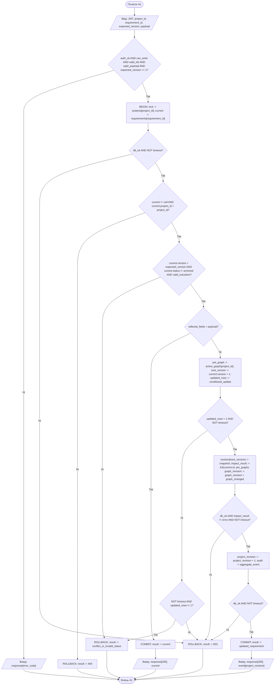
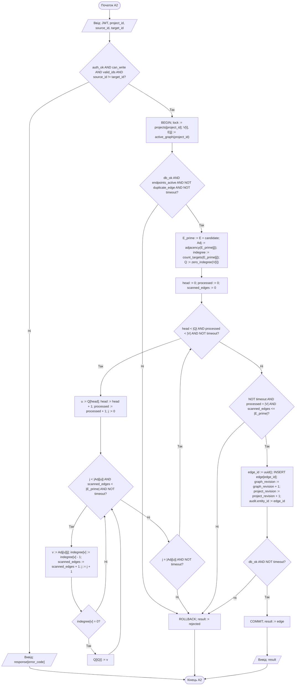
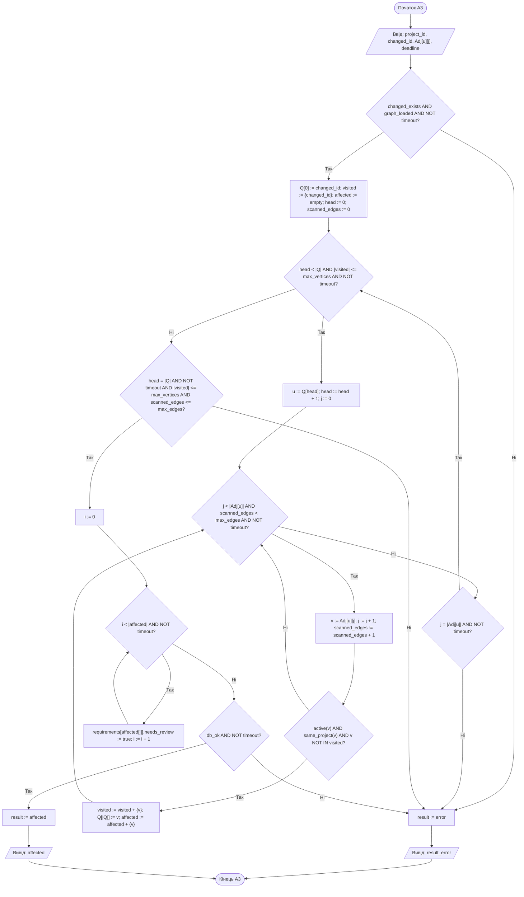

# 2.6. Моделювання логіки критичних вузлів системи

## 2.6.1. Вибір алгоритмів та позначення

| № | Критичний вузол | Роль в архітектурі UseTrace Studio |
| --- | --- | --- |
| А1 | Конкурентне редагування вимоги | Frontend SPA → Backend API → PostgreSQL: атомарна нова ревізія або відмова без часткового запису. |
| А2 | Додавання залежності з перевіркою DAG | Backend API → PostgreSQL: ребро зберігається лише за відсутності циклу. |
| А3 | Поширення впливу зміни | Backend API → PostgreSQL: досяжні вимоги отримують `needs_review := true`. |

`:=` — присвоювання; `=` та `!=` — порівняння. `AND`, `OR`, `NOT` — булеві оператори. `V[i]`, `E[j]`, `Q[i]`, `Adj[u][j]` — індексовані елементи колекцій. Активна вимога має `status IN {draft, approved}`; `archived` не входить до активного графа. Ребро `A → B` означає, що зміна A може вплинути на B. Транзакції запису містять також аудит та зміну ревізій проєкту. WebSocket-події публікуються після `COMMIT`.
`graph_changed` набуває значення 1 при зміні складу активного графа, інакше 0. `requirements.version` є редакційною версією `title`, `statement`, `type`, `status`; зміни системного `needs_review` відстежує `projects.project_revision` без редакційних ревізій залежних вимог. Одне агреговане `audit_events` описує вихідну бізнес-операцію. Ребро `source_id → target_id` задає напрям потенційного впливу.

## 2.6.2. А1 — конкурентне редагування вимоги

**Вхід:** `project_id`, `requirement_id`, `expected_version`, `payload`, JWT. **Вихід:** актуальна вимога або контрольована помилка. **Інваріант:** одна фактична редакційна зміна створює одну незмінну ревізію відповідної версії та одну подію аудиту; повторний `PUT` без зміни полів не створює нової ревізії.

1. Перевірити JWT, право запису, UUID, `expected_version >= 1` і поля `payload`. Порожнє тіло відхилити.
2. Почати транзакцію, заблокувати `projects[project_id]`, прочитати `requirements[requirement_id]`. Відхилити відсутню, чужу проєкту або архівовану вимогу. Перевірити дозволений перехід `current.status → payload.status`.
3. Порівняти `current.version = expected_version`. За конфлікту повернути `409` без змін. Якщо всі редакційні поля вже дорівнюють `payload`, завершити транзакцію без UPDATE, нової ревізії, аудиту та збільшення лічильників і повернути `200` з поточним станом.
4. До оновлення прочитати з PostgreSQL знімок активного графа `pre_graph` під тим самим блокуванням, звірити `graph_revision`; за помилки завантаження виконати ROLLBACK. Обчислити `next_version := current.version + 1`, виконати умовний `UPDATE ... WHERE version = expected_version`; вимагати `updated_rows = 1`. Записати `requirement_revisions[next_version]`, викликати А3 зі знімком `pre_graph`, отриманим до можливої зміни статусу; при зміні складу активного графа збільшити `graph_revision`. Після успішного А3 збільшити `project_revision` і записати одну подію `audit_events`, включивши `needs_review` до `changed_fields` лише за фактичного оновлення залежних вимог.
5. За помилки БД, А3 або дедлайну виконати `ROLLBACK`. Після `COMMIT` повернути `200` і надіслати повідомлення WebSocket.

**Edge cases:** повторний запит зі старою версією отримує `409`; ідентичний `PUT` з актуальною версією повертає `200` без нового запису; відсутня вимога — `404`; збій ревізії або аудиту скасовує зміну основного запису; порожній список залежностей дає порожній результат А3. Невдала доставка WebSocket після `COMMIT` не відкочує зафіксовану транзакцію: клієнт повторно читає стан за `project_revision`. Час без А3 — `O(1)` записів. Дозволено переходи `draft → draft/approved/archived` і `approved → draft/approved/archived`; `archived` є термінальним для PUT, порушення повертає `409 INVALID_STATUS_TRANSITION`. `needs_review` в залежних вимогах не збільшує їхньої редакційної версії.

## 2.6.3. А2 — додавання ребра з алгоритмом Кана

**Вхід:** `project_id`, `source_id`, `target_id`, JWT через `POST /api/v1/projects/{projectId}/requirement-dependencies`. **Вихід:** `201` з ребром або `400/401/403/404/409/429/503` за контрактом 2.5. **Інваріант:** активний граф проєкту залишається DAG.

1. Перевірити право запису, UUID та `source_id != target_id`. Заблокувати рядок проєкту в транзакції; прочитати активні вершини `V[i]` і ребра `E[j]`. Обидва кінці мають належати цьому проєкту й бути активними. Повторне ребро відхилити.
2. Додати кандидат лише до локального знімка: `E_prime := E ∪ {(source_id,target_id)}`. Обчислити `indegree[V[i]]`, сформувати `Q[i]` із вершин нульового степеня.
3. Поки `head < |Q|`, зняти `u := Q[head]`; для кожного `Adj[u][j]` зменшити `indegree[v]` і додати `v` до черги при нульовому степені. Контролювати дедлайн, `processed <= |V|` і `scanned_edges <= |E_prime|`.
4. Якщо `processed != |V|`, відхилити цикл. Інакше згенерувати `edge_id := uuid()`, вставити ребро з цим ID під унікальними обмеженнями, збільшити `graph_revision` та `project_revision`, записати один аудит із `entity_type = requirement_dependency`, `entity_id = edge_id`, `entity_version = NULL` і виконати `COMMIT`. Актуальний граф читається з PostgreSQL під блокуванням проєкту; кеш NetworkX дозволений лише після звірки `graph_revision` у цій транзакції.

**Edge cases:** самозалежність і дубль відхиляються; порожній граф не містить допустимих кінців; ізольовані вершини входять до `|V|`. Замок проєкту серіалізує паралельні зміни графа. Час і пам'ять — `O(|V| + |E|)`.

## 2.6.4. А3 — поширення впливу по активному графу

**Вхід:** `project_id`, `changed_id`, активний `Adj[u][j]`, відкрита транзакція А1. **Вихід:** `affected` або помилка для А1. **Інваріант:** кожна досяжна вершина відвідується не більше разу; стартова вимога не позначається як власний наслідок. А3 не виконує `COMMIT`.

1. Перевірити стартову вимогу й завантаження графа. Для архівації зняти знімок графа до виключення вузла. Ініціалізувати `Q[0] := changed_id`, `visited := {changed_id}`, `head := 0`, `affected := ∅`.
2. Поки `head < |Q| AND NOT timeout`, взяти `u := Q[head]`; для кожного `Adj[u][j]` додати активне `v` того ж проєкту до `Q` і `affected` тільки при `v NOT IN visited`.
3. Для кожного `affected[i]` записати `needs_review := true` у транзакції А1 без збільшення `requirements.version` та без окремих `requirement_revisions`; зафіксувати агреговану зміну під одним `project_revision` і однією подією аудиту вихідної вимоги. На помилці БД, дедлайні чи перевищенні конфігурованих лімітів вершин/ребер повернути помилку; А1 виконає `ROLLBACK`.

**Edge cases:** без вихідних ребер `affected := ∅`; повторні шляхи не дублюють запис; архівовані проміжні вершини не розгортаються; помилка скасовує всю транзакцію А1. Час `O(|V_reachable| + |E_reachable|)`, додаткова пам'ять `O(|V_reachable|)`. `max_vertices`, `max_edges` та `deadline` задаються конфігурацією; досягнення ліміту означає контрольовану відмову, а не частковий результат.

## 2.6.5. Межі специфікації

А1 і А2 використовують однакове блокування рядка проєкту. Результат А3 входить у транзакцію А1. HTTP-відповіді редагування і маршрут `POST /api/v1/projects/{projectId}/requirement-dependencies` визначено в підрозділі 2.5. Окремий `PUT .../review-acknowledgement` під блокуванням проєкту звіряє `expected_version` та `expected_project_revision`, скидає `needs_review`, збільшує тільки `project_revision` й пише одну подію аудиту; редакційна версія і ревізії вимоги не змінюються. Після втрати підтвердження COMMIT клієнт виконує GET та звіряє поточний стан до повтору PUT; при втраті WebSocket-події заголовки ревізій в REST показують розбіжність, а повний знімок проєкту є окремим контрактом наступного етапу. Код Mermaid зберігається як `graph TD`; відображення саме в цільовому PKM Workspace перевіряється після вставлення.

## 2.6.6. Контроль артефактів

У трьох схемах термінатори подано округленими блоками, операції — прямокутниками, перевірки — ромбами, ввід/вивід — паралелограмами. Присвоювання в процесах записані через `:=`; `=` і `!=` у ромбах позначають порівняння; складені умови використовують `AND`, `OR`, `NOT`. Статична перевірка вихідного Mermaid-коду виявила 3 схеми і не виявила стрілок до невизначених вузлів. Це не замінює перевірку рендерингу в цільовому PKM Workspace.
