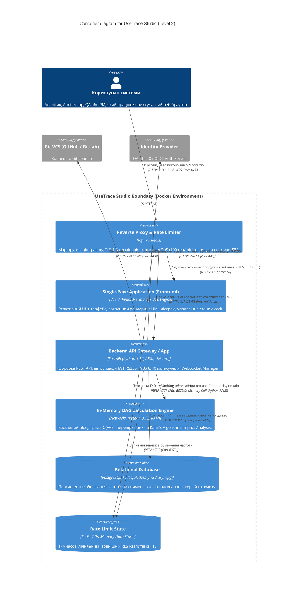
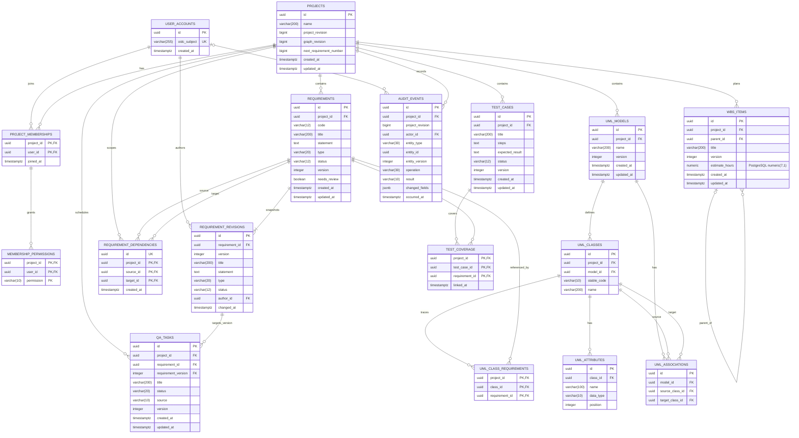
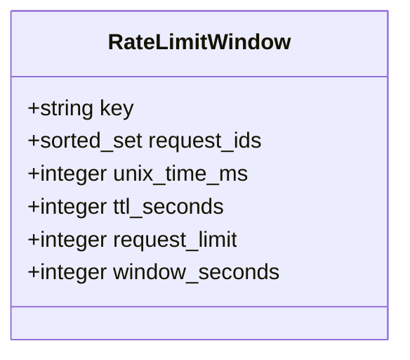
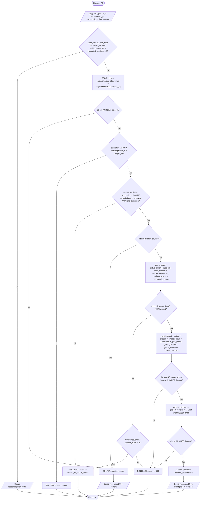
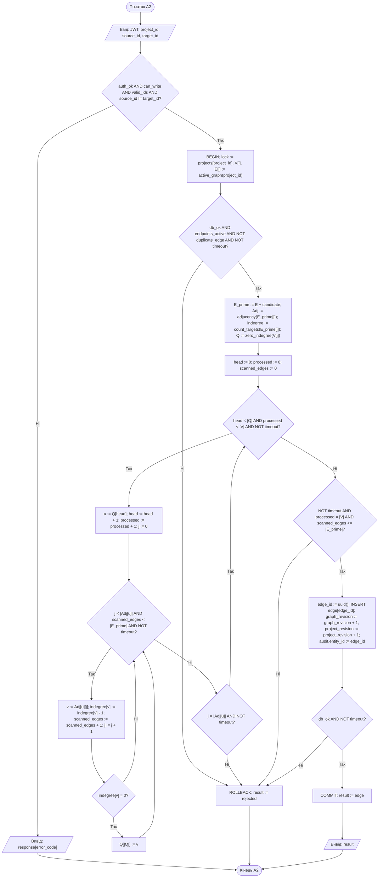
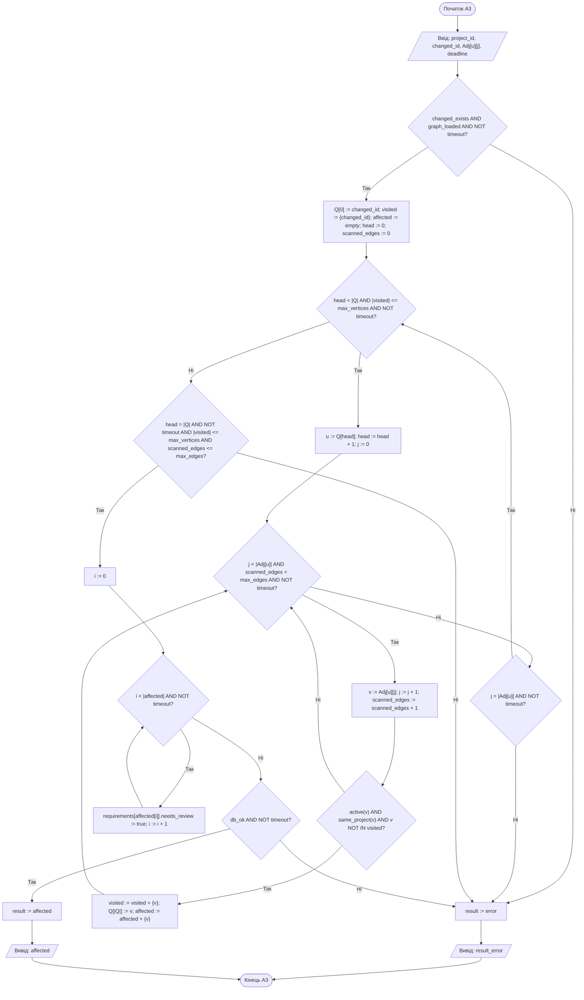

# 2. Архітектурне проєктування та алгоритми

Проєктування архітектури веб-системи «UseTrace Studio» виконано відповідно до методології C4 (Саймон Браун) за принципом *Diagrams-as-Code* у нотації Mermaid.js. В основу побудови моделей покладено вимоги специфікації `srs.md` (ISO/IEC/IEEE 29148:2018).

---

## 2.1. Контекстне та контейнерне моделювання системи (C4 Model)

### 2.1.1. System Context Diagram (C4 Level 1)

Контекстна діаграма визначає межі платформи «UseTrace Studio» (System Boundary), її внутрішніх/зовнішніх акторів та суміжні інфраструктурні сервіси.


#### Технічний опис вузлів та протоколів рівня System Context

**Актори системи (Persons):**

- **System Analyst:** Формує канонічні вимоги за стандартом ISO 29148. Взаємодія з системою здійснюється через захищене WebSockets-з'єднання (WSS) для реактивного live-editing та HTTPS / REST для CRUD-операцій (SRS-FUN-01).
- **Software Architect:** Використовує інструментарій каскадного аналізу впливу змін та переглядає двосторонньо згенеровані UML-діаграми у форматі Mermaid.js (SRS-FUN-05, SRS-FUN-06).
- **QA Engineer:** Отримує автоматично згенерований беклог верифікаційних завдань на основі виявлених вузлів графа без покриття (SRS-FUN-08).
- **Project Manager:** Отримує зводні дані розрахунку трудомісткості робіт WBS із автоматичною перевіркою інженерного правила 8/40 (SRS-FUN-07).

**Зовнішні системи (External Systems):**

- **Git VCS (GitHub / GitLab):** Зовнішній інфраструктурний контур для імпорту/експорту специфікацій у форматі Markdown/DSL (парадигма Docs-as-Code). Взаємодія відбувається через REST API за протоколом HTTPS (Port 443).
- **Identity Provider (OAuth 2.0 / OIDC):** Зовнішній сервіс автентифікації. Забезпечує перевірку облікових даних та видачу підписаних JWT-токенів за алгоритмом RS256 (SRS-NFR-SEC-01).

### 2.1.2. Container Diagram (C4 Level 2)

Контейнерна діаграма розгортає систему «UseTrace Studio» на рівні окремо виконуваних процесів, ізольованих контейнерних модулів (Docker), баз даних та проксі-серверів.



#### Технічний опис контейнерів та мережевих протоколів взаємодії

**Reverse Proxy & Rate Limiter (Nginx + Redis)**

- **Призначення:** Єдина точка входу (Edge Router). Забезпечує термінацію TLS 1.3/WSS, захист від DoS-атак шляхом обмеження частоти запитів до 100 req/min (SRS-NFR-SEC-02) та роздачу зібраних ресурсів Vue 3 SPA.
- **Протоколи:** Зовнішній зв'язок — HTTPS / WSS (Port 443); внутрішнє проксіювання — HTTP / 1.1 та WSS (Internal loopback).

**Single-Page Application (Vue 3 SPA)**

- **Стек:** Vue 3 (Composition API), Pinia (State Management), Mermaid.js DSL Engine.
- **Призначення:** Клієнтський веб-інтерфейс. Виконує локальну двосторонню генерацію UML-діаграм із Mermaid.js DSL-коду (SRS-FUN-06) та реактивне відображення дельта-змін.

**Backend API Application (FastAPI)**

- **Стек:** Python 3.12, FastAPI (ASGI), Uvicorn, SQLAlchemy v2 (asyncpg).
- **Призначення:** Ядро бізнес-логіки. Обробляє REST API запити (SRS-FUN-01), виконує перевірку JWT RS256 токенів (SRS-NFR-SEC-01), обчислює WBS-трудовитрати за моделлю 8/40 (SRS-FUN-07), генерує QA-беклог (SRS-FUN-08) та здійснює дуплексну трансляцію WebSocket-повідомлень з інфраструктурним Heartbeat Ping/Pong 15 с (SRS-FUN-09, SRS-FUN-10).

**In-Memory DAG Engine (NetworkX)**

- **Призначення:** Обчислювальний графовий рушій у пам'яті. Винесений з реляційної СУБД для зниження часової складності обходу з $O(V^2)$ до $O(V+E)$ та скорочення затримки до $< 50\text{ мс}$ (SRS-NFR-PERF-02). Виконує перевірку циклів (Kahn's Algorithm) та каскадний Change Impact Analysis (SRS-FUN-04, SRS-FUN-05).
- **Протокол:** In-Process Memory Call (виклики об'єктів у межах одного Python-процесу FastAPI).

**Relational Database (PostgreSQL 16)**

- **Призначення:** Персистентне зберігання ACID-консистентних даних (вимоги, зв'язки, версії, журнали аудиту GDPR).
- **Протокол:** SQL / TCP через асинхронний драйвер asyncpg (Port 5432).

**Rate Limit State (Redis 7)**

- **Призначення:** Тимчасовий стан атомарного обмеження частоти зовнішніх REST-запитів; WebSocket-з’єднання керуються Backend API.
- **Протокол:** RESP / TCP (REdis Serialization Protocol, Port 6379).

### 2.1.3. Матриця трасування функціональних та нефункціональних вимог (SRS Traceability)

| Ідентифікатор SRS | Вимога SRS | Контейнер реалізації | Мережевий / Інтерфейсний протокол |
|---|---|---|---|
| SRS-FUN-01 | CRUD-операції над вимогами | Backend API (FastAPI) $\rightarrow$ PostgreSQL 16 | REST / HTTPS $\rightarrow$ SQL / TCP (asyncpg) |
| SRS-FUN-03 | Побудова графа залежностей | In-Memory DAG Engine (NetworkX) | In-Process Memory Call (RAM) |
| SRS-FUN-04 | Валідація циклів (Kahn's) | In-Memory DAG Engine (NetworkX) | In-Process Memory Call (RAM) |
| SRS-FUN-05 | Аналіз впливу змін (Impact) | In-Memory DAG Engine (NetworkX) | In-Process Memory Call (RAM) |
| SRS-FUN-06 | Генерація Mermaid.js UML | SPA (Vue 3) + Backend API (FastAPI) | Client-side Rendering / REST API |
| SRS-FUN-07 | Розрахунок трудовитрат WBS | Backend API (FastAPI) | REST / HTTPS (Uvicorn ASGI) |
| SRS-FUN-08 | Синтез QA-беклогу | Backend API (FastAPI) | REST / HTTPS |
| SRS-FUN-09 | WebSocket-синхронізація | Backend API (FastAPI WebSocket Manager) | WSS / TCP (Duplex WebSockets) |
| SRS-FUN-10 | WebSocket Heartbeat (15 s) | Backend API $\leftrightarrow$ SPA Client | WSS Ping/Pong Control Frames |
| SRS-NFR-PERF-01 | API Latency $p95 < 150$ мс | Backend API (FastAPI / Uvicorn uvloop) | REST / HTTPS (500 RPS) |
| SRS-NFR-PERF-02 | DAG Recalculation $< 50$ мс | In-Memory DAG Engine (NetworkX) | RAM Access ($O(V+E)$) |
| SRS-NFR-SEC-01 | OAuth2 / OIDC (JWT RS256) | Backend API $\leftrightarrow$ Identity Provider | HTTPS / REST (JWKS Verification) |
| SRS-NFR-SEC-02 | Rate Limiting (100 req/min) | Reverse Proxy (Nginx) $\leftrightarrow$ Redis 7 | RESP / TCP (Port 6379) |

## 2.2. Компонентне моделювання критичного сервісу системи (C4 Model: Component)

Для проведення компонентного аналізу обрано ключовий бекенд-контейнер Backend Core Service (FastAPI / Python 3.12, ASGI). Сервіс відповідає за обробку CRUD-операцій вимог за стандартом ISO 29148, координацію оперативних графових обчислень в пам'яті (In-Memory DAG), дуплексну WebSocket-синхронізацію, калькуляцію WBS 8/40 та синтез QA-беклогу.

### 2.2.1. C4 Component Diagram: Backend Core Service (Level 3)

```mermaid
C4Component
  title Component diagram for Backend Core Service (Level 3)

  Container(spa, "Vue 3 SPA Frontend", "Vue 3 / Pinia", "Клієнтський веб-інтерфейс")
  Container(proxy, "Reverse Proxy", "Nginx", "Edge Router & Rate Limiter")
  ContainerDb(db, "PostgreSQL 16", "PostgreSQL", "Реляційна база даних")
  ContainerDb(redis, "Redis 7", "Redis", "Temporary Rate Limit State")

  Container_Boundary(api, "Backend Core Service (FastAPI / ASGI Boundary)") {
    Component(auth_guard, "JWT Auth Guard & Middleware", "FastAPI Security / PyJWT", "Валідація JWT-токенів (RS256), перевірка ролей RBAC та лічильників Rate Limiting.")
    Component(dto_val, "DTO Validation Middleware", "Pydantic v2", "Валідація та санітизація вхідних JSON-схем за стандартом ISO/IEC/IEEE 29148.")
    Component(err_handler, "Global Exception Handler", "FastAPI Middleware", "Централізований перехоплювач помилок, формування RFC 7807 Problem Details.")
    Component(req_controller, "Requirements Controller", "FastAPI APIRouter", "REST-ендпоінти для виконання CRUD-операцій над вимогами.")
    Component(ws_manager, "WebSocket Sync Manager", "FastAPI WebSockets / Starlette", "Управління активними WSS-сесіями, трансляція дельта-змін, Heartbeat Ping/Pong 15с.")
    Component(req_service, "Requirements Domain Service", "Python 3.12 Core Logic", "Центральна бізнес-логіка управління вимогами та координації оновлень.")
    Component(dag_component, "In-Memory DAG Calculation Engine", "NetworkX DiGraph", "Каскадний обхід графа O(V+E), перевірка циклів (Kahn's) та Change Impact Analysis.")
    Component(wbs_engine, "WBS 8/40 Estimation Engine", "Python Domain Model", "Обчислення трудовитрат у людино-годинах із перевіркою правила 8/40.")
    Component(qa_gen, "QA Verification Backlog Generator", "Python Domain Model", "Синтез тестових завдань на основі аналізу непокритих вузлів графа.")
    Component(repo, "Requirements Repository", "SQLAlchemy v2 (asyncpg)", "Шар доступу до даних (Repository Pattern) з асинхронним I/O.")
    Component(audit_logger, "GDPR Audit Logger", "Python Logging / Anonymizer", "Асинхронне логування системних подій із автоматичною анонімізацією PII.")
  }

  Rel(spa, proxy, "HTTPS API & WSS запити", "HTTPS / WSS")
  Rel(proxy, auth_guard, "Проксіювання запитів", "HTTP / WSS Internal")
  Rel(auth_guard, dto_val, "Декодований JWT та контекст користувача", "In-Process Call")
  Rel(dto_val, req_controller, "Передача санітизованих DTO об'єктів", "In-Process Call")
  Rel(dto_val, ws_manager, "Ініціалізація WSS-сесії", "In-Process Call")
  Rel(req_controller, req_service, "Виклики доменної логіки", "Dependency Injection / Interface")
  Rel(ws_manager, req_service, "Трансляція дельта-змін", "Observer Pattern")
  Rel(req_service, dag_component, "Перерозрахунок топології графа", "In-Memory Call")
  Rel(req_service, wbs_engine, "Калькуляція WBS 8/40", "In-Memory Call")
  Rel(req_service, qa_gen, "Аналіз непокритих вузлів", "In-Memory Call")
  Rel(req_service, repo, "Збереження/читання вимог", "Repository Pattern / Async")
  Rel(req_service, audit_logger, "Запис подій аудиту", "Async Event Call")
  Rel(repo, db, "Асинхронні SQL-запити", "SQL / TCP (asyncpg)")
  Rel(auth_guard, redis, "Перевірка лічильників обмеження частоти", "RESP / TCP")
  Rel(err_handler, req_controller, "Перехоплення винятків", "Global Interceptor")
```



### 2.2.2. Технічний опис шарів Clean Architecture та компонентів

#### Вхідний шар захисту та валідації (Inbound Layer / Security & Middleware)

- **JWT Auth Guard & Middleware:** Перший рубіж захисту всередині сервісу (SRS-NFR-SEC-01). Перевіряє криптографічний підпис JWT RS256, авторизує ролі користувачів (RBAC) та перевіряє стан лічильників Rate Limiting у Redis 7.
- **DTO Validation Middleware (Pydantic v2):** Виконує строго типізовану валідацію та санітизацію вхідних JSON-структур відповідно до ISO 29148 перед передачею обробки контролерам.
- **Global Exception Handler:** Централізований компонент перехоплення винятків. Унеможливлює витік внутрішніх стек-трейсів (Security by Design), повертаючи відповіді у форматі RFC 7807 Problem Details.

#### Шар контролерів та точки входу (Controllers & WebSocket Manager)

- **Requirements Controller (APIRouter):** REST-контролери для виконання CRUD-операцій над вимогами (SRS-FUN-01).
- **WebSocket Sync Manager:** Управляє активними дуплексними з'єднаннями, розсилає дельта-зміни специфікації у реальному часі (SRS-FUN-09) та контролює стан сокетного з'єднання через Heartbeat Ping/Pong 15 с (SRS-FUN-10).

#### Шар бізнес-логіки та доменних обчислень (Domain Core / Business Logic)

- **Requirements Domain Service:** Ядро бізнес-логіки. Використовує паттерн Dependency Injection для взаємодії з репозиторіями та обчислювальними модулями.
- **In-Memory DAG Calculation Engine (NetworkX):** Ізольований графовий компонент. Виконує перевірку циклів за алгоритмом Кана (SRS-FUN-04) та каскадний обхід графа для аналізу впливу змін $O(V+E)$ за затримку $< 50\text{ мс}$ (SRS-NFR-PERF-02).
- **WBS 8/40 Estimation Engine:** Обчислює оцінку трудовитрат з автоматичною валідацією правила 8/40 (SRS-FUN-07).
- **QA Verification Backlog Generator:** Формує беклог верифікаційних завдань на основі аналізу непокритих вузлів графа (SRS-FUN-08).

#### Шар інфраструктури та даних (Outbound Layer / Repositories)

- **Requirements Repository (SQLAlchemy v2 / asyncpg):** Забезпечує абсолютну ізоляцію доменної логіки від деталей СУБД (паттерн Repository). Всі запити до PostgreSQL є асинхронними.
- **GDPR Audit Logger:** Асинхронний компонент фіксації системних подій із автоматичною анонімізацією персональних даних (SRS-NFR-COMP-01).

---


---

# 2.4. Проєктування та документування моделей даних

**Система:** UseTrace Studio  
**Основа:** SRS, редакція 1.1 від 14.11.2026; контейнерна архітектура ЛР №5  
**Сховища:** PostgreSQL 16 — авторитетне постійне сховище; Redis — тимчасовий стан обмеження частоти запитів  
**Статус:** логіко-фізична модель; проєкт DDL `db/migrations/001_initial_schema.sql` створено, виконання в PostgreSQL 16 ще не підтверджено

## 2.4.1. Межі моделі

PostgreSQL зберігає проєкти, членство та права, вимоги й незмінні ревізії, ребра DAG, структуровану UML-модель, WBS, тест-кейси, покриття, QA-завдання та журнал змін. NetworkX будує відновлювану проєкцію графа в пам'яті Backend API на основі таблиць `requirements` і `requirement_dependencies`. Redis зберігає тільки ключі рухомого вікна rate limiting; він не є джерелом вимог або історії.

Автентифікацію виконує зовнішній OIDC-провайдер. `user_accounts.oidc_subject` пов'язує його незмінний ідентифікатор із внутрішнім UUID; пароль і токени доступу в цій БД не зберігаються. Git, CI, моніторинг та WebSocket-з'єднання не є окремими постійними сутностями цієї редакції SRS. Журнал `audit_events` фіксує факт підтвердженої зміни, але не оголошується довговічною чергою доставки WebSocket-подій.

## 2.4.2. ERD PostgreSQL

Позначення: `||` — рівно один, `o|` — нуль або один, `o{` — нуль або багато. Позначки `PK` і `FK` у Mermaid показують участь поля в ключі; складені ключі, `UNIQUE`, `CHECK`, часткові індекси й правила транзакцій уточнено після схеми. Типи `varchar(n)` і `uuid` відповідають PostgreSQL. Для `estimate_hours` точний тип `numeric(7,1)` наведено в коментарі до поля та специфікації, оскільки кома в типі має обмеження сумісності з парсером Mermaid. `timestamptz` зберігає момент часу; час записується в UTC.



У SQL-міграції `wbs_items.estimate_hours` оголошується як `numeric(7,1)`. Наявність першої ревізії вимоги забезпечує операція створення: початкова вимога і ревізія №1 записуються в одній транзакції.

## 2.4.3. Специфікація таблиць

У таблицях нижче `NN` означає `NOT NULL`; `UQ` — `UNIQUE`. Усі UUID генеруються сервером і не змінюються. Поля `created_at`, `updated_at`, `changed_at`, `occurred_at` мають тип `timestamptz`; сервер записує час у UTC.

### `user_accounts` — локальна ідентичність

| Поле | Тип | Обмеження | Призначення |
| --- | --- | --- | --- |
| `id` | `uuid` | PK | Внутрішній ідентифікатор. |
| `oidc_subject` | `varchar(255)` | NN, UQ | Незмінний `sub` довіреного OIDC-провайдера; якщо провайдерів кілька, ключ розширюється до `(issuer, sub)`. |
| `created_at` | `timestamptz` | NN | Час створення локального облікового запису. |

### `projects` — область ізоляції даних

| Поле | Тип | Обмеження | Призначення |
| --- | --- | --- | --- |
| `id` | `uuid` | PK | ID проєкту. |
| `name` | `varchar(200)` | NN | Назва. |
| `project_revision` | `bigint` | NN, `DEFAULT 0`, `CHECK >= 0` | Монотонний номер підтверджених змін проєкту для знімків і дельт. |
| `graph_revision` | `bigint` | NN, `DEFAULT 0`, `CHECK >= 0` | Номер стану DAG; оновлюється разом зі зміною ребра або активного складу вершин. |
| `next_requirement_number` | `bigint` | NN, `DEFAULT 1`, CHECK `BETWEEN 1 AND 100000000` | Наступний номер коду вимоги; резервується під блокуванням рядка проєкту, не перевикористовується після архівування. |
| `created_at`, `updated_at` | `timestamptz` | NN | Час створення і останньої зміни. |

### `project_memberships`, `membership_permissions` — членство та права

| Таблиця / поле | Тип | Обмеження | Призначення |
| --- | --- | --- | --- |
| `project_memberships.project_id` | `uuid` | PK разом із `user_id`, FK → `projects.id` | Проєкт членства. |
| `project_memberships.user_id` | `uuid` | PK разом із `project_id`, FK → `user_accounts.id` | Учасник. |
| `project_memberships.joined_at` | `timestamptz` | NN | Час вступу. |
| `membership_permissions.project_id`, `user_id` | `uuid`, `uuid` | складений FK → `project_memberships(project_id,user_id)`; частина PK | Членство, якому видано право. |
| `membership_permissions.permission` | `varchar(10)` | частина PK; `CHECK IN ('read','write','qa','admin')` | Одне з чотирьох прав SRS. |

Службовий обліковий запис CI отримує тільки `read`. Кожний запит перевіряє членство та потрібне право в конкретному проєкті; право `admin` не замінює запису членства.

### `requirements` — актуальний стан вимоги

| Поле | Тип | Обмеження | Призначення |
| --- | --- | --- | --- |
| `id` | `uuid` | PK; UQ `(project_id,id)` для складених FK | Стабільний ID вимоги. |
| `project_id` | `uuid` | NN, FK → `projects.id` | Область ізоляції. |
| `code` | `varchar(12)` | NN, UQ `(project_id,code)`, шаблон `^REQ-[0-9]{4,8}$` | Код вимоги; унікальність діє також для архівних записів. |
| `title` | `varchar(200)` | NN, довжина 1–200 | Назва. |
| `statement` | `text` | NN, довжина 1–10000; формальна перевірка модального слова | Формулювання вимоги. |
| `type` | `varchar(20)` | NN, `functional` / `nonfunctional` | Тип. |
| `status` | `varchar(12)` | NN, `draft` / `approved` / `archived` | Статус; `archived` означає логічне видалення. |
| `version` | `integer` | NN, `CHECK > 0` | Поточна версія для `expected_version`. |
| `needs_review` | `boolean` | NN, `DEFAULT false` | Позначка впливу зміни іншої вимоги. |
| `created_at`, `updated_at` | `timestamptz` | NN | Час створення й оновлення. |

Створення вимоги: після перевірки JWT/права `write` транзакція блокує рядок `projects` (`FOR UPDATE`), бере `next_requirement_number` у діапазоні 1–99999999, формує `REQ-` і номер із доповненням нулями щонайменше до чотирьох цифр, збільшує лічильник, вставляє `requirements` (`version = 1`, `status = draft`, `needs_review = false`) та ревізію 1, збільшує `project_revision` і `graph_revision` на 1 і вставляє одну подію `audit_events` з `result = success`; усі записи фіксуються одним COMMIT. При будь-якій помилці виконується ROLLBACK; при вичерпанні номерів — `409 CODE_EXHAUSTED` без запису. Код не перевикористовується після архівування. `created_at` і `updated_at` сервер встановлює в одній транзакції. Запис `requirements` і початкова ревізія створюються атомарно. Редагування виконує умовне оновлення за `id`, `project_id` і `expected_version`; за невідповідності версії повертається `409`, а попередній стан не змінюється. Формальну перевірку слова «повинна/повинен/повинні/має» виконує валідатор застосунку; перевірки довжини, коду, типу й статусу дублюються обмеженнями БД.

### `requirement_revisions` — незмінні знімки

| Поле | Тип | Обмеження | Призначення |
| --- | --- | --- | --- |
| `id` | `uuid` | PK | ID знімка. |
| `requirement_id` | `uuid` | NN, FK → `requirements.id`, UQ `(requirement_id,version)` | Вимога. |
| `version` | `integer` | NN, `CHECK > 0` | Номер збереженої версії. |
| `title`, `statement` | `varchar(200)`, `text` | NN | Значення на момент зміни. |
| `type`, `status` | `varchar(20)`, `varchar(12)` | NN | Тип і статус на момент зміни. |
| `author_id` | `uuid` | NN, FK → `user_accounts.id` | Внутрішній ID автора. |
| `changed_at` | `timestamptz` | NN | Час зміни. |

Історичні значення дублюються свідомо: це незмінні знімки, а не друга копія актуального стану. Заборонено UPDATE/DELETE ревізій через права БД; відновлення старого вмісту створює нову версію. Архівування зберігає ревізії.

### `requirement_dependencies` — напрямлені ребра DAG

| Поле | Тип | Обмеження | Призначення |
| --- | --- | --- | --- |
| `id` | `uuid` | NN, UQ, серверний UUID | Внутрішній ідентифікатор ребра для `audit_events.entity_id`; складений PK зберігається. |
| `project_id` | `uuid` | частина PK і обох складених FK | Проєкт ребра. |
| `source_id` | `uuid` | частина PK; FK `(project_id,source_id)` → `requirements(project_id,id)` | Вимога A, від якої поширюється вплив. |
| `target_id` | `uuid` | частина PK; FK `(project_id,target_id)` → `requirements(project_id,id)` | Залежна вимога B. |
| `created_at` | `timestamptz` | NN | Час додавання. |

Ребро `source_id → target_id` означає, що зміна джерельної вимоги може вплинути на цільову; активний обхід іде від `source_id` до `target_id`. При створенні події аудиту для ребра `entity_type = requirement_dependency`, `entity_id = requirement_dependencies.id`, `entity_version = NULL`; поліморфне посилання перевіряє сервіс в тій самій транзакції. PK `(project_id,source_id,target_id)` усуває дубль ребра; `CHECK (source_id <> target_id)` усуває самопетлю. Складені FK забороняють ребра між проєктами. Цикли й архівні кінці перевіряються під транзакційним блокуванням рядка `projects` перед INSERT: алгоритм Кана застосовується до актуального знімка. Зміна ребра, `graph_revision`, `project_revision` і запису аудиту — одна транзакція. При архівуванні ребра зберігаються для історії, але не входять до активної RAM-проєкції. Активними вершинами є вимоги зі статусом draft або approved.

### `uml_models`, `uml_classes`, `uml_attributes`, `uml_associations`, `uml_class_requirements`

| Таблиця / поле | Тип | Обмеження | Призначення |
| --- | --- | --- | --- |
| `uml_models.id` | `uuid` | PK; UQ `(project_id,id)` | Стабільний ID структурованої моделі. |
| `uml_models.project_id` | `uuid` | NN, FK → `projects.id` | Проєкт. |
| `uml_models.name`, `version` | `varchar(200)`, `integer` | NN; `version > 0` | Назва й версія для зворотного редагування. |
| `uml_models.created_at`, `updated_at` | `timestamptz` | NN | Часові мітки. |
| `uml_classes.id` | `uuid` | PK; UQ `(model_id,id)`, UQ `(project_id,id)` | Внутрішній ID класу. |
| `uml_classes.project_id`, `model_id` | `uuid`, `uuid` | NN; FK `(project_id,model_id)` → `uml_models(project_id,id)` | Модель і проєкт класу. |
| `uml_classes.stable_code` | `varchar(10)` | NN, UQ `(model_id,stable_code)`, шаблон `^C_[0-9]{1,8}$` | Стабільний ID у підтримуваному Mermaid DSL. |
| `uml_classes.name` | `varchar(200)` | NN | Ім'я класу. |
| `uml_attributes.id`, `class_id` | `uuid`, `uuid` | PK; NN FK → `uml_classes.id` | Атрибут і власник. |
| `uml_attributes.name`, `data_type`, `position` | `varchar(100)`, `varchar(10)`, `integer` | NN; `data_type IN ('string','int','bool')`; UQ `(class_id,name)` і `(class_id,position)`; `position >= 0` | Назва, скалярний тип і порядок виведення. |
| `uml_associations.id`, `model_id` | `uuid`, `uuid` | PK; NN FK → `uml_models.id` | Спрямована асоціація і модель. |
| `uml_associations.source_class_id`, `target_class_id` | `uuid`, `uuid` | NN; FK `(model_id,source_class_id)` та `(model_id,target_class_id)` → `uml_classes(model_id,id)` | Кінці асоціації в одній моделі. |
| `uml_class_requirements.project_id`, `class_id`, `requirement_id` | `uuid` | складений PK; FK `(project_id,class_id)` → `uml_classes(project_id,id)`; FK `(project_id,requirement_id)` → `requirements(project_id,id)` | Трасування UML-класу до вимоги того самого проєкту. |

Повторна пара `(model_id,source_class_id,target_class_id)` забороняється UQ. Видалення класу з поточної моделі каскадно видаляє його атрибути, асоціації та зв'язки трасування, але не самі вимоги. Генерація/імпорт підтримує лише описану в SRS підмножину `classDiagram`; зміна структури моделі вимагає `expected_version` і атомарного збільшення `version`.

### `wbs_items` — ієрархія робочих пакетів

| Поле | Тип | Обмеження | Призначення |
| --- | --- | --- | --- |
| `id` | `uuid` | PK; UQ `(project_id,id)` | Вузол WBS. |
| `project_id` | `uuid` | NN, FK → `projects.id` | Проєкт. |
| `parent_id` | `uuid` | NULL для кореня; FK `(project_id,parent_id)` → `wbs_items(project_id,id)` | Батьківський вузол того самого проєкту. |
| `title` | `varchar(200)` | NN | Назва роботи. |
| `version` | `integer` | NN, `DEFAULT 1`, `CHECK (version > 0)` | Версія вузла для умовного оновлення за `expected_version`. |
| `estimate_hours` | `numeric(7,1)` | NULL для підсумкового вузла; для кінцевого NN і `> 0` | Оцінка E в людино-годинах. |
| `created_at`, `updated_at` | `timestamptz` | NN | Часові мітки. |

Підсумковий вузол не зберігає копію суми: вона обчислюється з кінцевих нащадків, щоб уникнути аномалій оновлення. Правило 8/40 позначає кінцевий пакет, якщо `E < 8` або `E > 40`; воно не відхиляє додатну оцінку. Тривалість `D = E / 5` робочих днів обчислюється без збереження похідного поля. Зміна вузла виконується лише за збігу `expected_version` і збільшує `version`; нуль оновлених рядків означає конфлікт або відсутність вузла. При зміні батька транзакційна перевірка не допускає циклу; `CHECK (id <> parent_id)` відхиляє самопетлю.

### `test_cases`, `test_coverage` — тести та структурне покриття

| Таблиця / поле | Тип | Обмеження | Призначення |
| --- | --- | --- | --- |
| `test_cases.id`, `project_id` | `uuid`, `uuid` | PK `id`; NN FK `project_id` → `projects.id`; UQ `(project_id,id)` | Тест-кейс у проєкті. |
| `test_cases.title` | `varchar(200)` | NN | Назва. |
| `test_cases.steps`, `expected_result` | `text`, `text` | NN | Кроки й очікуваний результат. |
| `test_cases.status` | `varchar(12)` | NN, `draft` / `active` / `archived` | Активність для обліку покриття. |
| `test_cases.version` | `integer` | NN, `> 0` | Оптимістичне блокування редагування тест-кейсу. |
| `test_cases.created_at`, `updated_at` | `timestamptz` | NN | Часові мітки. |
| `test_coverage.project_id`, `test_case_id`, `requirement_id` | `uuid` | складений PK; складені FK до `test_cases` і `requirements` через `project_id` | Зв'язок `covers` у тому самому проєкті. |
| `test_coverage.linked_at` | `timestamptz` | NN | Час створення зв'язку. |

Покритою вважається лише вимога зі статусом draft або approved, пов'язана з тест-кейсом зі статусом `active`. Наявність рядка `covers` не підтверджує проходження тесту або змістовної достатності перевірки. Архівування не видаляє історичні зв'язки.

### `qa_tasks` — QA-беклог

| Поле | Тип | Обмеження | Призначення |
| --- | --- | --- | --- |
| `id` | `uuid` | PK | ID завдання. |
| `project_id`, `requirement_id` | `uuid`, `uuid` | NN; FK `(project_id,requirement_id)` → `requirements(project_id,id)` | Вимога в тому самому проєкті. |
| `requirement_version` | `integer` | NN; FK `(requirement_id,requirement_version)` → `requirement_revisions(requirement_id,version)` | Версія, для якої створено завдання. |
| `title` | `varchar(200)` | NN | Назва. |
| `status` | `varchar(20)` | NN, `todo` / `in_progress` / `done` / `cancelled` | Стан виконання. |
| `source` | `varchar(10)` | NN, `auto` / `manual` | Походження. |
| `version` | `integer` | NN, `DEFAULT 1`, `CHECK (version > 0)` | Версія QA-завдання для умовного оновлення за `expected_version`. |
| `created_at`, `updated_at` | `timestamptz` | NN | Часові мітки. |

Частковий унікальний індекс `(requirement_id,requirement_version) WHERE source = 'auto' AND status IN ('todo','in_progress')` не допускає двох відкритих автоматичних завдань на одну версію навіть за конкурентної генерації. Зміна завдання виконується лише за збігу `expected_version` з атомарним збільшенням `version`; нуль оновлених рядків означає конфлікт або відсутність завдання. Завершені завдання зберігаються. Нову версію вимоги можна супроводжувати новим завданням.

### `audit_events` — незмінний журнал підтверджених змін

| Поле | Тип | Обмеження | Призначення |
| --- | --- | --- | --- |
| `id` | `uuid` | PK | `event_id` дельти та ID журналу. |
| `project_id` | `uuid` | NN, FK → `projects.id` | Проєкт зміни. |
| `project_revision` | `bigint` | NN, `> 0`, UQ `(project_id,project_revision)` | Порядковий номер підтвердженої операції. |
| `actor_id` | `uuid` | NULL для системної дії; FK → `user_accounts.id` | Внутрішній ID автора за наявності. |
| `entity_type`, `entity_id` | `varchar(30)`, `uuid` | NN | Тип та ID зміненої сутності; поліморфне посилання перевіряє застосунок. |
| `entity_version` | `integer` | NULL, якщо сутність не має версії | Версія у форматі дельти. |
| `operation` | `varchar(30)` | NN | Тип дії. |
| `result` | `varchar(10)` | NN, CHECK `result = 'success'` | Підтверджений результат записаної бізнес-операції. Відмови транзакції не вставляються в цей журнал. |
| `changed_fields` | `jsonb` | NN, JSON-масив назв полів | Лише назви змінених полів; значення, текст вимоги й секрети не зберігаються. |
| `occurred_at` | `timestamptz` | NN | Час події. |

Кожна підтверджена бізнес-операція збільшує `projects.project_revision` і вставляє рівно один `audit_events` у тій самій транзакції. `requirements.version` версіонує лише редакційні поля `title`, `statement`, `type`, `status`; зміна системного прапорця `needs_review` у залежних вимогах не створює їхніх ревізій і не збільшує їхніх `version`. Одне агреговане `audit_events` посилається на вихідну зміну, включає назву `needs_review` до `changed_fields` за фактичного оновлення й відповідає одному `project_revision`; відновлення конкретних залежних станів виконується повторним читанням, а не з `changed_fields`. Скидання прапорця після підтвердження перегляду є окремою бізнес-операцією: вона збільшує `project_revision`, записує аудит, але не редакційну версію. Якщо одна операція змінює кілька рядків, `changed_fields` перелічує назви змінених полів агрегованої операції без їхніх значень. Після commit API намагається надіслати дельту активним WebSocket-сесіям. За втрати події клієнт відновлює стан через знімок і номер ревізії; журнал не гарантує доставку повідомлення.

## 2.4.4. Індекси, цілісність і транзакції

| Об'єкт | Ключ / правило | Причина |
| --- | --- | --- |
| `requirements` | UQ B-tree `(project_id,code)`; B-tree `(project_id,status)` | Атомарна унікальність коду та вибірка активних вимог. |
| `requirement_revisions` | UQ B-tree `(requirement_id,version)` | Історія в порядку версій, FK завдання на версію. |
| `requirement_dependencies` | PK `(project_id,source_id,target_id)`; UQ `(id)`; B-tree `(project_id,target_id)` | Обхід вперед використовує початок PK; зворотний обхід потребує окремого індексу. |
| `uml_classes` | UQ `(model_id,stable_code)`; UQ `(model_id,id)`; UQ `(project_id,id)` | Стабільні коди та складені FK. |
| `uml_attributes` | UQ `(class_id,name)` і `(class_id,position)` | Відсутність повторів і стабільний порядок DSL. |
| `uml_associations` | UQ `(model_id,source_class_id,target_class_id)`; B-tree `(model_id,target_class_id)` | Унікальність зв'язку та пошук асоціацій при видаленні класу. |
| `uml_class_requirements` | PK `(project_id,class_id,requirement_id)`; B-tree `(project_id,requirement_id)` | Трасування в обох напрямках. |
| `wbs_items` | B-tree `(project_id,parent_id)` | Пошук дітей та обчислення підсумків. |
| `test_coverage` | PK `(project_id,test_case_id,requirement_id)`; B-tree `(project_id,requirement_id,test_case_id)` | Пошук тестів вимоги і звіт про покриття. |
| `qa_tasks` | частковий UQ `(requirement_id,requirement_version)` для відкритих `auto`; B-tree `(project_id,status)` | Конкурентна дедуплікація й QA-беклог. |
| `audit_events` | UQ `(project_id,project_revision)`; B-tree `(project_id,occurred_at)` | Впорядкований журнал і вибірка за часом. |

PostgreSQL створює індекси для PK та UQ автоматично; таблиця вказує додаткові індекси лише там, де порядок наявного ключа не підтримує потрібний запит. FK сам собою не гарантує створення індексу на стороні, що посилається. Для `jsonb` у `audit_events.changed_fields` GIN не потрібен, доки SRS не визначає пошук за довільними ключами JSON. Векторний індекс не потрібен: ця редакція не зберігає ембеддинги.

Незмінність ревізій і аудиту забезпечується забороною UPDATE/DELETE для ролі застосунку та відсутністю маршрутів фізичного видалення. Для зміни ребра і для архівування вимоги транзакція блокує рядок проєкту `SELECT ... FOR UPDATE`, перевіряє актуальний активний граф, записує зміни й збільшує відповідні ревізії. Звичайна перевірка застарілого графа лише в RAM не є достатньою. Для глибоких об'єднань і рекурсії індекси наведено вище; фактичні плани запитів перевіряються `EXPLAIN (ANALYZE, BUFFERS)` після появи тестових даних.

## 2.4.5. Redis: схема тимчасових ключів

Redis не має реляційних PK/FK. Для обмеження 100 зовнішніх REST-запитів з однієї перевіреної IP-адреси за рухомі 60 секунд використовується один впорядкований набір на адресу:



Формат ключа: `rl:v1:{ip_hash}`; тип Redis: `ZSET`; член: унікальний `request_id`; score: Unix time у мілісекундах; `request_limit = 100`, `window_seconds = 60`, `ttl_seconds = 61`. `ip_hash` — односторонній HMAC від нормалізованої клієнтської IP з окремим серверним секретом. Значення IP визначається тільки з мережевого з'єднання або довіреного proxy-ланцюжка. Атомарний Lua-скрипт видаляє елементи старші за 60 секунд, рахує записи, для дозволеного запиту додає унікальний `request_id` з оцінкою часу в мілісекундах і оновлює TTL; для 101-го повертає відмову та час до найближчого звільнення місця. Запис відхиленого запиту не додається. 61 секунда TTL очищає неактивний ключ після завершення вікна; стан після закінчення TTL не відновлюється. За недоступності Redis захищений бізнес-запит повертає `503` згідно з SRS.

## 2.4.6. Відповідність функціональним вимогам

| Група SRS | Дані й механізм |
| --- | --- |
| `SRS-FUN-01`, `02` | `requirements`, `requirement_revisions`; унікальний код, оптимістична версія, архівування, незмінна історія. |
| `SRS-FUN-03`, `04`, `05` | `requirement_dependencies`, `projects.graph_revision`, `requirements.needs_review`; активна DAG-проєкція з PostgreSQL. |
| `SRS-FUN-06` | П'ять UML-таблиць; стабільні коди класів, структурована модель і `version`. |
| `SRS-FUN-07` | `wbs_items`; оцінки лише листків, підсумки й D обчислюються. |
| `SRS-FUN-08` | `test_cases`, `test_coverage`, `qa_tasks`; зв'язок `covers` і дедуплікація відкритих завдань. |
| `SRS-FUN-09`, `10` | `projects.project_revision`, `audit_events`; WebSocket-стан і Ping/Pong — у Backend API, не у таблиці сесій. |
| `SRS-FUN-11` | Експорт і звіт формуються зі знімка таблиць; збереження дубля Markdown не потрібне. |
| `SRS-NFR-SEC-02` | Тимчасовий Redis sorted set для атомарного рухомого вікна. |

**Висновок.** Схема визначає технічні ключі й межі цілісності постійних даних, зберігає історію без фізичного видалення та відділяє відновлювані проєкції RAM і Redis від авторитетного стану PostgreSQL. Міграція `db/migrations/001_initial_schema.sql` та smoke-тести `db/tests/001_constraints_smoke.sql` підготовлені; їх виконання в PostgreSQL 16, реальні плани запитів і навантажувальні властивості ще потрібно перевірити.

---

# 2.5. Специфікація міжсервісних контрактів (API Contracts)

**Система:** UseTrace Studio  
**Формат:** OpenAPI 3.0.3, YAML; версія контракту 1.2.0  
**Статус:** проєкт API-First контракту; реалізація та генерація SDK ще не підтверджені.

## 2.5.1. Контейнери й критичні інтерфейси

Контракт описує взаємодію двох контейнерів архітектури C4 Level 2: **Frontend SPA (Vue 3)** → **Backend API (FastAPI)**. SPA надсилає HTTPS-запити через Nginx; Nginx маршрутизує їх до Backend API. Backend перевіряє токен OIDC, членство та право в проєкті, а потім працює з PostgreSQL. Redis обслуговує обмеження частоти запитів. PostgreSQL і Redis не є сторонами цього REST-контракту.

Три первинно обрані інтерфейси покривають основний сценарій керування вимогою:

| № | Операція | Взаємодія контейнерів | Результат |
| --- | --- | --- | --- |
| 1 | `POST /api/v1/projects/{projectId}/requirements` | SPA передає назву, формулювання й тип; API перевіряє право `write` та атомарно створює вимогу, ревізію №1 і подію аудиту. | `201`, нова вимога, `Location` і ревізії проєкту та графа. |
| 2 | `GET /api/v1/projects/{projectId}/requirements/{requirementId}` | SPA запитує поточний стан; API перевіряє право `read` та читає вимогу у своєму проєкті. | `200`, поля вимоги, редакційна версія й поточні ревізії. |
| 3 | `PUT /api/v1/projects/{projectId}/requirements/{requirementId}` | SPA надсилає весь набір редагованих полів і `expected_version`; API перевіряє право `write`, конфлікти та дозволений перехід статусу. | `200` із новою версією або `409` без перезапису конкурентної зміни. |

Після інтеграційного аудиту до фінального контракту додано ще дві операції: `POST /api/v1/projects/{projectId}/requirement-dependencies` для напрямленого ребра DAG і `PUT /api/v1/projects/{projectId}/requirements/{requirementId}/review-acknowledgement` для підтвердження перегляду залежної вимоги. Це розширення пов'язує контракт з алгоритмами підрозділу 2.6. Первинний каркас, промпт і звіт ШІ-аудитора зберігаються окремо в **AI Insights** як хронологія кроку 2; наведений нижче YAML є фінальною редакцією.

## 2.5.2. Фінальний OpenAPI-контракт

Скопіювати вміст наступного блока до `openapi.yaml`. Поля `id`, `code`, `version` і часові мітки створює сервер. `needs_review` є системним прапорцем і не входить до тіла редакційного `PUT`.

````yaml
openapi: 3.0.3
info:
  title: UseTrace Studio Requirements API
  version: 1.2.0
  description: REST contract for requirements, directed dependencies and review acknowledgement.
servers:
  - url: https://{host}
    variables:
      host:
        default: localhost
tags:
  - name: Requirements
security:
  - oidcBearer: []
paths:
  /api/v1/projects/{projectId}/requirements:
    parameters:
      - $ref: '#/components/parameters/ProjectId'
    post:
      tags: [Requirements]
      operationId: createRequirement
      summary: Create a requirement and its first immutable revision
      description: Requires project write permission. Under the project row lock the server reserves a monotonic code number (REQ-0001 through REQ-99999999), creates the draft requirement and immutable revision 1, increments project_revision and graph_revision, records one audit event, and commits atomically. Any failure rolls back all records; exhaustion returns 409 CODE_EXHAUSTED.
      requestBody:
        required: true
        content:
          application/json:
            schema:
              $ref: '#/components/schemas/CreateRequirement'
      responses:
        '201':
          description: Created
          headers:
            Location:
              description: URL of the created requirement
              schema:
                type: string
            X-Project-Revision:
              $ref: '#/components/headers/ProjectRevision'
            X-Graph-Revision:
              $ref: '#/components/headers/GraphRevision'
          content:
            application/json:
              schema:
                $ref: '#/components/schemas/Requirement'
        '400':
          $ref: '#/components/responses/BadRequest'
        '401':
          $ref: '#/components/responses/Unauthorized'
        '403':
          $ref: '#/components/responses/Forbidden'
        '404':
          $ref: '#/components/responses/NotFound'
        '409':
          $ref: '#/components/responses/Conflict'
        '429':
          $ref: '#/components/responses/RateLimited'
        '503':
          $ref: '#/components/responses/Unavailable'
  /api/v1/projects/{projectId}/requirements/{requirementId}:
    parameters:
      - $ref: '#/components/parameters/ProjectId'
      - $ref: '#/components/parameters/RequirementId'
    get:
      tags: [Requirements]
      operationId: getRequirement
      summary: Read a requirement in the authorized project
      description: Requires project read permission.
      responses:
        '200':
          description: Current requirement state
          headers:
            X-Project-Revision:
              $ref: '#/components/headers/ProjectRevision'
            X-Graph-Revision:
              $ref: '#/components/headers/GraphRevision'
          content:
            application/json:
              schema:
                $ref: '#/components/schemas/Requirement'
        '400':
          $ref: '#/components/responses/BadRequest'
        '401':
          $ref: '#/components/responses/Unauthorized'
        '403':
          $ref: '#/components/responses/Forbidden'
        '404':
          $ref: '#/components/responses/NotFound'
        '429':
          $ref: '#/components/responses/RateLimited'
        '503':
          $ref: '#/components/responses/Unavailable'
    put:
      tags: [Requirements]
      operationId: replaceRequirement
      summary: Replace editable requirement fields if the version matches
      description: Requires project write permission. The request supplies all editable fields. draft and approved may transition to draft, approved or archived; archived is terminal for PUT. An invalid transition returns 409 INVALID_STATUS_TRANSITION. An editorial change creates an immutable revision and increments version atomically. A system-only needs_review change never increments editorial version. Repeating an old expected_version returns 409.
      requestBody:
        required: true
        content:
          application/json:
            schema:
              $ref: '#/components/schemas/ReplaceRequirement'
      responses:
        '200':
          description: Updated requirement and new version
          headers:
            X-Project-Revision:
              $ref: '#/components/headers/ProjectRevision'
            X-Graph-Revision:
              $ref: '#/components/headers/GraphRevision'
          content:
            application/json:
              schema:
                $ref: '#/components/schemas/Requirement'
        '400':
          $ref: '#/components/responses/BadRequest'
        '401':
          $ref: '#/components/responses/Unauthorized'
        '403':
          $ref: '#/components/responses/Forbidden'
        '404':
          $ref: '#/components/responses/NotFound'
        '409':
          $ref: '#/components/responses/Conflict'
        '429':
          $ref: '#/components/responses/RateLimited'
        '503':
          $ref: '#/components/responses/Unavailable'
  /api/v1/projects/{projectId}/requirement-dependencies:
    parameters:
      - $ref: '#/components/parameters/ProjectId'
    post:
      tags: [Requirements]
      operationId: createRequirementDependency
      summary: Add a directed dependency if the active graph remains acyclic
      description: Requires project write permission. source_id to target_id is the direction of potential change impact; changing source_id may require target_id review. Both endpoints must be active requirements of this project. Under the project row lock the server reads the current graph from PostgreSQL, runs Kahn cycle detection and atomically inserts the edge (including its internal UUID), increments graph_revision and project_revision and records one audit event. A duplicate edge or cycle returns 409.
      requestBody:
        required: true
        content:
          application/json:
            schema:
              $ref: '#/components/schemas/CreateRequirementDependency'
      responses:
        '201':
          description: Dependency created
          headers:
            X-Project-Revision:
              $ref: '#/components/headers/ProjectRevision'
            X-Graph-Revision:
              $ref: '#/components/headers/GraphRevision'
          content:
            application/json:
              schema:
                $ref: '#/components/schemas/RequirementDependency'
        '400':
          $ref: '#/components/responses/BadRequest'
        '401':
          $ref: '#/components/responses/Unauthorized'
        '403':
          $ref: '#/components/responses/Forbidden'
        '404':
          $ref: '#/components/responses/NotFound'
        '409':
          $ref: '#/components/responses/Conflict'
        '429':
          $ref: '#/components/responses/RateLimited'
        '503':
          $ref: '#/components/responses/Unavailable'
  /api/v1/projects/{projectId}/requirements/{requirementId}/review-acknowledgement:
    parameters:
      - $ref: '#/components/parameters/ProjectId'
      - $ref: '#/components/parameters/RequirementId'
    put:
      tags: [Requirements]
      operationId: acknowledgeRequirementReview
      summary: Clear needs_review after reviewing the current requirement and project state
      description: Requires project write or qa permission. Under the project row lock, require expected_version and expected_project_revision to match, then set needs_review to false, increment only project_revision and record one audit event. The editorial version and immutable revisions are unchanged. A stale state returns 409 VERSION_CONFLICT.
      requestBody:
        required: true
        content:
          application/json:
            schema:
              $ref: '#/components/schemas/AcknowledgeReview'
      responses:
        '200':
          description: Current requirement after acknowledgement
          headers:
            X-Project-Revision:
              $ref: '#/components/headers/ProjectRevision'
            X-Graph-Revision:
              $ref: '#/components/headers/GraphRevision'
          content:
            application/json:
              schema:
                $ref: '#/components/schemas/Requirement'
        '400':
          $ref: '#/components/responses/BadRequest'
        '401':
          $ref: '#/components/responses/Unauthorized'
        '403':
          $ref: '#/components/responses/Forbidden'
        '404':
          $ref: '#/components/responses/NotFound'
        '409':
          $ref: '#/components/responses/Conflict'
        '429':
          $ref: '#/components/responses/RateLimited'
        '503':
          $ref: '#/components/responses/Unavailable'
components:
  securitySchemes:
    oidcBearer:
      type: http
      scheme: bearer
      bearerFormat: JWT
      description: OIDC access token signed with RS256. Backend checks issuer, audience, expiry and project membership and permission.
  parameters:
    ProjectId:
      name: projectId
      in: path
      required: true
      schema:
        type: string
        format: uuid
    RequirementId:
      name: requirementId
      in: path
      required: true
      schema:
        type: string
        format: uuid
  schemas:
    CreateRequirement:
      type: object
      additionalProperties: false
      required: [title, statement, type]
      properties:
        title:
          type: string
          minLength: 1
          maxLength: 200
        statement:
          type: string
          minLength: 1
          maxLength: 10000
          description: The application validates a requirement modal word; violation returns 400 VALIDATION_ERROR.
        type:
          type: string
          enum: [functional, nonfunctional]
    ReplaceRequirement:
      type: object
      additionalProperties: false
      required: [expected_version, title, statement, type, status]
      properties:
        expected_version:
          type: integer
          format: int32
          minimum: 1
        title:
          type: string
          minLength: 1
          maxLength: 200
        statement:
          type: string
          minLength: 1
          maxLength: 10000
          description: The application validates a requirement modal word; violation returns 400 VALIDATION_ERROR.
        type:
          type: string
          enum: [functional, nonfunctional]
        status:
          type: string
          enum: [draft, approved, archived]
    Requirement:
      type: object
      additionalProperties: false
      required: [id, project_id, code, title, statement, type, status, version, needs_review, created_at, updated_at]
      properties:
        id:
          type: string
          format: uuid
        project_id:
          type: string
          format: uuid
        code:
          type: string
          pattern: '^REQ-[0-9]{4,8}$'
        title:
          type: string
          minLength: 1
          maxLength: 200
        statement:
          type: string
          minLength: 1
          maxLength: 10000
          description: The application validates a requirement modal word; violation returns 400 VALIDATION_ERROR.
        type:
          type: string
          enum: [functional, nonfunctional]
        status:
          type: string
          enum: [draft, approved, archived]
        version:
          type: integer
          format: int32
          minimum: 1
        needs_review:
          type: boolean
        created_at:
          type: string
          format: date-time
        updated_at:
          type: string
          format: date-time
    CreateRequirementDependency:
      type: object
      additionalProperties: false
      required: [source_id, target_id]
      properties:
        source_id:
          type: string
          format: uuid
        target_id:
          type: string
          format: uuid
          description: Must differ from source_id. A directed edge source_id to target_id means that a change to source_id may affect target_id. Enforced by the service and database CHECK.
    RequirementDependency:
      type: object
      additionalProperties: false
      required: [id, project_id, source_id, target_id, created_at]
      properties:
        id:
          type: string
          format: uuid
          description: Server-generated audit entity identifier.
        project_id:
          type: string
          format: uuid
        source_id:
          type: string
          format: uuid
        target_id:
          type: string
          format: uuid
        created_at:
          type: string
          format: date-time
    AcknowledgeReview:
      type: object
      additionalProperties: false
      required: [expected_version, expected_project_revision]
      properties:
        expected_version:
          type: integer
          format: int32
          minimum: 1
        expected_project_revision:
          type: integer
          format: int64
          minimum: 0
    ApiError:
      type: object
      additionalProperties: false
      required: [code, message, request_id]
      properties:
        code:
          type: string
          enum: [VALIDATION_ERROR, UNAUTHORIZED, FORBIDDEN, NOT_FOUND, VERSION_CONFLICT, CODE_CONFLICT, CODE_EXHAUSTED, INVALID_STATUS_TRANSITION, RATE_LIMITED, DEPENDENCY_UNAVAILABLE, GRAPH_CYCLE, DUPLICATE_DEPENDENCY]
        message:
          type: string
        request_id:
          type: string
        fields:
          type: array
          items:
            type: object
            additionalProperties: false
            required: [field, issue]
            properties:
              field:
                type: string
              issue:
                type: string
        current_version:
          type: integer
          minimum: 1
          description: Present for VERSION_CONFLICT when disclosure is authorized.
  headers:
    ProjectRevision:
      description: Monotonic project revision after the operation or at the read snapshot.
      schema:
        type: integer
        format: int64
        minimum: 0
    GraphRevision:
      description: Monotonic active graph revision after the operation or at the read snapshot.
      schema:
        type: integer
        format: int64
        minimum: 0
  responses:
    BadRequest:
      description: Invalid path, body or field validation. FastAPI validation failures are mapped to 400 VALIDATION_ERROR rather than the framework default 422.
      content:
        application/json:
          schema:
            $ref: '#/components/schemas/ApiError'
    Unauthorized:
      description: Missing, invalid or expired access token
      content:
        application/json:
          schema:
            $ref: '#/components/schemas/ApiError'
    Forbidden:
      description: Insufficient project permission
      content:
        application/json:
          schema:
            $ref: '#/components/schemas/ApiError'
    NotFound:
      description: Project or requirement is absent or hidden by access policy
      content:
        application/json:
          schema:
            $ref: '#/components/schemas/ApiError'
    Conflict:
      description: Version conflict, exhausted code space, invalid status transition, duplicate dependency or graph cycle
      content:
        application/json:
          schema:
            $ref: '#/components/schemas/ApiError'
    RateLimited:
      description: More than 100 REST requests from one verified client IP in a rolling 60 second window
      headers:
        Retry-After:
          description: Whole seconds until another request may be accepted
          schema:
            type: integer
            minimum: 1
      content:
        application/json:
          schema:
            $ref: '#/components/schemas/ApiError'
    Unavailable:
      description: Temporary backend dependency failure or graph traversal deadline, including unavailable Redis limiter. A3 rollback maps to 503 DEPENDENCY_UNAVAILABLE.
      content:
        application/json:
          schema:
            $ref: '#/components/schemas/ApiError'
````

## 2.5.3. Семантика операцій та помилок

| Операція | Право | Успіх | Важливі відмови |
| --- | --- | --- | --- |
| `createRequirement` | `write` | `201`; створена вимога, ревізія №1, `Location` | `400 VALIDATION_ERROR`, `409 CODE_EXHAUSTED` або `CODE_CONFLICT` |
| `getRequirement` | `read` | `200`; поточний стан | `404 NOT_FOUND` для відсутнього або прихованого ресурсу |
| `replaceRequirement` | `write` | `200`; нова редакційна версія | `409 VERSION_CONFLICT` або `INVALID_STATUS_TRANSITION` |
| `createRequirementDependency` | `write` | `201`; ребро з серверним UUID | `400` самопетля; `409 GRAPH_CYCLE` або `DUPLICATE_DEPENDENCY` |
| `acknowledgeRequirementReview` | `write` або `qa` | `200`; `needs_review=false`, нова ревізія проєкту | `409 VERSION_CONFLICT` за зміни вимоги або проєкту після читання |

Для всіх операцій діють `401` за відсутнього чи невалідного токена, `403` за браку права, `404` за політикою приховування чужого ресурсу, `429` за перевищення 100 запитів за рухомі 60 секунд і `503` за недоступності обов'язкової залежності. `429` повертає `Retry-After`. FastAPI має перетворювати власну стандартну помилку валідації `422` на описаний контрактом `400 VALIDATION_ERROR`. Тіло помилки містить `code`, `message`, `request_id` і, за потреби, `fields`; токен, IP та повний текст вимоги в повідомлення не включаються.

Успішні відповіді містять `X-Project-Revision` і `X-Graph-Revision` типу `int64`. `project_revision` зростає на одну підтверджену бізнес-операцію. `graph_revision` зростає за зміни активного складу вершин або ребер. `requirements.version` зростає лише за редакційної зміни `title`, `statement`, `type` або `status`. Встановлення чи скидання `needs_review` не створює нової редакційної ревізії. Підтвердження перегляду порівнює і `expected_version`, і `expected_project_revision` під блокуванням рядка проєкту.

Ребро `source_id → target_id` означає: зміна джерельної вимоги може вплинути на цільову. API відхиляє самопетлю, ребро з архівним кінцем, дублікат та цикл. Серверний `id` ребра використовується для `audit_events.entity_id`. Створення вимоги та її першої ревізії, резервування коду, оновлення ревізій і запис аудиту виконуються в одній транзакції. Вичерпання простору кодів повертає `409 CODE_EXHAUSTED` без часткового запису.

## 2.5.4. Перевірка та розміщення

| Крок | Артефакт | Стан |
| --- | --- | --- |
| 1. Базовий каркас | Три обрані критичні інтерфейси описані в 2.5.1; їхній первинний YAML збережений в AI Insights. | Виконано. |
| 2. API Gatekeeper | Промпт, початковий каркас, повний звіт і рішення щодо зауважень зафіксовані в AI Insights. | Виконано. |
| 3. Рефакторинг | Фінальний YAML містить п'ять операцій, типізовані схеми, JWT Bearer, валідацію, ревізії та помилки 4xx/503. Структурно перевірено локальні `$ref`: нерозв'язаних посилань не виявлено. | Зміст підготовлено; незалежний OpenAPI-валідатор і генератор SDK на редакції 1.2.0 не запускалися. |
| 4. PKM Workspace | Цей текст призначений для підрозділу 2.5 сторінки «Розділ 2. Проєктування архітектури системи»; історію аудиту слід тримати у блоці AI Insights. | Факт вставлення та відображення в PKM перевіряється після перенесення. |

Для інструментальної перевірки слід зберегти **лише YAML із 2.5.2** як `openapi.yaml`, запустити сумісний з OpenAPI 3.0.3 валідатор і генератор клієнта, перевірити всі п'ять `operationId` та схеми запитів, відповідей і помилок. Після вставлення в PKM слід перевірити відображення підсвіченого YAML-блока. Цей документ не видає ці зовнішні перевірки за виконані.

---

# 2.6. Моделювання логіки критичних вузлів системи

## 2.6.1. Вибір алгоритмів та позначення

| № | Критичний вузол | Роль в архітектурі UseTrace Studio |
| --- | --- | --- |
| А1 | Конкурентне редагування вимоги | Frontend SPA → Backend API → PostgreSQL: атомарна нова ревізія або відмова без часткового запису. |
| А2 | Додавання залежності з перевіркою DAG | Backend API → PostgreSQL: ребро зберігається лише за відсутності циклу. |
| А3 | Поширення впливу зміни | Backend API → PostgreSQL: досяжні вимоги отримують `needs_review := true`. |

`:=` — присвоювання; `=` та `!=` — порівняння. `AND`, `OR`, `NOT` — булеві оператори. `V[i]`, `E[j]`, `Q[i]`, `Adj[u][j]` — індексовані елементи колекцій. Активна вимога має `status IN {draft, approved}`; `archived` не входить до активного графа. Ребро `A → B` означає, що зміна A може вплинути на B. Транзакції запису містять також аудит та зміну ревізій проєкту. WebSocket-події публікуються після `COMMIT`.
`graph_changed` набуває значення 1 при зміні складу активного графа, інакше 0. `requirements.version` є редакційною версією `title`, `statement`, `type`, `status`; зміни системного `needs_review` відстежує `projects.project_revision` без редакційних ревізій залежних вимог. Одне агреговане `audit_events` описує вихідну бізнес-операцію. Ребро `source_id → target_id` задає напрям потенційного впливу.

## 2.6.2. А1 — конкурентне редагування вимоги

**Вхід:** `project_id`, `requirement_id`, `expected_version`, `payload`, JWT. **Вихід:** актуальна вимога або контрольована помилка. **Інваріант:** одна фактична редакційна зміна створює одну незмінну ревізію відповідної версії та одну подію аудиту; повторний `PUT` без зміни полів не створює нової ревізії.

1. Перевірити JWT, право запису, UUID, `expected_version >= 1` і поля `payload`. Порожнє тіло відхилити.
2. Почати транзакцію, заблокувати `projects[project_id]`, прочитати `requirements[requirement_id]`. Відхилити відсутню, чужу проєкту або архівовану вимогу. Перевірити дозволений перехід `current.status → payload.status`.
3. Порівняти `current.version = expected_version`. За конфлікту повернути `409` без змін. Якщо всі редакційні поля вже дорівнюють `payload`, завершити транзакцію без UPDATE, нової ревізії, аудиту та збільшення лічильників і повернути `200` з поточним станом.
4. До оновлення прочитати з PostgreSQL знімок активного графа `pre_graph` під тим самим блокуванням, звірити `graph_revision`; за помилки завантаження виконати ROLLBACK. Обчислити `next_version := current.version + 1`, виконати умовний `UPDATE ... WHERE version = expected_version`; вимагати `updated_rows = 1`. Записати `requirement_revisions[next_version]`, викликати А3 зі знімком `pre_graph`, отриманим до можливої зміни статусу; при зміні складу активного графа збільшити `graph_revision`. Після успішного А3 збільшити `project_revision` і записати одну подію `audit_events`, включивши `needs_review` до `changed_fields` лише за фактичного оновлення залежних вимог.
5. За помилки БД, А3 або дедлайну виконати `ROLLBACK`. Після `COMMIT` повернути `200` і надіслати повідомлення WebSocket.



**Edge cases:** повторний запит зі старою версією отримує `409`; ідентичний `PUT` з актуальною версією повертає `200` без нового запису; відсутня вимога — `404`; збій ревізії або аудиту скасовує зміну основного запису; порожній список залежностей дає порожній результат А3. Невдала доставка WebSocket після `COMMIT` не відкочує зафіксовану транзакцію: клієнт повторно читає стан за `project_revision`. Час без А3 — `O(1)` записів. Дозволено переходи `draft → draft/approved/archived` і `approved → draft/approved/archived`; `archived` є термінальним для PUT, порушення повертає `409 INVALID_STATUS_TRANSITION`. `needs_review` в залежних вимогах не збільшує їхньої редакційної версії.

## 2.6.3. А2 — додавання ребра з алгоритмом Кана

**Вхід:** `project_id`, `source_id`, `target_id`, JWT через `POST /api/v1/projects/{projectId}/requirement-dependencies`. **Вихід:** `201` з ребром або `400/401/403/404/409/429/503` за контрактом 2.5. **Інваріант:** активний граф проєкту залишається DAG.

1. Перевірити право запису, UUID та `source_id != target_id`. Заблокувати рядок проєкту в транзакції; прочитати активні вершини `V[i]` і ребра `E[j]`. Обидва кінці мають належати цьому проєкту й бути активними. Повторне ребро відхилити.
2. Додати кандидат лише до локального знімка: `E_prime := E ∪ {(source_id,target_id)}`. Обчислити `indegree[V[i]]`, сформувати `Q[i]` із вершин нульового степеня.
3. Поки `head < |Q|`, зняти `u := Q[head]`; для кожного `Adj[u][j]` зменшити `indegree[v]` і додати `v` до черги при нульовому степені. Контролювати дедлайн, `processed <= |V|` і `scanned_edges <= |E_prime|`.
4. Якщо `processed != |V|`, відхилити цикл. Інакше згенерувати `edge_id := uuid()`, вставити ребро з цим ID під унікальними обмеженнями, збільшити `graph_revision` та `project_revision`, записати один аудит із `entity_type = requirement_dependency`, `entity_id = edge_id`, `entity_version = NULL` і виконати `COMMIT`. Актуальний граф читається з PostgreSQL під блокуванням проєкту; кеш NetworkX дозволений лише після звірки `graph_revision` у цій транзакції.



**Edge cases:** самозалежність і дубль відхиляються; порожній граф не містить допустимих кінців; ізольовані вершини входять до `|V|`. Замок проєкту серіалізує паралельні зміни графа. Час і пам'ять — `O(|V| + |E|)`.

## 2.6.4. А3 — поширення впливу по активному графу

**Вхід:** `project_id`, `changed_id`, активний `Adj[u][j]`, відкрита транзакція А1. **Вихід:** `affected` або помилка для А1. **Інваріант:** кожна досяжна вершина відвідується не більше разу; стартова вимога не позначається як власний наслідок. А3 не виконує `COMMIT`.

1. Перевірити стартову вимогу й завантаження графа. Для архівації зняти знімок графа до виключення вузла. Ініціалізувати `Q[0] := changed_id`, `visited := {changed_id}`, `head := 0`, `affected := ∅`.
2. Поки `head < |Q| AND NOT timeout`, взяти `u := Q[head]`; для кожного `Adj[u][j]` додати активне `v` того ж проєкту до `Q` і `affected` тільки при `v NOT IN visited`.
3. Для кожного `affected[i]` записати `needs_review := true` у транзакції А1 без збільшення `requirements.version` та без окремих `requirement_revisions`; зафіксувати агреговану зміну під одним `project_revision` і однією подією аудиту вихідної вимоги. На помилці БД, дедлайні чи перевищенні конфігурованих лімітів вершин/ребер повернути помилку; А1 виконає `ROLLBACK`.



**Edge cases:** без вихідних ребер `affected := ∅`; повторні шляхи не дублюють запис; архівовані проміжні вершини не розгортаються; помилка скасовує всю транзакцію А1. Час `O(|V_reachable| + |E_reachable|)`, додаткова пам'ять `O(|V_reachable|)`. `max_vertices`, `max_edges` та `deadline` задаються конфігурацією; досягнення ліміту означає контрольовану відмову, а не частковий результат.

## 2.6.5. Межі специфікації

А1 і А2 використовують однакове блокування рядка проєкту. Результат А3 входить у транзакцію А1. HTTP-відповіді редагування і маршрут `POST /api/v1/projects/{projectId}/requirement-dependencies` визначено в підрозділі 2.5. Окремий `PUT .../review-acknowledgement` під блокуванням проєкту звіряє `expected_version` та `expected_project_revision`, скидає `needs_review`, збільшує тільки `project_revision` й пише одну подію аудиту; редакційна версія і ревізії вимоги не змінюються. Після втрати підтвердження COMMIT клієнт виконує GET та звіряє поточний стан до повтору PUT; при втраті WebSocket-події заголовки ревізій в REST показують розбіжність, а повний знімок проєкту є окремим контрактом наступного етапу. Код Mermaid зберігається як `graph TD`; відображення саме в цільовому PKM Workspace перевіряється після вставлення.

## 2.6.6. Контроль артефактів

У трьох схемах термінатори подано округленими блоками, операції — прямокутниками, перевірки — ромбами, ввід/вивід — паралелограмами. Присвоювання в процесах записані через `:=`; `=` і `!=` у ромбах позначають порівняння; складені умови використовують `AND`, `OR`, `NOT`. Статична перевірка вихідного Mermaid-коду виявила 3 схеми і не виявила стрілок до невизначених вузлів. Це не замінює перевірку рендерингу в цільовому PKM Workspace.

---

# 2.7. Інтеграційний аудит та верифікація цілісності доменів

**UseTrace Studio · 16.11.2026.** Межа перевірки: редакції SRS, ERD PostgreSQL 16 (2.4), REST OpenAPI 3.0.3 v1.2.0 (2.5), алгоритми А1–А3 (2.6). Додатково визначено підтвердження перегляду. Повний зовнішній звіт збережено окремо як `Task4_Step2_Integration_Audit_Report.md`.

## 2.7.1. Результат перевірки зауважень зовнішнього аудитора

| ID | Рішення | Обґрунтування та дія |
| --- | --- | --- |
| P0-01 | Не підтверджено як прогалину | 2.4 уже містить UQ `requirements(project_id,id)`, UQ `requirement_revisions(requirement_id,version)`, обидва складені FK ребра й складений FK `qa_tasks(requirement_id,requirement_version)`. У Mermaid не вміщуються всі складені обмеження; текстова специфікація їх задає. Відповідні DDL-обмеження внесено до `db/migrations/001_initial_schema.sql`; виконання ще не підтверджено. |
| P0-02 | Підтверджено, виправлено | `requirement_dependencies.id uuid UNIQUE` — внутрішній ID ребра; складений бізнес-PK збережено. А2 пише `audit_events.entity_type=requirement_dependency`, `entity_id=edge_id`. API повертає `id`. |
| P0-03 | Частково підтверджено, деталізовано | 2.4 уже вказував атомарність першої ревізії та ревізії проєкту, але код і приріст графа були неявні. Проєктний лічильник резервується під `FOR UPDATE`; POST створює draft v1, ревізію 1, аудит, збільшує `project_revision` і `graph_revision` в одному COMMIT; помилка — ROLLBACK. |
| P0-04 | Не підтверджено як прогалину | SRS, 2.4 і вступ 2.6 уже визначають A → B як напрям поширення впливу. У 2.5 додано це ж формулювання біля `source_id/target_id`, щоб контракт читався самостійно. |
| P0-05 | Підтверджено, виправлено | `requirements.version` — лише редакційні `title/statement/type/status`. А3 змінює `needs_review` без нової ревізії залежної вимоги; одна агрегована подія вихідної операції та один `project_revision` відображають зміну. Окремий PUT підтвердження перегляду скидає прапорець за `expected_version` та `expected_project_revision`. |
| P1-01 | Частково закрито | Успішні REST-відповіді містять `X-Project-Revision`, `X-Graph-Revision`. Вони дають виявити розрив; повний API знімка/списку проєкту й WebSocket-протокол залишаються окремим контрактом до реалізації синхронізації SRS-FUN-09. |
| P1-02 | Уточнено | А1 й А2 читають активний граф PostgreSQL під блокуванням рядка проєкту; кеш NetworkX застосовний лише після перевірки `graph_revision` у транзакції. За відмови — ROLLBACK. |
| P1-03 | Виправлено для PUT | `draft` та `approved` можуть перейти в `draft/approved/archived`; `archived` є термінальним для PUT. Невалідний перехід — 409 `INVALID_STATUS_TRANSITION`; відновлення попередньої ревізії SRS-FUN-14 є окремою майбутньою операцією. |
| P1-04 | Уточнено в контракті | Валідація FastAPI має бути приведена до 400 `VALIDATION_ERROR`; конфлікти — 409, дедлайн або помилка А3 до COMMIT — ROLLBACK і 503 `DEPENDENCY_UNAVAILABLE`. Налаштування handler є завданням реалізації. |
| P1-05 | Не підтверджено як прогалину | 2.4 уже описує складені FK для UML-асоціацій в межах моделі, WBS-батька, TEST_COVERAGE і QA_TASKS в межах проєкту. DDL внесено; виконання обмежень перевіряється запуском `db/tests/001_constraints_smoke.sql` у PostgreSQL 16. |
| P1-06 | Виправлено в межах контракту | `PUT .../review-acknowledgement` з очікуваною версією та ревізією проєкту. |
| P2-01 | Відкладено, задокументовано | Для автоматичного безпечного повтору POST потрібен стабільний `Idempotency-Key` і збереження результату. Поки повтор після невідомого COMMIT вимагає повторного читання; це не доказ ідемпотентності POST. |
| P2-02 | Частково виправлено | А1 читає `pre_graph` перед фактичною редакційною зміною; ідентичний `PUT` не створює ревізії та аудиту. Механізм graph cache потребує тестів. |
| P2-03 | Виправлено | А3 запускає фактична зміна `title`, `statement`, `type` або `status`; ідентичний `PUT` та зміна тільки `needs_review` не запускають А3. |

## 2.7.2. Наскрізна матриця типів та інваріантів

| API | PostgreSQL 2.4 | Логіка 2.6 | Висновок |
| --- | --- | --- | --- |
| `projectId`, `requirementId`, `source_id`, `target_id`: `string/uuid` | `uuid` | А1/А2 перевіряють проєкт і кінці | Узгоджено |
| `title` 1–200, `statement` 1–10000 | `varchar(200)`, `text` з межами | А1 перевіряє до запису | Узгоджено; модальне слово перевіряє сервіс |
| `type` і `status` enum | `varchar(20)`, `varchar(12)` з тими самими множинами | `draft/approved` активні; `archived` виключено | Узгоджено |
| `expected_version` int32 ≥1 | `requirements.version integer >0`; UQ ревізії | Умовний UPDATE; 409 при конфлікті | Узгоджено |
| `needs_review boolean` | `boolean`, `DEFAULT false` | А3/ack змінюють лише системний стан | Узгоджено без інкременту редакційної версії |
| `RequirementDependency.id/source_id/target_id` UUID | `id uuid UNIQUE`, бізнес-PK трійки | А2 генерує edge_id й пише аудит | Узгоджено |
| `date-time` | `timestamptz` UTC | Сервер серіалізує RFC 3339 з offset | Узгоджено за транспортним відображенням |
| `X-Project-Revision`, `X-Graph-Revision` int64 | `projects.*_revision bigint` | Після COMMIT або на read snapshot | Узгоджено |

## 2.7.3. Пакет файлів і межі готовності

Змінені документи: `srs.md`, `2_4_data_model.md`, `UseTrace_Studio_Lab6_Task2_API_Contracts.md`, `2_6_algorithms.md`; цей підрозділ; окремий журнал `AI_Insights_Task4_Integration_Review.md`. Початкові промпт і повний звіт зовнішнього аудитора зберігаються без переписування їхніх висновків.

**Рішення quality gate:** для охоплених операцій вимог і ребер усунено підтверджені документальні P0 та пояснено хибні спрацьовування. Специфікації придатні як проєктне завдання для Розділу 3. Swagger Editor 5.11.0 прийняв `openapi.yaml` (OAS 3.0.3, п’ять операцій) без видимих помилок валідації. Mermaid Live 12.3.0 відрендерив усі вісім схем після виправлення зайвої дужки в C4Container. Повну production readiness не встановлено: генерація SDK, виконання SQL-міграції та smoke-тестів PK/FK/UNIQUE/CHECK, рендер у PKM, конкурентні тести та повний контракт відновлення WebSocket ще потребують виконання. Інші модулі SRS (UML/WBS/QA/зовнішні інтеграції) виходять за межі цього REST-зрізу.
