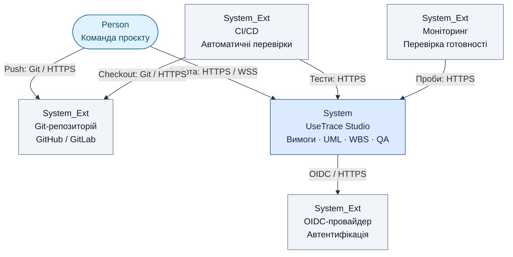
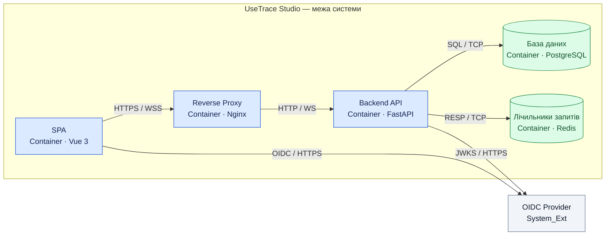
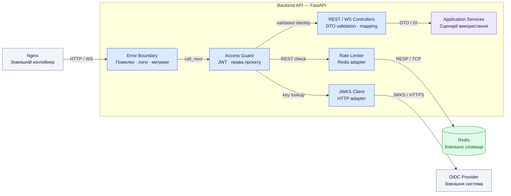
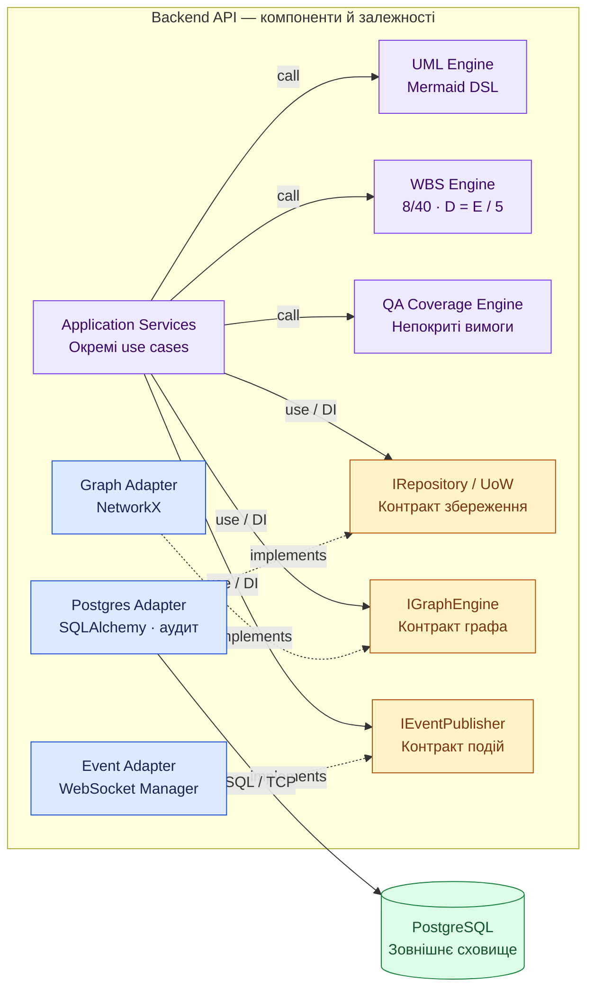

# 2. Архітектурне проєктування системи

**Проєкт:** UseTrace Studio

[Специфікація вимог](./srs.md) · [ADR-001](./adr/0001-choice-of-technology.md)

## 2.1. Контекстне та контейнерне моделювання системи (C4 Model)

**Проєкт:** UseTrace Studio
**Рівні:** System Context (Level 1) та Container (Level 2)
**Основа:** [фінальна SRS із завдання 1](srs.md)
**Дата редакції:** 14.11.2026

Схеми показують поточний лабораторний обсяг SRS: вимоги, ревізії, DAG, UML, WBS, QA-беклог і синхронізацію.

Для читабельного компонування C4-модель подано засобами Mermaid `flowchart`: типи `Person`, `System`, `System_Ext` та `Container` явно зазначено у блоках. C4 визначає рівні й зміст моделі та не вимагає єдиної графічної нотації. Це не підміна Level 1 компонентною схемою: на першому рівні UseTrace Studio залишається одним блоком, на другому розкривається на застосунки й сховища.

**Легенда:** округлий блок — користувачі; синій прямокутник — наша система або застосунок; зелений циліндр — сховище; сірий прямокутник — зовнішня система. Стрілка показує ініціатора взаємодії та ціль; відповідь проходить тим самим з’єднанням, тому окремі зворотні стрілки не дублюються.

### 2.1.1. System Context Diagram — Level 1

#### Актори та зовнішні системи

П’ять ролей об’єднані в один блок **«Команда проєкту»**, оскільки працюють через той самий вебінтерфейс. Це спрощує схему, а не об’єднує їхні права доступу.

| Роль | Робота в системі |
| --- | --- |
| Системний аналітик | Формує та редагує вимоги, працює з історією ревізій. |
| Архітектор | Аналізує залежності, вплив змін та UML-моделі. |
| Розробник | Читає вимоги й моделі, переглядає залежності; зміни виконує лише за наданих прав. |
| QA-інженер | Веде тестове покриття та верифікаційний беклог. |
| Проєктний менеджер | Переглядає WBS, оцінки та планову тривалість пакетів. |

| Зовнішній вузол | Призначення |
| --- | --- |
| Git-репозиторій | Зберігає документацію Markdown/DSL та вихідний код. |
| CI/CD | Перевіряє документацію й код; за налаштованим сценарієм тестує API стенда. |
| OIDC-провайдер | Автентифікує користувача та видає токени доступу. |
| Моніторинг | Prometheus і Blackbox Exporter накопичують результати зовнішніх проб готовності. |

#### Зв’язки та протоколи

| Зв’язок | Протокол | Зміст |
| --- | --- | --- |
| Команда → UseTrace Studio | REST / HTTPS, WebSocket / WSS | Робота з даними та отримання підтверджених змін. |
| Команда → Git | Git через HTTPS | Користувач додає файли до репозиторію та виконує push. |
| CI/CD → Git | Git через HTTPS | Отримання версії документації й коду для перевірки. |
| CI/CD → UseTrace Studio | REST / HTTPS | Тестові запити до авторизованого API стенда. |
| Моніторинг → UseTrace Studio | HTTP GET через HTTPS | Перевірка endpoint готовності через публічну точку входу. |
| UseTrace Studio → OIDC-провайдер | OIDC через HTTPS | Вхід із браузерної частини системи та отримання відкритої конфігурації/ключів серверною частиною. |

Автоматична синхронізація Backend API з GitHub/GitLab API тут не заявляється. Git — документаційний контур, у якому працює користувач або CI.

### 2.1.2. Container Diagram — Level 2

Основний потік читається **зліва направо: SPA → Nginx → FastAPI**. Сховища розташовані біля Backend API. Користувачі вже показані на Level 1, тому їхній блок не повторюється. Зовнішні CI та моніторинг звертаються до того самого Nginx через HTTPS; їхні стрілки не дублюються на другій схемі.

#### Контейнери та відповідальність

| Контейнер | Технологія | Відповідальність |
| --- | --- | --- |
| SPA | Vue 3, Mermaid.js | Інтерфейс у браузері, редагування, відображення UML і застосування отриманих змін. |
| Reverse Proxy | Nginx | Роздача HTML/JS/CSS, завершення зовнішнього TLS, маршрутизація REST і WebSocket-запитів. |
| Backend API | FastAPI, Uvicorn, NetworkX, SQLAlchemy / asyncpg | Вимоги, ревізії, DAG, перевірка циклів, Impact Analysis, перетворення UML/DSL, WBS, QA-беклог, JWT, аудит і WebSocket Manager. |
| База даних | PostgreSQL 16 | Постійні вимоги, ревізії, зв’язки, UML-моделі, WBS, тест-кейси, QA-завдання та журнал аудиту. |
| Лічильники запитів | Redis | Спільний стан Rate Limiting. Не є постійним сховищем вимог або сховищем відкритих сокетних з’єднань. |

**Межі виконання:** SPA є C4-контейнером, що виконується у браузері; Nginx доставляє її статичні файли. C4-контейнер не обов’язково дорівнює Docker-контейнеру. Nginx, Backend API, PostgreSQL і Redis розгортаються як серверні сервіси локального Docker-середовища.

**NetworkX** — бібліотека всередині процесу FastAPI. Вона не має власного мережевого endpoint, тому окрема стрілка API → NetworkX на Level 2 відсутня. Граф у RAM відновлюється зі збережених PostgreSQL-даних. Для поточного стенда використовується один процес Backend API; багатопроцесна синхронізація RAM-графів цим рішенням не оголошується реалізованою.

#### Зв’язки та протоколи

| Зв’язок | Протокол / порт | Зміст |
| --- | --- | --- |
| SPA → Nginx | REST / HTTPS і WebSocket / WSS; 443 | Статичні ресурси, бізнес-запити та захищене сокетне з’єднання. |
| Nginx → Backend API | REST / HTTP і WebSocket / WS; 8000 | Внутрішнє проксіювання після завершення TLS на Nginx; WebSocket Upgrade передається до Uvicorn. |
| Backend API → PostgreSQL | SQL через PostgreSQL wire protocol / TCP; 5432 | Читання та запис через asyncpg. SQLAlchemy й asyncpg працюють на стороні API, а не як окремі процеси всередині БД. |
| Backend API → Redis | RESP / TCP; 6379 | Атомарна перевірка ліміту запитів та оновлення його стану. |
| SPA → OIDC-провайдер | OIDC / HTTPS; 443 | Вхід користувача та отримання access token у браузерному потоці авторизації. |
| Backend API → OIDC-провайдер | JWKS / HTTPS; 443 | Отримання відкритих ключів. Перевірка підпису JWT виконується локально в API; ключі можуть кешуватися. |

**Безпека та готовність:**

- Rate Limiting виконується в Backend API зі станом у Redis: не більше 100 REST-запитів на клієнтську IP за рухоме вікно 60 секунд; перевищення — HTTP 429. Окремий Nginx/Lua limiter у цій редакції не використовується. Заголовки клієнтської IP приймаються лише від довіреного proxy.
- PostgreSQL і Redis не публікуються як зовнішні точки входу; доступ до них надається через внутрішню мережу Docker.
- Для поточного локального профілю HTTP/WS між Nginx та API є внутрішнім транспортом. Позначення WSS на цій стрілці вимагало б окремого внутрішнього TLS.
- API перевіряє валідність access token і права на конкретний проєкт. Відповіді WebSocket не розсилаються сесіям інших проєктів.
- Heartbeat реалізується WebSocket Manager/Uvicorn: серверний Ping кожні 15 секунд, відповідний Pong від іншої сторони. Після перепідключення SPA отримує актуальний стан.
- Прикладний аудит зберігається в PostgreSQL за дозволеним складом полів COMP-01. Псевдонімний ID автора не оголошується повністю анонімним.
- Моніторинг опитує `/health/ready` через Nginx кожні 30 секунд. HTTP 200 означає готовність БД і відновленого графа. Наявність цього механізму ще не доводить досягнення 99,9% за 30 діб.

### 2.1.3. Трасування SRS → архітектура

| ID вимоги | Функція / обмеження | Місце реалізації |
| --- | --- | --- |
| [SRS-FUN-01](./srs.md#srs-fun-01) | Створення вимоги | SPA → API → PostgreSQL. |
| [SRS-FUN-02](./srs.md#srs-fun-02) | Історія ревізій | API + PostgreSQL. |
| [SRS-FUN-03](./srs.md#srs-fun-03) | Побудова DAG | API / NetworkX у RAM; джерело — PostgreSQL. |
| [SRS-FUN-04](./srs.md#srs-fun-04) | Заборона циклів | API / NetworkX; узгоджена перевірка та запис ребра в PostgreSQL. |
| [SRS-FUN-05](./srs.md#srs-fun-05) | Аналіз впливу | API / NetworkX; позначення зберігаються в PostgreSQL. |
| [SRS-FUN-06](./srs.md#srs-fun-06) | Генерація UML DSL | API перетворює збережену модель; SPA / Mermaid.js відображає її. |
| [SRS-FUN-07](./srs.md#srs-fun-07) | WBS | API розраховує D = E / 5; PostgreSQL зберігає оцінки й пакети; SPA показує результат. |
| [SRS-FUN-08](./srs.md#srs-fun-08) | QA-беклог | API визначає непокриті вимоги та створює завдання в PostgreSQL без відкритих дублів. |
| [SRS-FUN-09](./srs.md#srs-fun-09) | Синхронізація | API WebSocket Manager → Nginx → авторизовані SPA-сесії. |
| [SRS-FUN-10](./srs.md#srs-fun-10) | Heartbeat 15 секунд | Uvicorn / WebSocket Manager і WebSocket-клієнт браузера. |
| [SRS-FUN-11](./srs.md#srs-fun-11) | Перегляд вимоги | SPA → API → PostgreSQL. |
| [SRS-FUN-12](./srs.md#srs-fun-12) | Редагування з перевіркою версії | API + PostgreSQL; конфлікт повертає HTTP 409. |
| [SRS-FUN-13](./srs.md#srs-fun-13) | Архівування | API + PostgreSQL; архівний вузол виключається з активного DAG. |
| [SRS-FUN-14](./srs.md#srs-fun-14) | Відновлення попереднього вмісту | API створює нову ревізію в PostgreSQL. |
| [SRS-FUN-15](./srs.md#srs-fun-15) | Зворотне редагування UML | SPA передає підтримуваний classDiagram; API перевіряє й зберігає модель у PostgreSQL. |
| [SRS-NFR-PERF-01](./srs.md#srs-nfr-perf-01) | p95 TTFB < 150 мс при 500 RPS | Наскрізний шлях Nginx → API → залежності; перевірка k6 за профілем SRS. |
| [SRS-NFR-PERF-02](./srs.md#srs-nfr-perf-02) | Топологія DAG < 50 мс | NetworkX усередині API; окремий benchmark у RAM. |
| [SRS-NFR-SEC-01](./srs.md#srs-nfr-sec-01) | OIDC, JWT RS256, проєктні права | OIDC-провайдер + перевірки Backend API. |
| [SRS-NFR-SEC-02](./srs.md#srs-nfr-sec-02) | 100 req/min/IP | Backend API + Redis. |
| [SRS-NFR-COMP-01](./srs.md#srs-nfr-comp-01) | Мінімізація даних аудиту | Backend API → PostgreSQL. |
| [SRS-NFR-REL-01](./srs.md#srs-nfr-rel-01) | Доступність 99,9% за 30 діб | Nginx + готовий API; зовнішній Prometheus / Blackbox Exporter. |

Архітектура визначає відповідальність за вимоги. Числа 500 RPS, 150 мс, 50 мс та 99,9% залишаються цільовими показниками SRS до фактичної перевірки.

## 2.2. Компонентне моделювання критичного сервісу системи

**Проєкт:** UseTrace Studio
**Обраний контейнер:** Backend API / FastAPI
**Рівень:** C4 Component, Level 3
**Дата редакції:** 14.11.2026

**Вхідні документи:** [SRS](srs.md), [виправлені Context і Container](2_design.md#diagram-level1).

Backend API обрано як критичний контейнер: у ньому зосереджено керування вимогами й ревізіями, DAG-обчислення, UML/DSL, WBS, QA-беклог і синхронізацію.

**Стек:** Python 3.12, FastAPI / Uvicorn, Pydantic v2, NetworkX, SQLAlchemy v2 / asyncpg. PostgreSQL, Redis, Nginx та OIDC Provider — зовнішні щодо обраного контейнера елементи Level 2.

### 2.2.1. Фінальна компонентна модель

Для читабельності одна модель Backend API показана у двох узгоджених проєкціях:

- **А — вхід і захист:** маршрут запиту, валідація, авторизація, помилки, логи, метрики та зовнішні клієнти.
- **Б — бізнес-логіка й контракти:** обчислювальні компоненти, інтерфейси та інфраструктурні адаптери.

Обидві схеми є Level 3 одного контейнера, а не двома новими сервісами. Використано Mermaid `flowchart` з явно визначеними межами та легендою C4. Детальні обов’язки винесено під схеми, щоб не перевантажувати стрілки.

**Легенда:** синій блок усередині межі — вхідний компонент або адаптер; фіолетовий — прикладна/доменна логіка; жовтий — контракт; зелений циліндр — зовнішнє сховище; сірий — інший контейнер або зовнішня система.

#### А. Вхідний шар і захист

На схемі показано логічне проходження запиту. `call_next` означає обгортання нижчих шарів обробником, а не окремий мережевий виклик. Error Boundary охоплює відповідь і помилки нижчих шарів.

REST та WebSocket мають різну транспортну обробку. Для REST DTO валідується перед викликом сценарію. Для WebSocket спочатку перевіряється право на встановлення з’єднання, а кожне вхідне прикладне повідомлення проходить окрему перевірку схеми.

#### Б. Бізнес-логіка та Dependency Inversion

**Суцільна внутрішня стрілка** означає використання компонента або контракту. **Пунктирна `implements`** спрямована від адаптера до інтерфейсу, який він реалізує. Вона показує залежність вихідного коду, а не порядок виконання запиту.

Під час виконання Application Services звертаються до інтерфейсу; виклик обробляє реалізація, підставлена через DI. Бізнес-логіка не імпортує SQLAlchemy, asyncpg, NetworkX або FastAPI WebSocket.

### 2.2.2. Технічний опис компонентів

| Компонент | Роль | Інтерфейс / взаємодія |
| --- | --- | --- |
| **Error Boundary / Global Error Handler** | ASGI-обгортка, HTTP exception handlers та локальна обробка помилок WebSocket. Формує безпечну відповідь, записує технічний результат і метрики. | Виклик наступного обробника; перехоплення винятку; Python Logging / лічильники й гістограми. |
| **Access Guard** | Перевіряє RS256-підпис, issuer, audience, строк дії токена, потрібні права та членство в проєкті. Не вважає валідний JWT автоматичним дозволом на будь-яку операцію. | FastAPI dependencies; локальна перевірка токена; виклики JWKS Client, Rate Limiter і policy-перевірки доступу. |
| **Rate Limiter** | Контролює не більше 100 REST-запитів на клієнтську IP за рухоме вікно 60 секунд. | Атомарний check/update у Redis через RESP/TCP; перевищення — HTTP 429. |
| **JWKS Client** | Отримує відкриті ключі OIDC Provider та оновлює кеш ключів. | HTTPS/443; перевірка JWT після отримання ключа виконується локально. |
| **REST Controllers** | Приймають HTTP-запити, запускають DTO Validator/Mapper, обирають сценарій, перетворюють результат у HTTP-відповідь. | APIRouter; in-process виклик use case через DI. Прямого SQL немає. |
| **WebSocket Controller / Manager** | Перевіряє підключення, веде активні сесії, валідує повідомлення й розсилає дозволені події конкретного проєкту. | ASGI WebSocket; внутрішній WS до Nginx, зовнішній WSS до браузера. |
| **DTO Validator / Mapper** | Перевіряє форму й обмеження вхідних даних та перетворює транспортний DTO на прикладну команду; результат — у response DTO. | Pydantic + явне мапування до чистих Python-структур. Внутрішній виклик. |
| **Application Services** | Група окремих сценаріїв керування вимогами, ревізіями, UML, WBS і QA. Координує компоненти й транзакцію, не реалізуючи всі алгоритми в одному класі. | Вхідні Python-команди; вузькі repository-порти, UoW, IGraphEngine, IEventPublisher та чисті обчислювальні компоненти. |
| **UML Engine** | Формує підтримуваний Mermaid classDiagram зі структурованої моделі та розбирає валідні зворотні зміни зі збереженням стабільних ID. | Чисті Python-структури ↔ DSL. Некоректний або непідтримуваний DSL не змінює збережену модель. |
| **WBS Engine** | Перевіряє правило 8–40 людино-годин для кінцевих пакетів і розраховує D = E / (8 × 0,625) = E / 5 робочих днів. | Чистий виклик розрахунку. E задається користувачем; правило 8/40 не генерує оцінку автоматично. |
| **QA Coverage Engine** | Визначає активні вимоги без зв’язку з активним тест-кейсом. | Чистий аналіз знімка вимог і тестових зв’язків; створення завдань і захист від дублів — у відповідному use case та БД. |
| **IRepository / Unit of Work** | Контракти зберігання, перевірки версій, транзакції та фіксації аудиту разом зі зміною. | Python Protocol/ABC. Назва на схемі узагальнює кілька вузьких репозиторіїв, а не вимагає одного універсального інтерфейсу. |
| **Postgres Adapter** | Реалізує конкретні репозиторії та UoW; виконує SQL і мапінг ORM ↔ прикладні структури. Містить Audit Writer для збереження дозволених полів аудиту. | SQLAlchemy AsyncSession + asyncpg; PostgreSQL wire protocol/TCP, порт 5432. |
| **IGraphEngine / Graph Adapter** | Контракт графових операцій та його реалізація на NetworkX: DAG, цикли, досяжність, топологічний порядок. | In-process. На межі порту передаються ID, вузли й ребра у власних структурах; NetworkX DiGraph не витікає в прикладне ядро. |
| **IEventPublisher / Event Adapter** | Контракт публікації підтверджених змін; реалізація передає події WebSocket Manager. | In-process виклик після commit; розсилка через наявні WebSocket-з’єднання. |
| **Composition Root** | На старті FastAPI створює адаптери та прив’язує їх до інтерфейсів прикладних сервісів. | Явне constructor injection / FastAPI Depends. У тестах реалізації замінюються fake/stub. |

**DTO Validation не дорівнює перевірці ISO 29148.** Pydantic перевіряє типи, обов’язковість і чисельні/текстові обмеження схеми; атомарність і зміст вимог перевіряються окремим процесом рев’ю.

**Project Access Policy:** Guard отримує актуальну інформацію про права через вузький read-only контракт доступу, реалізований адаптером сховища. Операція use case додатково обмежується цільовим проєктом; переданий клієнтом project_id не є доказом членства.

#### Контракти та ін’єкція залежностей

| Контракт | Основні операції | Реалізація |
| --- | --- | --- |
| IRequirementsRepository | Читання, створення, version-checked update, архівування, історія, створення відновленої ревізії. | Postgres requirements repository. |
| IModelsRepository | Структуровані UML-моделі та їхні версії. | Postgres models repository. |
| IPlanningRepository / ITestRepository | WBS-пакети, тест-кейси, покриття, QA-завдання. | Відповідні Postgres-репозиторії. |
| IUnitOfWork | Begin, commit, rollback; спільна транзакція зміни й audit record. | SQLAlchemy AsyncSession / transaction scope. |
| IGraphEngine | Перевірка DAG, кандидата ребра, множини впливу та топологічного порядку. | NetworkX adapter. |
| IEventPublisher | publish(ChangeEvent) після підтвердження зміни. | In-process WebSocket event adapter. |

Protocol/ABC сам по собі не виконує ін’єкцію й не гарантує правильність реалізації. Composition Root передає конкретні об’єкти; перевірки контрактів і тестові підстановки контролюють поведінку.

#### Порядок успішної зміни

1. Boundary приймає запит через Nginx; Guard перевіряє токен, ліміт REST-запитів і права проєкту.
2. Контролер валідує DTO та передає прикладну команду.
3. Use case відкриває UoW і читає актуальний стан. Застарілий expected_version відхиляється з HTTP 409.
4. Для нового ребра перевірка циклу спирається на актуальний знімок під транзакційним блокуванням проєкту. Перевірка та прийняття ребра не виконуються як два незалежні конкурентні записи.
5. Репозиторії зберігають зміну, ревізію та audit record в одній транзакції. Audit Writer залишає лише дозволені SRS поля: час, псевдонімний ID автора, ID проєкту, ID сутності, дію та результат.
6. Після успішного commit оновлюється відповідна RAM-проєкція; через IEventPublisher передається ChangeEvent дозволеним сесіям проєкту. Rollback не породжує подію успішної зміни.
7. При втраті події або з’єднання клієнт відновлює стан зі сховища. Локальна WebSocket-розсилка не гарантує довговічної доставки або exactly-once.

Для поточного Level 2 використовується один процес API. RAM-граф відновлюється з PostgreSQL; Redis не зберігає живі сокети й не є авторитетним сховищем вимог.

Помилка WebSocket-публікації після commit не скасовує вже збереженої транзакції: її фіксує технічна телеметрія, а проблемні сесії перепідключаються й отримують актуальний знімок. Якщо RAM-проєкцію після commit не вдалося оновити, readiness залишається негативним до її відновлення; збережений стан PostgreSQL не втрачається.

#### Помилки, аудит і метрики

- HTTP-помилки відображаються у Problem Details за RFC 9457: 401 — токен, 403 — права, 409 — конфлікт, 422 — DTO/DSL, 429 — ліміт, 503 — необхідна залежність недоступна; непередбачена помилка — 500 без внутрішніх деталей.
- Після прийняття WebSocket-з’єднання HTTP Problem Details не надсилається як HTTP-відповідь. Контролер використовує прикладне повідомлення про помилку або відповідний WebSocket close code.
- Операційні логи Boundary не містять токенів, паролів або повних тіл запитів. Вони не підміняють транзакційний журнал аудиту.
- Метрики включають кількість запитів, помилок і час виконання. Мітки використовують шаблон маршруту й код результату, а не персональні дані чи довільні entity_id.
- Readiness endpoint у вхідному адаптері перевіряє потрібні залежності та готовність RAM-графа. Це механізм для вимірювання REL-01, а не доказ уже досягнутої доступності.
- Серверний Ping налаштовується в Uvicorn/WebSocket-рівні кожні 15 секунд; клієнтська сторона відповідає Pong.

### 2.2.3. Узгодження з актуальною SRS

| Вимоги | Компоненти |
| --- | --- |
| [FUN-01](./srs.md#srs-fun-01), [FUN-02](./srs.md#srs-fun-02), [FUN-11](./srs.md#srs-fun-11), [FUN-12](./srs.md#srs-fun-12), [FUN-13](./srs.md#srs-fun-13), [FUN-14](./srs.md#srs-fun-14) | Controllers, відповідні use cases, IRequirementsRepository, UoW, Postgres Adapter. |
| [FUN-03](./srs.md#srs-fun-03), [FUN-04](./srs.md#srs-fun-04), [FUN-05](./srs.md#srs-fun-05) | Прикладні сценарії + IGraphEngine / NetworkX Adapter; постійний стан у PostgreSQL. |
| [FUN-06](./srs.md#srs-fun-06), [FUN-15](./srs.md#srs-fun-15) | UML Engine, IModelsRepository, DTO/DSL-валидація; рендеринг у SPA поза обраним контейнером. |
| [FUN-07](./srs.md#srs-fun-07) | WBS Engine + Planning Repository. |
| [FUN-08](./srs.md#srs-fun-08) | QA Coverage Engine, use case генерації, Test Repository і обмеження від дублів у БД. |
| [FUN-09](./srs.md#srs-fun-09), [FUN-10](./srs.md#srs-fun-10) | IEventPublisher, WebSocket Manager, ASGI/Uvicorn та SPA-клієнт. |
| [NFR-PERF-01](./srs.md#srs-nfr-perf-01) | Наскрізний запит API; вимірюється k6 за профілем SRS. |
| [NFR-PERF-02](./srs.md#srs-nfr-perf-02) | NetworkX Adapter; окремий RAM benchmark. |
| [NFR-SEC-01](./srs.md#srs-nfr-sec-01), [NFR-SEC-02](./srs.md#srs-nfr-sec-02) | Access Guard, Project Access Policy, JWKS Client, Rate Limiter / Redis. |
| [NFR-COMP-01](./srs.md#srs-nfr-comp-01) | Audit Writer усередині Postgres Adapter; allowlist полів. |
| [NFR-REL-01](./srs.md#srs-nfr-rel-01) | Readiness, відновлення графа та зовнішній моніторинг із Level 2. |

У таблиці використано скорочення FUN/NFR; повні ID мають префікс `SRS-`. Цілі 500 RPS, p95 < 150 мс, граф < 50 мс і доступність 99,9% не вважаються підтвердженими лише через наявність компонентної схеми.

## 2.3. Документування архітектурних рішень

[ADR-001: PostgreSQL як основне сховище та NetworkX для графових обчислень](./adr/0001-choice-of-technology.md) має статус **Approved**. Рішення обґрунтовує RAM-граф у процесі API для [SRS-FUN-03](./srs.md#srs-fun-03), [SRS-FUN-04](./srs.md#srs-fun-04), [SRS-FUN-05](./srs.md#srs-fun-05) та цільового [SRS-NFR-PERF-02](./srs.md#srs-nfr-perf-02).

## 2.4. Наскрізне трасування

| Архітектурний елемент | Вимоги SRS | Обґрунтування |
| --- | --- | --- |
| [SPA та Backend API](#diagram-level2) | [Створення](./srs.md#srs-fun-01), [читання](./srs.md#srs-fun-11), [редагування](./srs.md#srs-fun-12), [архівування](./srs.md#srs-fun-13) | Вхідний і прикладний шари [компонентної моделі](#diagram-level3). |
| [API та PostgreSQL](#diagram-level3) | [Історія](./srs.md#srs-fun-02), [відновлення ревізії](./srs.md#srs-fun-14) | Repository / UoW; вибір сховища — [ADR-001](./adr/0001-choice-of-technology.md). |
| [IGraphEngine / NetworkX](#diagram-level3) | [DAG](./srs.md#srs-fun-03), [цикли](./srs.md#srs-fun-04), [аналіз впливу](./srs.md#srs-fun-05), [PERF-02](./srs.md#srs-nfr-perf-02) | [ADR-001](./adr/0001-choice-of-technology.md): похідний RAM-граф, транзакції та відновлення. |
| [UML Engine](#diagram-level3) | [Генерація DSL](./srs.md#srs-fun-06), [зворотне редагування](./srs.md#srs-fun-15) | Структурована модель та підтримувана підмножина classDiagram. |
| [WBS і QA Engines](#diagram-level3) | [WBS](./srs.md#srs-fun-07), [QA-беклог](./srs.md#srs-fun-08) | Окремі обчислювальні компоненти з чистими інтерфейсами. |
| [WebSocket Manager](#diagram-level3) | [Синхронізація](./srs.md#srs-fun-09), [Heartbeat](./srs.md#srs-fun-10) | Події після commit; WS усередині мережі, WSS зовні. |
| [Access Guard, Rate Limiter](#diagram-level3) | [Доступ](./srs.md#srs-nfr-sec-01), [ліміт запитів](./srs.md#srs-nfr-sec-02) | Перевірки JWT/прав і атомарний стан Redis. |
| [Аудит та готовність](#diagram-level3) | [Дані аудиту](./srs.md#srs-nfr-comp-01), [доступність](./srs.md#srs-nfr-rel-01), [API latency](./srs.md#srs-nfr-perf-01) | Транзакційний аудит, readiness і профіль перевірки SRS. |
