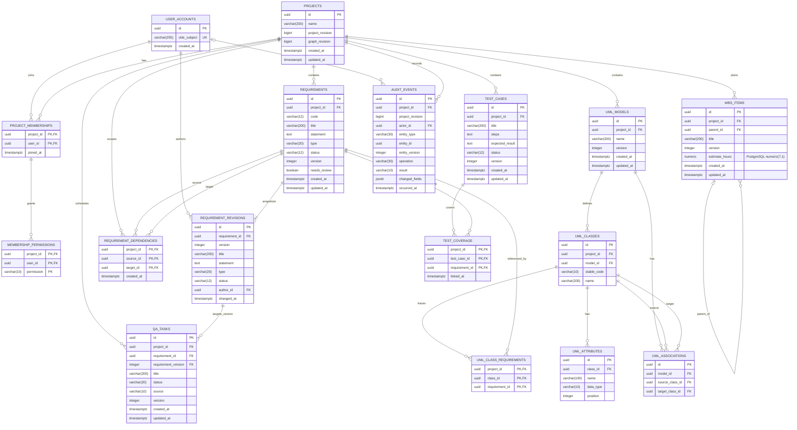
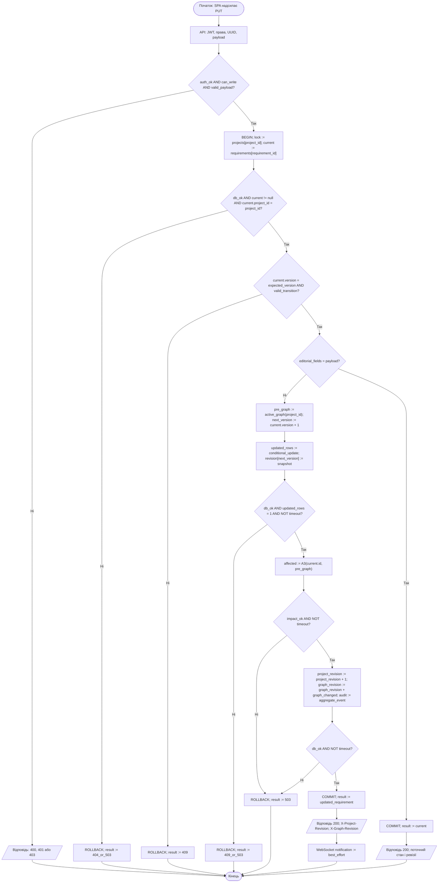

# AI Insights — Завдання 4. Повний протокол інтеграційного аудиту UseTrace Studio

**Дата аудиту:** 16.11.2026.  
**Мета:** задокументувати вхідні версії схеми даних, API й алгоритмів, відповідь ШІ-аудитора, перевірку кожного зауваження та внесені виправлення.  
**Правило хронології:** початковий промпт і отриманий звіт нижче наведено в історичному вигляді. Їхні висновки стосуються стану **до** виправлень. Актуальний результат наведено наприкінці в журналі дій і підрозділі 2.7.

## 1. Початковий запит до ШІ-аудитора

Наведено повний промпт, переданий аудитору разом із трьома тодішніми технічними артефактами.

# ШІ-промпт-Аудитор інтеграційної цілісності (Data & Logic Gatekeeper) — UseTrace Studio

**Роль:** Principal Systems Architect, Lead Data Engineer та голова комісії з технічного аудиту програмних систем Enterprise-рівня.

**Контекст:** Я студент 4 курсу спеціальності 121/F2 «Інженерія ПЗ». Я завершив проєктування нижнього рівня системи **UseTrace Studio** (моделі даних, API-контракти та логіка алгоритмів). Мені потрібен твій фінальний суворий аудит на відсутність конфліктів інтеграції між цими трьома артефактами.

**Технологічний стек і контейнери:** Frontend SPA на Vue 3 → Backend API на FastAPI через Nginx; PostgreSQL 16 є постійним сховищем вимог, ревізій і залежностей; Redis зберігає тимчасовий стан rate limiting; NetworkX будує активну проєкцію графа з PostgreSQL; зовнішній OIDC-провайдер видає JWT. Для інтеграційного зрізу визначено чотири REST-операції: створення, читання, редагування вимоги й додавання напрямленої залежності. Алгоритм поширення впливу викликається всередині редагування.

**Ось мої інженерні артефакти:**

### 1. Фінальний код схеми даних (Mermaid, PostgreSQL 16; підрозділ 2.4)



**Обмеження, які доповнюють ERD:** `requirements.id/project_id` та кінці залежності — UUID; `requirements.title` — 1–200, `statement` — 1–10000 символів; `type` ∈ {`functional`, `nonfunctional`}; `status` ∈ {`draft`, `approved`, `archived`}; активні вершини мають `draft` або `approved`. `version > 0`; `code` відповідає `^REQ-[0-9]{4,8}$` та унікальний у проєкті. Для `requirement_dependencies` діє складений PK `(project_id,source_id,target_id)`, складені FK на вимоги того самого проєкту, CHECK `source_id <> target_id`; цикли перевіряє алгоритм Кана під блокуванням рядка проєкту. `audit_events.result` = `success`; `changed_fields` містить тільки назви полів без значень. Часові поля — `timestamptz` у UTC.

### 2. Фінальний API-контракт (OpenAPI 3.0.3 YAML, версія 1.1.0; підрозділ 2.5)

```yaml
openapi: 3.0.3
info:
  title: UseTrace Studio Requirements API
  version: 1.1.0
  description: REST contract for requirements and directed dependencies.
servers:
  - url: https://{host}
    variables:
      host:
        default: localhost
tags:
  - name: Requirements
security:
  - oidcBearer: []
paths:
  /api/v1/projects/{projectId}/requirements:
    parameters:
      - $ref: '#/components/parameters/ProjectId'
    post:
      tags: [Requirements]
      operationId: createRequirement
      summary: Create a requirement and its first immutable revision
      description: Requires project write permission. The server assigns the ID, code, version 1 and timestamps atomically.
      requestBody:
        required: true
        content:
          application/json:
            schema:
              $ref: '#/components/schemas/CreateRequirement'
      responses:
        '201':
          description: Created
          headers:
            Location:
              description: URL of the created requirement
              schema:
                type: string
          content:
            application/json:
              schema:
                $ref: '#/components/schemas/Requirement'
        '400':
          $ref: '#/components/responses/BadRequest'
        '401':
          $ref: '#/components/responses/Unauthorized'
        '403':
          $ref: '#/components/responses/Forbidden'
        '404':
          $ref: '#/components/responses/NotFound'
        '409':
          $ref: '#/components/responses/Conflict'
        '429':
          $ref: '#/components/responses/RateLimited'
        '503':
          $ref: '#/components/responses/Unavailable'
  /api/v1/projects/{projectId}/requirements/{requirementId}:
    parameters:
      - $ref: '#/components/parameters/ProjectId'
      - $ref: '#/components/parameters/RequirementId'
    get:
      tags: [Requirements]
      operationId: getRequirement
      summary: Read a requirement in the authorized project
      description: Requires project read permission.
      responses:
        '200':
          description: Current requirement state
          content:
            application/json:
              schema:
                $ref: '#/components/schemas/Requirement'
        '400':
          $ref: '#/components/responses/BadRequest'
        '401':
          $ref: '#/components/responses/Unauthorized'
        '403':
          $ref: '#/components/responses/Forbidden'
        '404':
          $ref: '#/components/responses/NotFound'
        '429':
          $ref: '#/components/responses/RateLimited'
        '503':
          $ref: '#/components/responses/Unavailable'
    put:
      tags: [Requirements]
      operationId: replaceRequirement
      summary: Replace editable requirement fields if the version matches
      description: Requires project write permission. The request supplies all editable fields. A successful change creates an immutable revision and increments version atomically. Repeating an old expected_version returns 409.
      requestBody:
        required: true
        content:
          application/json:
            schema:
              $ref: '#/components/schemas/ReplaceRequirement'
      responses:
        '200':
          description: Updated requirement and new version
          content:
            application/json:
              schema:
                $ref: '#/components/schemas/Requirement'
        '400':
          $ref: '#/components/responses/BadRequest'
        '401':
          $ref: '#/components/responses/Unauthorized'
        '403':
          $ref: '#/components/responses/Forbidden'
        '404':
          $ref: '#/components/responses/NotFound'
        '409':
          $ref: '#/components/responses/Conflict'
        '429':
          $ref: '#/components/responses/RateLimited'
        '503':
          $ref: '#/components/responses/Unavailable'
  /api/v1/projects/{projectId}/requirement-dependencies:
    parameters:
      - $ref: '#/components/parameters/ProjectId'
    post:
      tags: [Requirements]
      operationId: createRequirementDependency
      summary: Add a directed dependency if the active graph remains acyclic
      description: Requires project write permission. Both endpoints must be active requirements of this project. The server serializes graph changes on the project row, runs Kahn cycle detection and inserts the edge, project revision and audit event in one transaction. A duplicate edge or cycle returns 409.
      requestBody:
        required: true
        content:
          application/json:
            schema:
              $ref: '#/components/schemas/CreateRequirementDependency'
      responses:
        '201':
          description: Dependency created
          content:
            application/json:
              schema:
                $ref: '#/components/schemas/RequirementDependency'
        '400':
          $ref: '#/components/responses/BadRequest'
        '401':
          $ref: '#/components/responses/Unauthorized'
        '403':
          $ref: '#/components/responses/Forbidden'
        '404':
          $ref: '#/components/responses/NotFound'
        '409':
          $ref: '#/components/responses/Conflict'
        '429':
          $ref: '#/components/responses/RateLimited'
        '503':
          $ref: '#/components/responses/Unavailable'
components:
  securitySchemes:
    oidcBearer:
      type: http
      scheme: bearer
      bearerFormat: JWT
      description: OIDC access token signed with RS256. Backend checks issuer, audience, expiry and project membership and permission.
  parameters:
    ProjectId:
      name: projectId
      in: path
      required: true
      schema:
        type: string
        format: uuid
    RequirementId:
      name: requirementId
      in: path
      required: true
      schema:
        type: string
        format: uuid
  schemas:
    CreateRequirement:
      type: object
      additionalProperties: false
      required: [title, statement, type]
      properties:
        title:
          type: string
          minLength: 1
          maxLength: 200
        statement:
          type: string
          minLength: 1
          maxLength: 10000
        type:
          type: string
          enum: [functional, nonfunctional]
    ReplaceRequirement:
      type: object
      additionalProperties: false
      required: [expected_version, title, statement, type, status]
      properties:
        expected_version:
          type: integer
          format: int32
          minimum: 1
        title:
          type: string
          minLength: 1
          maxLength: 200
        statement:
          type: string
          minLength: 1
          maxLength: 10000
        type:
          type: string
          enum: [functional, nonfunctional]
        status:
          type: string
          enum: [draft, approved, archived]
    Requirement:
      type: object
      additionalProperties: false
      required: [id, project_id, code, title, statement, type, status, version, needs_review, created_at, updated_at]
      properties:
        id:
          type: string
          format: uuid
        project_id:
          type: string
          format: uuid
        code:
          type: string
          pattern: '^REQ-[0-9]{4,8}$'
        title:
          type: string
          minLength: 1
          maxLength: 200
        statement:
          type: string
          minLength: 1
          maxLength: 10000
        type:
          type: string
          enum: [functional, nonfunctional]
        status:
          type: string
          enum: [draft, approved, archived]
        version:
          type: integer
          format: int32
          minimum: 1
        needs_review:
          type: boolean
        created_at:
          type: string
          format: date-time
        updated_at:
          type: string
          format: date-time
    CreateRequirementDependency:
      type: object
      additionalProperties: false
      required: [source_id, target_id]
      properties:
        source_id:
          type: string
          format: uuid
        target_id:
          type: string
          format: uuid
          description: Must differ from source_id; enforced by the service and database CHECK.
    RequirementDependency:
      type: object
      additionalProperties: false
      required: [project_id, source_id, target_id, created_at]
      properties:
        project_id:
          type: string
          format: uuid
        source_id:
          type: string
          format: uuid
        target_id:
          type: string
          format: uuid
        created_at:
          type: string
          format: date-time
    ApiError:
      type: object
      additionalProperties: false
      required: [code, message, request_id]
      properties:
        code:
          type: string
          enum: [VALIDATION_ERROR, UNAUTHORIZED, FORBIDDEN, NOT_FOUND, VERSION_CONFLICT, CODE_CONFLICT, RATE_LIMITED, DEPENDENCY_UNAVAILABLE, GRAPH_CYCLE, DUPLICATE_DEPENDENCY]
        message:
          type: string
        request_id:
          type: string
        fields:
          type: array
          items:
            type: object
            additionalProperties: false
            required: [field, issue]
            properties:
              field:
                type: string
              issue:
                type: string
        current_version:
          type: integer
          minimum: 1
          description: Present for VERSION_CONFLICT when disclosure is authorized.
  responses:
    BadRequest:
      description: Invalid path, body or field validation
      content:
        application/json:
          schema:
            $ref: '#/components/schemas/ApiError'
    Unauthorized:
      description: Missing, invalid or expired access token
      content:
        application/json:
          schema:
            $ref: '#/components/schemas/ApiError'
    Forbidden:
      description: Insufficient project permission
      content:
        application/json:
          schema:
            $ref: '#/components/schemas/ApiError'
    NotFound:
      description: Project or requirement is absent or hidden by access policy
      content:
        application/json:
          schema:
            $ref: '#/components/schemas/ApiError'
    Conflict:
      description: Version conflict, generated code collision, duplicate dependency or graph cycle
      content:
        application/json:
          schema:
            $ref: '#/components/schemas/ApiError'
    RateLimited:
      description: More than 100 REST requests from one verified client IP in a rolling 60 second window
      headers:
        Retry-After:
          description: Whole seconds until another request may be accepted
          schema:
            type: integer
            minimum: 1
      content:
        application/json:
          schema:
            $ref: '#/components/schemas/ApiError'
    Unavailable:
      description: Temporary backend dependency failure, including unavailable Redis limiter
      content:
        application/json:
          schema:
            $ref: '#/components/schemas/ApiError'
```

### 3. Фінальні текстові описи трьох алгоритмів (підрозділ 2.6)

## 2.6.2. А1 — конкурентне редагування вимоги

**Вхід:** `project_id`, `requirement_id`, `expected_version`, `payload`, JWT. **Вихід:** оновлена вимога або контрольована помилка. **Інваріант:** успішна зміна створює одну незмінну ревізію відповідної версії та одну подію аудиту.

1. Перевірити JWT, право запису, UUID, `expected_version >= 1` і поля `payload`. Порожнє тіло відхилити.
2. Почати транзакцію, заблокувати `projects[project_id]`, прочитати `requirements[requirement_id]` і знімок активного графа `pre_graph`. Відхилити відсутню, чужу проєкту або архівовану вимогу.
3. Порівняти `current.version = expected_version`. За конфлікту повернути `409` без змін. Обчислити `next_version := current.version + 1`, виконати умовний `UPDATE ... WHERE version = expected_version`; вимагати `updated_rows = 1`.
4. В одній транзакції записати `requirement_revisions[next_version]`, `audit_events`, збільшити `project_revision`. Якщо змінилися зміст, тип або статус, викликати А3 зі знімком `pre_graph`, отриманим до зміни статусу; при зміні складу активного графа збільшити `graph_revision`.
5. За помилки БД, А3 або дедлайну виконати `ROLLBACK`. Після `COMMIT` повернути `200` і надіслати повідомлення WebSocket.

**Edge cases:** повторний запит із тією самою версією отримує `409`; відсутня вимога — `404`; збій ревізії скасовує зміну основного запису; порожній список залежностей дає порожній результат А3. Невдала доставка WebSocket після `COMMIT` не відкочує зафіксовану транзакцію: клієнт повторно читає стан за `project_revision`. Час без А3 — `O(1)` записів. Архівування потребує окремої перевірки правил переходу статусів у сервісі.

## 2.6.3. А2 — додавання ребра з алгоритмом Кана

**Вхід:** `project_id`, `source_id`, `target_id`, JWT через `POST /api/v1/projects/{projectId}/requirement-dependencies`. **Вихід:** `201` з ребром або `400/401/403/404/409/429/503` за контрактом 2.5. **Інваріант:** активний граф проєкту залишається DAG.

1. Перевірити право запису, UUID та `source_id != target_id`. Заблокувати рядок проєкту в транзакції; прочитати активні вершини `V[i]` і ребра `E[j]`. Обидва кінці мають належати цьому проєкту й бути активними. Повторне ребро відхилити.
2. Додати кандидат лише до локального знімка: `E_prime := E ∪ {(source_id,target_id)}`. Обчислити `indegree[V[i]]`, сформувати `Q[i]` із вершин нульового степеня.
3. Поки `head < |Q|`, зняти `u := Q[head]`; для кожного `Adj[u][j]` зменшити `indegree[v]` і додати `v` до черги при нульовому степені. Контролювати дедлайн, `processed <= |V|` і `scanned_edges <= |E_prime|`.
4. Якщо `processed != |V|`, відхилити цикл. Інакше вставити ребро під унікальним обмеженням, збільшити `graph_revision` та `project_revision`, записати аудит і виконати `COMMIT`.

**Edge cases:** самозалежність і дубль відхиляються; порожній граф не містить допустимих кінців; ізольовані вершини входять до `|V|`. Замок проєкту серіалізує паралельні зміни графа. Час і пам'ять — `O(|V| + |E|)`.

## 2.6.4. А3 — поширення впливу по активному графу

**Вхід:** `project_id`, `changed_id`, активний `Adj[u][j]`, відкрита транзакція А1. **Вихід:** `affected` або помилка для А1. **Інваріант:** кожна досяжна вершина відвідується не більше разу; стартова вимога не позначається як власний наслідок. А3 не виконує `COMMIT`.

1. Перевірити стартову вимогу й завантаження графа. Для архівації зняти знімок графа до виключення вузла. Ініціалізувати `Q[0] := changed_id`, `visited := {changed_id}`, `head := 0`, `affected := ∅`.
2. Поки `head < |Q| AND NOT timeout`, взяти `u := Q[head]`; для кожного `Adj[u][j]` додати активне `v` того ж проєкту до `Q` і `affected` тільки при `v NOT IN visited`.
3. Для кожного `affected[i]` записати `needs_review := true` у транзакції А1. На помилці БД, дедлайні чи перевищенні конфігурованих лімітів вершин/ребер повернути помилку; А1 виконає `ROLLBACK`.

**Edge cases:** без вихідних ребер `affected := ∅`; повторні шляхи не дублюють запис; архівовані проміжні вершини не розгортаються; помилка скасовує всю транзакцію А1. Час `O(|V_reachable| + |E_reachable|)`, додаткова пам'ять `O(|V_reachable|)`. `max_vertices`, `max_edges` та `deadline` задаються конфігурацією; досягнення ліміту означає контрольовану відмову, а не частковий результат.

**Твоє завдання:** Проведи наскрізне рев'ю цих компонентів та згенеруй фінальну інженерну аналітику українською мовою за наступними пунктами:

1. **Аналіз конфліктів «API-to-Database Mismatch»:** Перевір, чи є в моїх API-контрактах поля або методи, які неможливо зберегти або обробити у поточній схемі бази даних. Знайди розбіжності в типах даних (наприклад, UUID в API та INT у БД, string-дата в API та TIMESTAMP у БД). Враховуй, що JSON `date-time` може бути коректним транспортним представленням PostgreSQL `timestamptz`, якщо часова зона визначена.
2. **Аналіз конфліктів «Logic-to-API/Data Mismatch»:** Перевір мої три критичні алгоритми. Чи використовують вони ті самі сутності й атрибути, що зафіксовані у схемі даних та API-контрактах? Перевір відповідність `V[i]`, `E[j]`, `Adj[u][j]` таблицям вимог і залежностей, умовного оновлення за `expected_version`, поля `needs_review`, статусів та ревізій. Вкажи, які структури тимчасові в пам'яті, а які повинні зберігатися в БД. Перевір, чи всі зовнішньо викликані алгоритми мають визначений API-маршрут.
3. **Фінальний інструментальний чек-ліст (Production Readiness):** Видай суворий інженерний висновок — чи готові ці специфікації до передачі в розробку (Розділ 3 диплому), чи є критичні блокери (Showstoppers), які призведуть до багів інтеграції. Якщо виявлено критичні невідповідності — вкажи точне місце, наслідок і мінімальне виправлення. Окремо познач, що можна довести зіставленням текстів, а для чого потрібні OpenAPI-валідатор, SQL-міграції, рендер Mermaid і конкурентні тести.

**Стиль:** Сухий контрактний стиль. Повна відсутність розмовної мови, оціночних суджень та «води». Не вигадуй результатів інструментальних перевірок.

---

## 2. Повна відповідь ШІ-аудитора

Наведено повні текстові висновки отриманого звіту. Оцінки P0/P1/P2 та висновок про неготовність характеризують **початковий стан**. У пункті 7 службовий CSS, що потрапив у експорт замість діаграми, замінено читабельною реконструкцією Mermaid. Вихідний експорт без змін збережено окремим файлом.

# Завдання 4 — крок 2. Результат зовнішнього ШІ-Валідатора

**Джерело:** надіслана користувачем відповідь аудитора «Фінальний аудит інтеграційної цілісності UseTrace Studio», 16.11.2026. Нижче збережено повний текст звіту. Висновки аудитора ще потребують перевірки за повними специфікаціями перед внесенням змін у кроці 3.

---

# Фінальний аудит інтеграційної цілісності UseTrace Studio

Task 4 — Data & Logic Gatekeeper | Технічний звіт для дипломного проєкту

Роль аудиту: Principal Systems Architect / Lead Data Engineer\
Об'єкт: UseTrace Studio\
Артефакти: ERD PostgreSQL 16 (§2.4), OpenAPI 3.0.3 v1.1.0 (§2.5), алгоритми А1–А3 (§2.6)\
Метод: статичне зіставлення контрактів, моделей даних, алгоритмічних інваріантів та транзакційних вимог.

## 1. Загальний інженерний висновок

НЕ ГОТОВО ДО РЕАЛІЗАЦІЇ БЕЗ КОРЕКЦІЙ

Статичний аудит

Артефакти загалом сумісні за основними типами даних, назвами сутностей, HTTP-маршрутами та базовою логікою версіонування. Водночас виявлено невідповідності й неповні інваріанти, які можуть порушити транзакційну цілісність, відстеження змін і коректність поширення впливу між вимогами.

Критичні блокери P0

# 5

Суттєві ризики P1

# 6

Низькі ризики P2

# 3

P0 — необхідно усунути перед реалізацією відповідного механізму; P1 — виправити до інтеграційного тестування; P2 — уточнення контрактів та оптимізація.

Межі висновку: кількість ризиків є результатом експертної класифікації специфікацій, а не автоматизованого аналізатора. Наявність помилок у фактичних SQL-міграціях або Python-реалізації не встановлена, оскільки ці реалізації не надані.

## 2. API-to-Database Mismatch

### 2.1. Перевірка відповідності типів

| Поле / операція            | API                   | PostgreSQL   | Висновок                                 |
| -------------------------- | --------------------- | ------------ | ---------------------------------------- |
| `Requirement.id`           | string, uuid          | uuid         | Сумісно                                  |
| `Requirement.project_id`   | string, uuid          | uuid         | Сумісно                                  |
| `title`                    | string, 1–200         | varchar(200) | Сумісно за наявності CHECK               |
| `statement`                | string, 1–10000       | text         | Сумісно за наявності CHECK               |
| `type`                     | enum                  | varchar(20)  | Сумісно за наявності CHECK               |
| `status`                   | enum                  | varchar(12)  | Сумісно за наявності CHECK               |
| `version`                  | int32, ≥1             | integer      | Сумісно                                  |
| `needs_review`             | boolean               | boolean      | Сумісно                                  |
| `created_at`, `updated_at` | string, date-time     | timestamptz  | Сумісно                                  |
| `source_id`, `target_id`   | string, uuid          | uuid         | Сумісно                                  |
| `project_revision`         | Відсутнє у відповідях | bigint       | Порушено доступність стану синхронізації |
| `graph_revision`           | Відсутнє у відповідях | bigint       | Потрібне уточнення синхронізації графа   |

Дата у форматі RFC 3339 з часовою зоною є коректним транспортним представленням PostgreSQL `timestamptz`. Наприклад, `2026-11-16T10:30:00Z` не потребує зміни типу бази даних.

Розмір `varchar(12)` достатній для максимального значення `REQ-12345678`. Усі визначені значення `type` і `status` також уміщуються у відповідні стовпці.

Підсумок: прямих конфліктів UUID/INT, date-time/timestamptz або переповнення рядкових типів у чотирьох REST-операціях не виявлено.

### 2.2. Підтверджена відповідність CRUD-маршрутів

| REST-операція    | Таблиці PostgreSQL                                      | Алгоритм                          | Статус            |
| ---------------- | ------------------------------------------------------- | --------------------------------- | ----------------- |
| POST requirement | `requirements`, `requirement_revisions`                 | Створення не деталізоване в А1–А3 | Частково          |
| GET requirement  | `requirements`                                          | Пряме читання                     | Сумісно           |
| PUT requirement  | `requirements`, `requirement_revisions`, `audit_events` | А1 + А3                           | Сумісно з умовами |
| POST dependency  | `requirement_dependencies`, `projects`, `audit_events`  | А2                                | Сумісно з умовами |

Алгоритм А3 є внутрішнім механізмом, який викликається А1. Окремий REST-маршрут для нього не потрібний.

Наведене зіставлення підтверджує структурну сумісність, але не підтверджує, що всі необхідні транзакційні обмеження реалізовані.

## 3. Реєстр критичних блокерів P0

### P0-01. Неповнота складених зовнішніх ключів і ключів ревізій

Місце: ERD §2.4 — `REQUIREMENTS`, `REQUIREMENT_REVISIONS`, `REQUIREMENT_DEPENDENCIES`, `QA_TASKS`.

Проблема: у схемі визначено:

- `requirements.id` як первинний ключ.
- `requirement_dependencies` із посиланнями `(project_id, source_id)` та `(project_id, target_id)`.
- `requirement_revisions.id` як первинний ключ.
- `qa_tasks.requirement_id` та `requirement_version` як посилання на ревізію.

Для реалізації складених FK у PostgreSQL необхідні відповідні унікальні ключі у цільових таблицях. У наданій специфікації вони явно не визначені.

Особливо критично, що сам `requirement_version` не може однозначно ідентифікувати ревізію: версія `2` може існувати у багатьох вимогах.

Наслідок: неможливість створення заявлених зовнішніх ключів у SQL або некоректне зв'язування QA-завдань із ревізіями.

Мінімальне виправлення:

```
ALTER TABLE requirements
ADD CONSTRAINT uq_requirement_project_id
UNIQUE (project_id, id);

ALTER TABLE requirement_revisions
ADD CONSTRAINT uq_requirement_revision_version
UNIQUE (requirement_id, version);

ALTER TABLE qa_tasks
ADD CONSTRAINT fk_qa_requirement_revision
FOREIGN KEY (requirement_id, requirement_version)
REFERENCES requirement_revisions (requirement_id, version);
```

Додатково необхідно реалізувати два складені FK у `requirement_dependencies` на `(project_id, id)` таблиці `requirements`, замість покладання лише на окремі FK за UUID.

Ці SQL-фрагменти є запропонованими виправленнями, а не результатом виконаних міграцій.

### P0-02. Аудит залежностей не має однозначного ідентифікатора сутності

Місце: `REQUIREMENT_DEPENDENCIES` та `AUDIT_EVENTS`; алгоритм А2, крок 4.

Проблема: залежність визначається складеним PK:

`(project_id, source_id, target_id)`

Але таблиця `AUDIT_EVENTS` містить тільки `entity_id uuid` для ідентифікації зміненої сутності.

Залежність не має власного UUID. Обмеження на `changed_fields` дозволяє зберігати лише назви полів, тому передача двох UUID через цей атрибут не розв'язує проблему.

Наслідок: аудит події створення ребра не може однозначно встановити, яку саме залежність створено.

Мінімальне виправлення: додати внутрішній унікальний UUID до `requirement_dependencies`, зберігши складений PK і його бізнес-унікальність:

```
ALTER TABLE requirement_dependencies
ADD COLUMN id uuid NOT NULL
DEFAULT gen_random_uuid();

ALTER TABLE requirement_dependencies
ADD CONSTRAINT uq_dependency_id UNIQUE (id);
```

Тоді `audit_events.entity_id` міститиме `requirement_dependencies.id` для подій цього типу.

Умовою є чітке визначення поліморфної семантики `entity_id` та правил перевірки його коректності.

### P0-03. Створення вимоги не має повністю визначеного транзакційного протоколу

Місце: POST `/api/v1/projects/{projectId}/requirements`, §2.5.

Проблема: контракт обіцяє атомарне створення вимоги та її першої незмінної ревізії. Однак для цієї операції не визначено:

- чи змінюється `project_revision`;
- чи змінюється `graph_revision`;
- чи створюється `audit_events`;
- яким способом генерується унікальний `REQ-XXXX`;
- як відбувається повне скасування транзакції за помилки будь-якого запису.

Нова вимога має початковий статус `draft`, отже за визначенням активного графа вона створює нову вершину.

Наслідок: можлива ситуація, коли нова вимога існує в PostgreSQL, але глобальна ревізія проєкту або графа не відображає її створення.

Мінімальне виправлення: формалізувати транзакцію POST:

1. Перевірити авторизацію й заблокувати рядок проєкту.
2. Згенерувати унікальний код.
3. Створити `requirements` із `version = 1`, `status = draft`, `needs_review = false`.
4. Створити `requirement_revisions` версії 1.
5. Збільшити `project_revision` та `graph_revision`.
6. Створити подію аудиту.
7. Зафіксувати всі зміни одним `COMMIT`.

Схема також повинна забезпечувати `NOT NULL` і значення за замовчуванням для всіх обов'язкових полів відповіді API.

### P0-04. Не визначено напрямлену семантику залежності

Місце: `CreateRequirementDependency`, А2, А3.

Проблема: А3 поширює вплив від `changed_id` через вихідні ребра `Adj[u][j]`. Однак контракт не визначає, що саме означає `source_id → target_id`.

Можливі два трактування:

- `source` є передумовою для `target`: зміна `source` може вплинути на `target`.
- `source` залежить від `target`: зміна `target` повинна вплинути на `source`.

У другому трактуванні поточний напрям обходу А3 буде неправильним.

Рекомендована семантика для UseTrace Studio

Мінімальне виправлення: зафіксувати, що ребро `(source_id, target_id)` означає напрям потенційного впливу, а не неоднозначне depends on. Додати визначення до OpenAPI та §2.6.4.

### P0-05. Не визначено узгоджену політику версій для `needs_review`

Місце: А1, А3, `REQUIREMENTS.version`, `REQUIREMENT_REVISIONS`.

Проблема: А3 змінює постійні записи інших вимог:

```
UPDATE requirements
SET needs_review = true
WHERE id = :affected_id;
```

Проте алгоритм не збільшує версії цих вимог та не створює для них ревізій або окремих подій аудиту.

Це не обов'язково є помилкою, якщо `version` означає лише версію редакційного змісту. Однак поточна специфікація не формалізує таку відмінність.

Наслідок: різні частини системи можуть по-різному трактувати `version`. Наприклад, клієнт вважатиме вимогу незміненою, хоча її `needs_review` вже оновлено.

Мінімальне виправлення: обрати одну політику.

| Політика                        | Необхідні дії                                                                                                                    |
| ------------------------------- | -------------------------------------------------------------------------------------------------------------------------------- |
| `version` = версія змісту       | Зафіксувати, що `needs_review` є системним станом; для його змін використовувати `project_revision` і визначений механізм аудиту |
| `version` = версія всього стану | При зміні `needs_review` збільшувати версію відповідної вимоги, створювати ревізію та аудит; переглянути інваріант «одна подія»  |

Для поточної архітектури доцільніша перша політика, оскільки А3 може позначати значну кількість залежних вимог, не змінюючи їхнього змісту.

## 4. Суттєві ризики P1

| ID    | Місце та невідповідність                                                                  | Наслідок                                                                                                            | Мінімальне виправлення                                                                     |
| ----- | ----------------------------------------------------------------------------------------- | ------------------------------------------------------------------------------------------------------------------- | ------------------------------------------------------------------------------------------ |
| P1-01 | `project_revision` та `graph_revision` не доступні в REST-відповідях                      | Клієнт не може виконати заявлену перевірку актуальності стану за ревізією після втрати WebSocket-події              | Додати заголовки ревізій або окремий endpoint стану проєкту                                |
| P1-02 | Не визначено гарантію актуальності NetworkX-проєкції                                      | При використанні застарілого графа А2 може не виявити цикл, а А3 — пропустити залежні вершини                       | Читати транзакційно актуальний граф або перевіряти кеш за `graph_revision` під блокуванням |
| P1-03 | А1 забороняє зміну архівованої вимоги, але API не визначає правила всіх переходів статусу | Неоднозначні результати PUT та помилки клієнта                                                                      | Визначити таблицю переходів і код `INVALID_STATUS_TRANSITION`                              |
| P1-04 | Неузгоджена таксономія помилок валідації та лімітів                                       | FastAPI за стандартної валідації може повернути 422 замість 400; помилки А3 не мають однозначного HTTP-відображення | Налаштувати обробники помилок і доповнити OpenAPI                                          |
| P1-05 | Для UML, WBS, TEST_COVERAGE та QA_TASKS не повністю задані міжпроєктні обмеження          | Можливе створення зв'язків між об'єктами різних проєктів за неповної SQL-реалізації                                 | Додати складені FK та перевірки належності одному проєкту                                  |
| P1-06 | Відсутня операція завершення перегляду `needs_review`                                     | Система може встановлювати прапорець, але не має визначеного контракту його скидання                                | Передбачити окрему операцію підтвердження перегляду або QA-workflow                        |

Зауваження до P1-01: заголовки ревізій у відповідях чотирьох наявних маршрутів частково вирішують проблему. Для універсального відновлення синхронізації, включно з порожнім проєктом, доцільно передбачити `GET /api/v1/projects/{projectId}/sync-state`.

Зауваження до P1-05: це ризик повної ERD системи, а не безпосередньо чотирьох перевірених REST-операцій. Особливо важливо гарантувати, що UML-асоціація пов'язує класи тієї самої UML-моделі, а дочірній WBS-елемент належить проєкту батьківського елемента.

## 5. Ризики P2

| ID    | Ризик                                                                                | Рекомендація                                                                                                                   |
| ----- | ------------------------------------------------------------------------------------ | ------------------------------------------------------------------------------------------------------------------------------ |
| P2-01 | Повторний POST після втрати відповіді може створити другу вимогу                     | Запровадити `Idempotency-Key` із серверним збереженням результату операції                                                     |
| P2-02 | А1 завантажує `pre_graph` до визначення необхідності запуску А3                      | Завантажувати граф лише для операцій, яким необхідний обхід; зберегти знімок до зміни статусу                                  |
| P2-03 | Термін «змінилися зміст, тип або статус» не визначає однозначно, чи включено `title` | Явно задати набір змін, які запускають А3: `title`, `statement`, `type`, `status` — відповідно до затвердженої політики впливу |

Для P2-02 твердження А1 про `O(1)` записів без А3 є коректним лише щодо кількості записів. Воно не описує загальну вартість попереднього читання графа.

## 6. Logic-to-API/Data Mismatch

### 6.1. Алгоритм А1 — конкурентне редагування

Частково узгоджено

| Крок алгоритму               | Перевірка                          | Результат                                          |
| ---------------------------- | ---------------------------------- | -------------------------------------------------- |
| JWT і право запису           | OIDC, memberships, permissions     | Узгоджено                                          |
| `expected_version`           | PUT body та `requirements.version` | Узгоджено                                          |
| Блокування `projects`        | Таблиця існує                      | Узгоджено                                          |
| `UPDATE WHERE version = ...` | Колонка `version` існує            | Узгоджено                                          |
| Створення ревізії            | `requirement_revisions`            | Потрібен UNIQUE для пари вимога/версія             |
| Запис аудиту                 | `audit_events`                     | Можливо для основної вимоги                        |
| Виклик А3                    | Внутрішній, без REST               | Узгоджено                                          |
| WebSocket після COMMIT       | Не включено до OpenAPI             | Потрібний окремий контракт доставки та відновлення |

Висновок А1: принцип Optimistic Concurrency Control реалізований коректно на рівні алгоритмічного опису. Умовне оновлення та перевірка кількості змінених рядків захищають від перезапису застарілої версії.

Для завершення специфікації необхідно додати однозначні правила обробки стану `archived`, політику `needs_review` та перевірку повноти транзакції.

### 6.2. Алгоритм А2 — виявлення циклів

Частково узгоджено

Відповідність структур:

| Алгоритмічна структура | Джерело                                  | Тип зберігання                |
| ---------------------- | ---------------------------------------- | ----------------------------- |
| `V[i]`                 | Активні рядки `requirements`             | Тимчасове представлення       |
| `E[j]`                 | Активні ребра `requirement_dependencies` | Тимчасове представлення       |
| `E_prime`              | `E` + кандидат нового ребра              | Оперативна пам'ять            |
| `indegree`             | Обчислюється за `E_prime`                | Оперативна пам'ять            |
| `Q[i]`                 | Черга алгоритму Кана                     | Оперативна пам'ять            |
| `Adj[u][j]`            | Список суміжності з таблиці залежностей  | Оперативна пам'ять / NetworkX |
| `graph_revision`       | `projects`                               | Постійне зберігання           |

У PostgreSQL необхідно постійно зберігати саме ребра й вершини предметної області, а не допоміжні масиви `indegree`, `Q` або `Adj`.

Перевірка `processed != |V|` є правильною умовою виявлення циклу для алгоритму Кана.

Обов'язкові умови коректності:

- Множина `E` повинна включати лише ребра, обидва кінці яких присутні в активній множині `V`.
- Знімок графа повинен відповідати стану, актуальному після отримання блокування проєкту.
- Усі операції, які змінюють склад графа, повинні дотримуватися тієї самої політики серіалізації.
- Відмова за дедлайном повинна завершуватися відкатом транзакції, а не прийняттям частково перевіреного графа.

Висновок А2: математична логіка виявлення циклів правильна. Гарантія збереження DAG залежить від транзакційної дисципліни та актуальності вхідного графа.

### 6.3. Алгоритм А3 — поширення впливу

Частково узгоджено

Алгоритм використовує пошук у ширину (BFS) із множиною `visited`, що запобігає повторній обробці вершин. Включення початкової вершини до `visited` гарантує, що вона не буде позначена власним наслідком.

Перевірені відповідності:

- `changed_id` відповідає `requirements.id`.
- `Adj` формується з `requirement_dependencies`.
- `affected` — тимчасова множина UUID.
- `needs_review` — постійний атрибут `requirements`.
- `project_id` визначає межі обходу.
- А3 не виконує `COMMIT`, отже його зміни можуть входити до транзакції А1.

Для архівації вимоги використання `pre_graph` є необхідним: поширення впливу повинно враховувати її залежності до вилучення вершини з активної проєкції.

Висновок А3: обхід графа та обробка повторних шляхів узгоджені з моделлю. Невизначеними залишаються семантика напрямку залежності, правила версіонування побічних змін і контракт контрольованої відмови.

## 7. Наскрізний сценарій інтеграції

Нижче відновлено графічну структуру сценарію за текстом звіту: експорт відповіді підмінив діаграму CSS-стилями та злитими підписами. Це редакційне відновлення візуалізації, а не новий висновок аудитора. Оригінальний експорт збережено окремо у `Task4_Step2_Integration_Audit_Report.md`.



Інваріант атомарності: усі постійні зміни в межах однієї успішної транзакції фіксуються разом. Будь-яка помилка до `COMMIT` не повинна залишати частково зміненого стану.

## 8. Production Readiness — інструментальний чек-ліст

Контроль виконання перевірок

2 / 16

Контракти та статичне зіставлення

Основні типи UUID, integer, boolean, timestamptz узгоджені

Підтверджено статичним зіставленням

Для А1 і А2 визначені REST-маршрути, А3 є внутрішнім

Підтверджено статичним зіставленням

Усі переходи статусів та семантика напрямку ребра визначені

Потрібне виправлення або формалізація

Створення вимоги синхронізує обидві ревізії проєкту

Потрібне виправлення або формалізація

Структура даних

Складені FK, UNIQUE, CHECK і NOT NULL перевірені в реальній БД

Потрібна інструментальна перевірка

Ревізії незмінні, забезпечена унікальність requirement_id + version

Потрібна інструментальна перевірка

Аудит залежності ідентифікує конкретне ребро

Потрібне виправлення або формалізація

Усі зв'язки UML, WBS, QA ізольовані в межах проєкту

Потрібна інструментальна перевірка

API та виконання

OpenAPI успішно проходить структурну валідацію

Потрібна інструментальна перевірка

Реальний FastAPI повертає лише задокументовані коди та схеми

Потрібна інструментальна перевірка

Mermaid ERD рендериться без помилок

Потрібна інструментальна перевірка

Дві конкурентні PUT не спричиняють втрати оновлення

Потрібна інструментальна перевірка

Конкурентне створення протилежних ребер не утворює цикл

Потрібна інструментальна перевірка

Rollback А3 повністю відкочує зміни А1

Потрібна інструментальна перевірка

Redis rate limit і сценарій Redis unavailable перевірені

Потрібна інструментальна перевірка

Втрата WebSocket-повідомлення не порушує відновлення стану

Потрібна інструментальна перевірка

&#x20;Копіювати чек-ліст

Позначки інструментальних перевірок вище не означають, що такі перевірки виконані. Вони є критеріями приймання для наступного етапу.

### 8.1. Мінімальні конкурентні тести

| Тест  | Умови                                                 | Очікуваний результат                                  |
| ----- | ----------------------------------------------------- | ----------------------------------------------------- |
| CT-01 | Два PUT для однієї вимоги з `expected_version = 1`    | Один 200; другий 409; одна нова ревізія               |
| CT-02 | Паралельні POST ребер A→B та B→A                      | Не більше одного успішного створення                  |
| CT-03 | Архівація A паралельно зі створенням залежності від A | Серіалізований результат без порушення активного DAG  |
| CT-04 | Штучний збій запису `requirement_revisions`           | Відкат основної вимоги, аудиту й лічильників ревізій  |
| CT-05 | Перевищення ліміту вершин у А3                        | Контрольована помилка, нуль часткових змін            |
| CT-06 | Втрата WebSocket після COMMIT                         | Дані збережені; клієнт може відновити актуальний стан |
| CT-07 | Спроба використати `requirementId` іншого проєкту     | Відхилення без розкриття чужих даних                  |

## 9. Що доведено, а що ще потребує перевірки

Доведено зіставленням текстових специфікацій:

- Типи основних полів між API та ERD узгоджені.
- А1 використовує атрибути наявної моделі даних.
- А2 реалізує коректну ідею перевірки ациклічності алгоритмом Кана.
- А3 використовує коректний механізм відвідування вершин без повторів.
- Описані зовнішні алгоритми А1 і А2 мають відповідні REST-операції.
- Виявлено прогалини у визначенні референційної цілісності, аудиту, ревізій і синхронізації.

Не доведено без додаткових інструментів:

- Валідність OpenAPI YAML за повним стандартом 3.0.3.
- Фактичну створюваність SQL-обмежень PostgreSQL.
- Незмінність ревізій на рівні реальних міграцій.
- Результат рендерингу Mermaid.
- Коректність конкурентного блокування й транзакцій.
- Точність повернення HTTP-кодів реалізацією FastAPI.
- Продуктивність NetworkX на великих графах.
- Надійність Redis rate limiting, WebSocket та відновлення синхронізації.

Ці результати не можна позначати як `PASS` до запуску відповідних тестів.

## 10. Підсумкове рішення щодо Розділу 3

| Компонент                    | Рішення                                                                                     |
| ---------------------------- | ------------------------------------------------------------------------------------------- |
| ERD PostgreSQL 16            | Потребує виправлень ключів, аудиту та обмежень цілісності                                   |
| OpenAPI 1.1.0                | Базові маршрути узгоджені; потрібне розширення контрактів стану й помилок                   |
| А1 — конкурентне редагування | Концептуально придатний; формалізувати інваріанти побічних змін                             |
| А2 — алгоритм Кана           | Алгоритмічно придатний; забезпечити актуальний транзакційний граф                           |
| А3 — поширення впливу        | Алгоритмічно придатний; формалізувати семантику ребер та версій                             |
| Інтеграційна готовність      | Не підтверджена                                                                             |
| Передача в реалізацію        | Допустима після усунення P0 і формалізації P1; Production Readiness потребує окремих тестів |

### Фінальний висновок для дипломної роботи

Статичний наскрізний аудит моделей даних, API-контракту та алгоритмів системи UseTrace Studio засвідчив узгодженість основних типів даних, складу базових сутностей і структури критичних операцій керування вимогами. Алгоритми конкурентного редагування, перевірки ациклічності графа й поширення впливу мають несуперечливі базові алгоритмічні принципи.

Водночас виявлено критичні прогалини в обмеженнях референційної цілісності, ідентифікації подій аудиту, транзакційному протоколі створення вимог, визначенні напрямленої семантики залежностей та узгодженості версіонування системних змін.

Рішення аудиту: умовне відхилення передачі специфікацій у реалізацію в незміненому вигляді. Після усунення п'яти блокерів P0 та формалізації суттєвих контрактних умов можливо переходити до Розділу 3 — програмної реалізації й інтеграційного тестування. Остаточна технічна готовність встановлюється лише за результатами перевірки SQL-міграцій, валідації OpenAPI та виконання конкурентних й інтеграційних тестів.

---

## 3. Перевірка зауважень і журнал виправлень

Наведені нижче рішення прийнято після звірення звіту з повними SRS, 2.4, 2.5 та 2.6. Виявлені у звіті хибні спрацьовування не записано як фактичні дефекти.

**Проєкт:** UseTrace Studio. **Дата:** 16.11.2026. **Межа:** PostgreSQL ERD, OpenAPI 3.0.3, А1–А3, SRS.

## 1. Хронологія взаємодії

1. Вхідна редакція: 2.4 ERD, 2.5 OpenAPI v1.1.0 із чотирма REST-операціями, 2.6 А1–А3 і SRS. Повний переданий промпт: `UseTrace_Studio_Task4_Integration_Auditor_Prompt.md`.
2. Зовнішній ШІ-аудитор повернув звіт «Фінальний аудит інтеграційної цілісності UseTrace Studio»; повний не змінений текст збережено у `Task4_Step2_Integration_Audit_Report.md`. Його початкове рішення — 5 P0, 6 P1, 3 P2, «не готово без корекцій».
3. Я зіставив кожне твердження з **повними** специфікаціями, а не тільки з Mermaid ERD, який не відображає всі складені ключі. Хибні спрацьовування відхилено з конкретним місцем у документах; підтверджені прогалини виправлено.
4. Після змін повторно звірено типи, статуси, версії, поля ребра, правила транзакцій і назви операцій. У фінальному OpenAPI v1.2.0 — п'ять операцій: три вихідні операції вимоги, створення залежності та підтвердження перегляду.
5. Після повторного перегляду А1 подію аудиту перенесено за успішне виконання А3. Ідентичний `PUT` з актуальною версією повертає поточний стан без нової редакційної ревізії чи аудиту. Окремий `openapi.yaml` і зведений пакет синхронізовано з фінальними 2.5–2.7. Рішення в 2.7 стосується узгодженості документації; інструментальні тести не видаються за пройдені.

## 2. Рішення щодо критичних висновків аудитора

| Зауваження | Перевірка | Дія |
| --- | --- | --- |
| P0-01: немає складених UQ/FK | UQ `requirements(project_id,id)`, UQ `requirement_revisions(requirement_id,version)`, складені FK ребра і QA уже були в текстовій специфікації 2.4. | Відхилено як хибне спрацьовування; ці обмеження мають бути реалізовані в майбутній SQL-міграції. |
| P0-02: ребро не має UUID для `audit_events.entity_id` | Підтверджено. | Додано `requirement_dependencies.id uuid UNIQUE` без заміни бізнес-PK; А2 та API використовують `edge_id`. |
| P0-03: невизначений POST-протокол | Частину атомарності вже описано, але код і ревізія графа були неявні. | Додано проєктний лічильник коду, повну транзакцію, аудит, rollback і приріст обох ревізій. |
| P0-04: напрям ребра неоднозначний | A → B вже визначено в SRS/2.4/2.6 як напрям потенційного впливу. | Відхилено як системну прогалину; формулювання дубльовано в OpenAPI для автономності контракту. |
| P0-05: версія залежної вимоги при А3 | Політика `version` була неявна. | Версія формально означає редакційний стан; `needs_review` обліковує `project_revision` і агрегований аудит, без ревізії для кожної залежної вимоги. |

## 3. Рішення щодо P1 і P2

| ID | Рішення |
| --- | --- |
| P1-01 | Додано заголовки проєктної та графової ревізії до успішних REST-відповідей. Повний знімок/відновлення WebSocket ще потребує окремого контракту. |
| P1-02 | А1/А2 працюють з актуальним графом БД під замком проєкту; кеш NetworkX потребує звірки `graph_revision`. |
| P1-03 | Визначено переходи `draft/approved`, термінальність `archived` для PUT і `INVALID_STATUS_TRANSITION`. |
| P1-04 | В API описано мапінг помилок валідації на 400 та дедлайну А3 на 503; реалізаційні handlers і тести попереду. |
| P1-05 | Відхилено як відсутню специфікацію: складені FK для UML, WBS, TEST_COVERAGE, QA вже є в 2.4. SQL-реалізація не перевірена. |
| P1-06 | Додано авторизоване `PUT .../review-acknowledgement` з OCC за версією і ревізією проєкту. |
| P2-01 | Ідемпотентність POST за ключем відкладено; після невідомого COMMIT повтор вимагає читання поточного стану. |
| P2-02 | А1 читає `pre_graph` перед фактичною редакційною зміною. Ідентичний `PUT` не створює нової ревізії та аудиту. |
| P2-03 | Тригер А3 — фактична зміна `title`, `statement`, `type` або `status`. Подію аудиту А1 записує після успішного А3, тому `changed_fields` відображає фактичний результат. |

## 4. Лог змін файлів

| Файл | Правка |
| --- | --- |
| `2_4_data_model.md` | UUID ребра, лічильник коду, протокол POST, редакційна семантика версії та агрегованого аудиту. |
| `UseTrace_Studio_Lab6_Task2_API_Contracts.md` | OpenAPI v1.2.0, UUID відповіді ребра, напрям впливу, заголовки ревізій, підтвердження перегляду, опис помилок. |
| `2_6_algorithms.md` | Оновлено А1/А2/А3; аудит А1 виконується після А3, а ідентичний `PUT` не створює ревізії. Прибрано застаріле твердження, ніби маршруту А2 немає. |
| `openapi.yaml` | Синхронізовано з фінальним YAML у 2.5; п'ять `operationId`. |
| `srs.md` | Уточнено редакційну версію і процедуру скидання `needs_review`. |
| `2_7_integration_review.md` | Матриця рішень для всіх P0/P1/P2 та обмежений висновок readiness. |
| `UseTrace_Studio_Task4_Full_Corrected.md` | Зведено актуальні SRS, 2.4–2.7 та цей журнал без старих редакцій розділів. |

## 5. Межі доказу

Перевірка в цій сесії є статичним аналізом текстів і локальним контролем посилань у YAML. Вона не доводить, що PostgreSQL міграції виконуються, OpenAPI проходить незалежний валідатор, SDK генерується, Mermaid рендериться в оновленому PKM або WebSocket доставляє події. Ці результати потрібно зафіксувати окремо після запуску інструментів. Початковий промпт і повний зовнішній звіт збережено в названих у пункті 1 файлах без ретроспективного переписування; при розміщенні в PKM їх додають як вкладення або окремі блоки до цього журналу.

---

## 4. Підсумок для нормоконтролю

За результатами звірення виправлено документальні розбіжності в ідентифікації ребер, атомарному створенні вимог, ревізіях проєкту й графа, семантиці `needs_review`, статусних переходах, контракті підтвердження перегляду та послідовності запису аудиту після А3. Окремо зафіксовано зауваження аудитора щодо складених UQ/FK, які вже були визначені в тексті 2.4.

Фінальні специфікації SRS, 2.4–2.7 та `openapi.yaml` синхронізовано. Документальний зріз придатний до передачі в реалізацію Розділу 3. Незалежний OpenAPI-валідатор, генератор SDK, SQL-міграції, конкурентні тести й рендер Mermaid у цільовому PKM потребують окремого підтвердження; їх не позначено як виконані.

## Додаток до журналу: SQL-міграція після аудиту (16.11.2026)

Після завершення текстового інтеграційного аудиту додано окремий технічний артефакт `db/migrations/001_initial_schema.sql` для PostgreSQL 16. Він переводить 17 таблиць ERD із підрозділу 2.4 у DDL із PK, FK, UNIQUE, CHECK та індексами. Додано `db/tests/001_constraints_smoke.sql` із позитивними й негативними перевірками первинного ключа, зовнішніх ключів, коду вимоги, статусу, міжпроєктного ребра, самопетлі, часткового індексу QA-завдань і незмінності історії. Статичне звірення показало наявність у DDL усіх 17 таблиць і всіх полів ERD.

**Межа доказу:** це журнал створення й статичного звірення SQL-файлів, а не протокол їх виконання. У цьому середовищі `psql` відсутній, Docker Engine не працює, WSL повернув помилку доступу. Результат SQL smoke-тестів потрібно дописати після запуску в окремій PostgreSQL 16 тестовій базі. Історичний висновок ШІ-аудитора вище залишено без ретроспективного переписування.

## Додаток до журналу: інструментальна перевірка OpenAPI і Mermaid (16.11.2026)

1. `openapi.yaml` імпортовано через File → Import File у Swagger Editor 5.11.0. Редактор відобразив OAS 3.0.3, назву UseTrace Studio Requirements API, версію 1.2.0 і п’ять операцій: `createRequirement`, `getRequirement`, `replaceRequirement`, `createRequirementDependency`, `acknowledgeRequirementReview`. Видимих повідомлень про помилки валідації не було. Генерацію клієнтського SDK або серверних стабів не запускали.
2. У Mermaid Live 12.3.0 послідовно відкрито всі вісім блоків `mermaid` з `docs/2_design.md`: C4Context, C4Container, C4Component, ERD PostgreSQL, classDiagram Redis, A1, A2 і A3. Початковий C4Container показав lexical error на рядку `ContainerDb(redis, ...)`: після визначення контейнера стояли дві закривальні дужки.
3. Зайву дужку вилучено зі зведеного `docs/2_design.md`. Повторна перевірка C4Container та перевірка решти семи схем відобразили графи без повідомлень про синтаксичні помилки. Це підтверджує рендер у Mermaid Live; рендер у конкретному PKM Workspace залишається окремою перевіркою.
4. Міграцію SQL і smoke-тести PK/FK/UNIQUE/CHECK не виконано, оскільки запущена PostgreSQL 16 і `psql` у середовищі недоступні. Результати цих тестів не слід позначати як пройдені.
