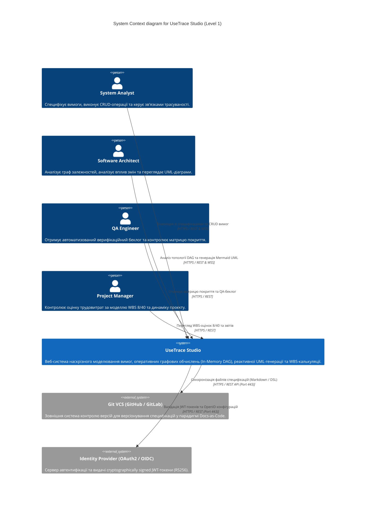
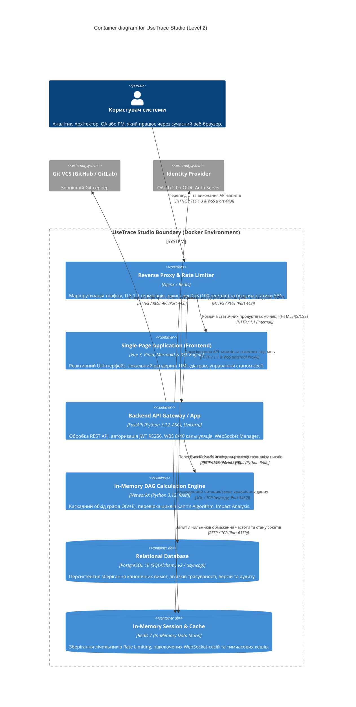

# 2. Архітектурне проєктування та алгоритми

Проєктування архітектури веб-системи «UseTrace Studio» виконано відповідно до методології C4 (Саймон Браун) за принципом *Diagrams-as-Code* у нотації Mermaid.js. В основу побудови моделей покладено вимоги специфікації `srs.md` (ISO/IEC/IEEE 29148:2018).

---

## 2.1. Контекстне та контейнерне моделювання системи (C4 Model)

### 2.1.1. System Context Diagram (C4 Level 1)

Контекстна діаграма визначає межі платформи «UseTrace Studio» (System Boundary), її внутрішніх/зовнішніх акторів та суміжні інфраструктурні сервіси.

#### Технічний опис вузлів та протоколів рівня System Context

**Актори системи (Persons):**

- **System Analyst:** Формує канонічні вимоги за стандартом ISO 29148. Взаємодія з системою здійснюється через захищене WebSockets-з'єднання (WSS) для реактивного live-editing та HTTPS / REST для CRUD-операцій (SRS-FUN-01).
- **Software Architect:** Використовує інструментарій каскадного аналізу впливу змін та переглядає двосторонньо згенеровані UML-діаграми у форматі Mermaid.js (SRS-FUN-05, SRS-FUN-06).
- **QA Engineer:** Отримує автоматично згенерований беклог верифікаційних завдань на основі виявлених вузлів графа без покриття (SRS-FUN-08).
- **Project Manager:** Отримує зводні дані розрахунку трудомісткості робіт WBS із автоматичною перевіркою інженерного правила 8/40 (SRS-FUN-07).

**Зовнішні системи (External Systems):**

- **Git VCS (GitHub / GitLab):** Зовнішній інфраструктурний контур для імпорту/експорту специфікацій у форматі Markdown/DSL (парадигма Docs-as-Code). Взаємодія відбувається через REST API за протоколом HTTPS (Port 443).
- **Identity Provider (OAuth 2.0 / OIDC):** Зовнішній сервіс автентифікації. Забезпечує перевірку облікових даних та видачу підписаних JWT-токенів за алгоритмом RS256 (SRS-NFR-SEC-01).

### 2.1.2. Container Diagram (C4 Level 2)

Контейнерна діаграма розгортає систему «UseTrace Studio» на рівні окремо виконуваних процесів, ізольованих контейнерних модулів (Docker), баз даних та проксі-серверів.

#### Технічний опис контейнерів та мережевих протоколів взаємодії

**Reverse Proxy & Rate Limiter (Nginx + Redis)**

- **Призначення:** Єдина точка входу (Edge Router). Забезпечує термінацію TLS 1.3/WSS, захист від DoS-атак шляхом обмеження частоти запитів до 100 req/min (SRS-NFR-SEC-02) та роздачу зібраних ресурсів Vue 3 SPA.
- **Протоколи:** Зовнішній зв'язок — HTTPS / WSS (Port 443); внутрішнє проксіювання — HTTP / 1.1 та WSS (Internal loopback).

**Single-Page Application (Vue 3 SPA)**

- **Стек:** Vue 3 (Composition API), Pinia (State Management), Mermaid.js DSL Engine.
- **Призначення:** Клієнтський веб-інтерфейс. Виконує локальну двосторонню генерацію UML-діаграм із Mermaid.js DSL-коду (SRS-FUN-06) та реактивне відображення дельта-змін.

**Backend API Application (FastAPI)**

- **Стек:** Python 3.12, FastAPI (ASGI), Uvicorn, SQLAlchemy v2 (asyncpg).
- **Призначення:** Ядро бізнес-логіки. Обробляє REST API запити (SRS-FUN-01), виконує перевірку JWT RS256 токенів (SRS-NFR-SEC-01), обчислює WBS-трудовитрати за моделлю 8/40 (SRS-FUN-07), генерує QA-беклог (SRS-FUN-08) та здійснює дуплексну трансляцію WebSocket-повідомлень з інфраструктурним Heartbeat Ping/Pong 15 с (SRS-FUN-09, SRS-FUN-10).

**In-Memory DAG Engine (NetworkX)**

- **Призначення:** Обчислювальний графовий рушій у пам'яті. Винесений з реляційної СУБД для зниження часової складності обходу з $O(V^2)$ до $O(V+E)$ та скорочення затримки до $< 50\text{ мс}$ (SRS-NFR-PERF-02). Виконує перевірку циклів (Kahn's Algorithm) та каскадний Change Impact Analysis (SRS-FUN-04, SRS-FUN-05).
- **Протокол:** In-Process Memory Call (виклики об'єктів у межах одного Python-процесу FastAPI).

**Relational Database (PostgreSQL 16)**

- **Призначення:** Персистентне зберігання ACID-консистентних даних (вимоги, зв'язки, версії, журнали аудиту GDPR).
- **Протокол:** SQL / TCP через асинхронний драйвер asyncpg (Port 5432).

**In-Memory Session & Cache (Redis 7)**

- **Призначення:** Кешування токенів, збереження реєстру активних WebSocket-сесій та виконання лічильників Rate Limiting.
- **Протокол:** RESP / TCP (REdis Serialization Protocol, Port 6379).

### 2.1.3. Матриця трасування функціональних та нефункціональних вимог (SRS Traceability)

| Ідентифікатор SRS | Вимога SRS | Контейнер реалізації | Мережевий / Інтерфейсний протокол |
|---|---|---|---|
| SRS-FUN-01 | CRUD-операції над вимогами | Backend API (FastAPI) $\rightarrow$ PostgreSQL 16 | REST / HTTPS $\rightarrow$ SQL / TCP (asyncpg) |
| SRS-FUN-03 | Побудова графа залежностей | In-Memory DAG Engine (NetworkX) | In-Process Memory Call (RAM) |
| SRS-FUN-04 | Валідація циклів (Kahn's) | In-Memory DAG Engine (NetworkX) | In-Process Memory Call (RAM) |
| SRS-FUN-05 | Аналіз впливу змін (Impact) | In-Memory DAG Engine (NetworkX) | In-Process Memory Call (RAM) |
| SRS-FUN-06 | Генерація Mermaid.js UML | SPA (Vue 3) + Backend API (FastAPI) | Client-side Rendering / REST API |
| SRS-FUN-07 | Розрахунок трудовитрат WBS | Backend API (FastAPI) | REST / HTTPS (Uvicorn ASGI) |
| SRS-FUN-08 | Синтез QA-беклогу | Backend API (FastAPI) | REST / HTTPS |
| SRS-FUN-09 | WebSocket-синхронізація | Backend API (FastAPI WebSocket Manager) | WSS / TCP (Duplex WebSockets) |
| SRS-FUN-10 | WebSocket Heartbeat (15 s) | Backend API $\leftrightarrow$ SPA Client | WSS Ping/Pong Control Frames |
| SRS-NFR-PERF-01 | API Latency $p95 < 150$ мс | Backend API (FastAPI / Uvicorn uvloop) | REST / HTTPS (500 RPS) |
| SRS-NFR-PERF-02 | DAG Recalculation $< 50$ мс | In-Memory DAG Engine (NetworkX) | RAM Access ($O(V+E)$) |
| SRS-NFR-SEC-01 | OAuth2 / OIDC (JWT RS256) | Backend API $\leftrightarrow$ Identity Provider | HTTPS / REST (JWKS Verification) |
| SRS-NFR-SEC-02 | Rate Limiting (100 req/min) | Reverse Proxy (Nginx) $\leftrightarrow$ Redis 7 | RESP / TCP (Port 6379) |

## 2.2. Компонентне моделювання критичного сервісу системи (C4 Model: Component)

Для проведення компонентного аналізу обрано ключовий бекенд-контейнер Backend Core Service (FastAPI / Python 3.12, ASGI). Сервіс відповідає за обробку CRUD-операцій вимог за стандартом ISO 29148, координацію оперативних графових обчислень в пам'яті (In-Memory DAG), дуплексну WebSocket-синхронізацію, калькуляцію WBS 8/40 та синтез QA-беклогу.

### 2.2.1. C4 Component Diagram: Backend Core Service (Level 3)

```mermaid
C4Component
  title Component diagram for Backend Core Service (Level 3)

  Container(spa, "Vue 3 SPA Frontend", "Vue 3 / Pinia", "Клієнтський веб-інтерфейс")
  Container(proxy, "Reverse Proxy", "Nginx", "Edge Router & Rate Limiter")
  ContainerDb(db, "PostgreSQL 16", "PostgreSQL", "Реляційна база даних")
  ContainerDb(redis, "Redis 7", "Redis", "In-Memory Cache & Session Store")

  Container_Boundary(api, "Backend Core Service (FastAPI / ASGI Boundary)") {
    Component(auth_guard, "JWT Auth Guard & Middleware", "FastAPI Security / PyJWT", "Валідація JWT-токенів (RS256), перевірка ролей RBAC та лічильників Rate Limiting.")
    Component(dto_val, "DTO Validation Middleware", "Pydantic v2", "Валідація та санітизація вхідних JSON-схем за стандартом ISO/IEC/IEEE 29148.")
    Component(err_handler, "Global Exception Handler", "FastAPI Middleware", "Централізований перехоплювач помилок, формування RFC 7807 Problem Details.")
    Component(req_controller, "Requirements Controller", "FastAPI APIRouter", "REST-ендпоінти для виконання CRUD-операцій над вимогами.")
    Component(ws_manager, "WebSocket Sync Manager", "FastAPI WebSockets / Starlette", "Управління активними WSS-сесіями, трансляція дельта-змін, Heartbeat Ping/Pong 15с.")
    Component(req_service, "Requirements Domain Service", "Python 3.12 Core Logic", "Центральна бізнес-логіка управління вимогами та координації оновлень.")
    Component(dag_component, "In-Memory DAG Calculation Engine", "NetworkX DiGraph", "Каскадний обхід графа O(V+E), перевірка циклів (Kahn's) та Change Impact Analysis.")
    Component(wbs_engine, "WBS 8/40 Estimation Engine", "Python Domain Model", "Обчислення трудовитрат у людино-годинах із перевіркою правила 8/40.")
    Component(qa_gen, "QA Verification Backlog Generator", "Python Domain Model", "Синтез тестових завдань на основі аналізу непокритих вузлів графа.")
    Component(repo, "Requirements Repository", "SQLAlchemy v2 (asyncpg)", "Шар доступу до даних (Repository Pattern) з асинхронним I/O.")
    Component(audit_logger, "GDPR Audit Logger", "Python Logging / Anonymizer", "Асинхронне логування системних подій із автоматичною анонімізацією PII.")
  }

  Rel(spa, proxy, "HTTPS API & WSS запити", "HTTPS / WSS")
  Rel(proxy, auth_guard, "Проксіювання запитів", "HTTP / WSS Internal")
  Rel(auth_guard, dto_val, "Декодований JWT та контекст користувача", "In-Process Call")
  Rel(dto_val, req_controller, "Передача санітизованих DTO об'єктів", "In-Process Call")
  Rel(dto_val, ws_manager, "Ініціалізація WSS-сесії", "In-Process Call")
  Rel(req_controller, req_service, "Виклики доменної логіки", "Dependency Injection / Interface")
  Rel(ws_manager, req_service, "Трансляція дельта-змін", "Observer Pattern")
  Rel(req_service, dag_component, "Перерозрахунок топології графа", "In-Memory Call")
  Rel(req_service, wbs_engine, "Калькуляція WBS 8/40", "In-Memory Call")
  Rel(req_service, qa_gen, "Аналіз непокритих вузлів", "In-Memory Call")
  Rel(req_service, repo, "Збереження/читання вимог", "Repository Pattern / Async")
  Rel(req_service, audit_logger, "Запис подій аудиту", "Async Event Call")
  Rel(repo, db, "Асинхронні SQL-запити", "SQL / TCP (asyncpg)")
  Rel(auth_guard, redis, "Перевірка токенів та лічильників", "RESP / TCP")
  Rel(err_handler, req_controller, "Перехоплення винятків", "Global Interceptor")
```

### 2.2.2. Технічний опис шарів Clean Architecture та компонентів

#### Вхідний шар захисту та валідації (Inbound Layer / Security & Middleware)

- **JWT Auth Guard & Middleware:** Перший рубіж захисту всередині сервісу (SRS-NFR-SEC-01). Перевіряє криптографічний підпис JWT RS256, авторизує ролі користувачів (RBAC) та перевіряє стан лічильників Rate Limiting у Redis 7.
- **DTO Validation Middleware (Pydantic v2):** Виконує строго типізовану валідацію та санітизацію вхідних JSON-структур відповідно до ISO 29148 перед передачею обробки контролерам.
- **Global Exception Handler:** Централізований компонент перехоплення винятків. Унеможливлює витік внутрішніх стек-трейсів (Security by Design), повертаючи відповіді у форматі RFC 7807 Problem Details.

#### Шар контролерів та точки входу (Controllers & WebSocket Manager)

- **Requirements Controller (APIRouter):** REST-контролери для виконання CRUD-операцій над вимогами (SRS-FUN-01).
- **WebSocket Sync Manager:** Управляє активними дуплексними з'єднаннями, розсилає дельта-зміни специфікації у реальному часі (SRS-FUN-09) та контролює стан сокетного з'єднання через Heartbeat Ping/Pong 15 с (SRS-FUN-10).

#### Шар бізнес-логіки та доменних обчислень (Domain Core / Business Logic)

- **Requirements Domain Service:** Ядро бізнес-логіки. Використовує паттерн Dependency Injection для взаємодії з репозиторіями та обчислювальними модулями.
- **In-Memory DAG Calculation Engine (NetworkX):** Ізольований графовий компонент. Виконує перевірку циклів за алгоритмом Кана (SRS-FUN-04) та каскадний обхід графа для аналізу впливу змін $O(V+E)$ за затримку $< 50\text{ мс}$ (SRS-NFR-PERF-02).
- **WBS 8/40 Estimation Engine:** Обчислює оцінку трудовитрат з автоматичною валідацією правила 8/40 (SRS-FUN-07).
- **QA Verification Backlog Generator:** Формує беклог верифікаційних завдань на основі аналізу непокритих вузлів графа (SRS-FUN-08).

#### Шар інфраструктури та даних (Outbound Layer / Repositories)

- **Requirements Repository (SQLAlchemy v2 / asyncpg):** Забезпечує абсолютну ізоляцію доменної логіки від деталей СУБД (паттерн Repository). Всі запити до PostgreSQL є асинхронними.
- **GDPR Audit Logger:** Асинхронний компонент фіксації системних подій із автоматичною анонімізацією персональних даних (SRS-NFR-COMP-01).
